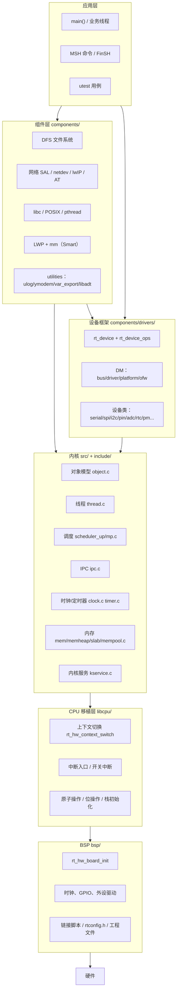
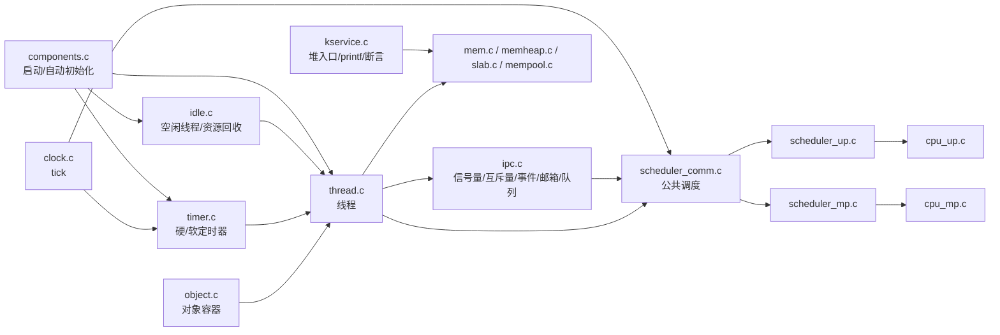
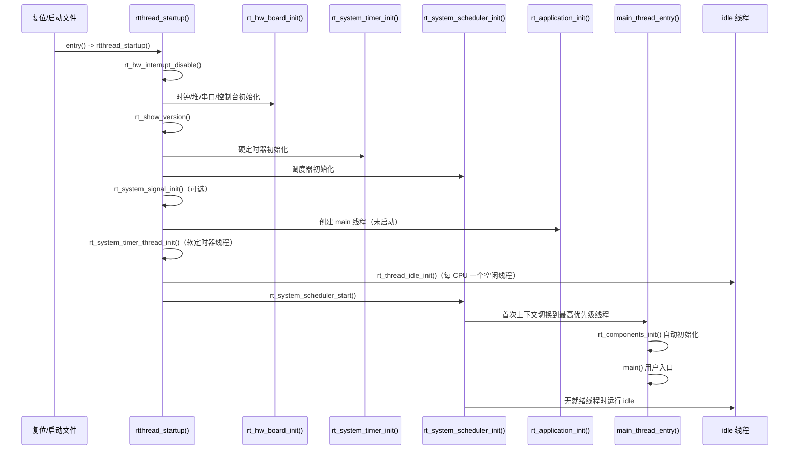
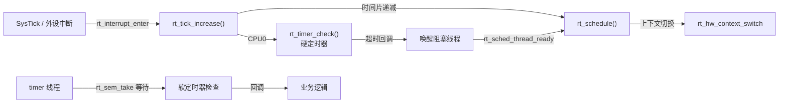

# 1. 整体架构

本章给出 RT-Thread 的全局视图：系统如何分层、内核由哪些源文件构成、上电后按什么顺序启动、运行期各子系统如何协作。

---

## 1.1 分层视图

RT-Thread 不是微内核，也不是纯宏内核，而是**“可裁剪的模块化内核 + 组件层 + 设备框架”**结构：



### 各层职责

| 层 | 目录 | 职责 | 是否必须 |
| --- | --- | --- | --- |
| 应用层 | 用户代码、`examples/` | 业务逻辑、命令、测试 | 是（至少一个入口） |
| 组件层 | `components/` | 文件系统、网络、命令行、libc、工具 | 否，按需裁剪 |
| 设备框架 | `components/drivers/` | 统一设备模型与各类设备类 | 否，`RT_USING_DEVICE` 控制 |
| 内核 | `src/`、`include/` | 对象、线程、调度、IPC、时钟、内存 | 是 |
| CPU 移植层 | `libcpu/<arch>/` | 与架构相关的上下文/中断/原子操作 | 是（每架构一份） |
| 板级支持包 | `bsp/<vendor>/<board>/` | 板级初始化、外设、链接脚本、配置 | 是（每板一份） |

---

## 1.2 内核源码地图

`src/` 下的文件可以按“对象—线程—调度—同步—时间—内存—服务”分组：



| 文件 | 关键导出 | 说明 |
| --- | --- | --- |
| [object.c](file:///workspace/src/object.c) | `rt_object_init/detach/allocate/find/...` | 内核对象容器、按类索引、对象钩子 |
| [thread.c](file:///workspace/src/thread.c) | `rt_thread_init/create/startup/detach/delete/yield/delay/suspend/resume/control` | 线程栈初始化、状态迁移、超时回调 |
| [scheduler_comm.c](file:///workspace/src/scheduler_comm.c) | `rt_sched_thread_*` | 与 UP/SMP 无关的调度公共逻辑 |
| [scheduler_up.c](file:///workspace/src/scheduler_up.c) | `rt_schedule`、`rt_system_scheduler_start` | 单核优先级位图调度 |
| [scheduler_mp.c](file:///workspace/src/scheduler_mp.c) | `rt_schedule`、`rt_scheduler_ipi_handler` | 多核全局/本地就绪表、IPI |
| [cpu_up.c](file:///workspace/src/cpu_up.c) / [cpu_mp.c](file:///workspace/src/cpu_mp.c) | `rt_hw_cpu_id`、`rt_cpus_lock` 等 | CPU 相关封装 |
| [ipc.c](file:///workspace/src/ipc.c) | `rt_sem_*`、`rt_mutex_*`、`rt_event_*`、`rt_mb_*`、`rt_mq_*` | 所有 IPC 原语 |
| [clock.c](file:///workspace/src/clock.c) | `rt_tick_increase`、`rt_tick_get/set` | tick 推进与钩子 |
| [timer.c](file:///workspace/src/timer.c) | `rt_timer_init/create/start/stop/control` | 跳表定时器、软定时器线程 |
| [mem.c](file:///workspace/src/mem.c) / [memheap.c](file:///workspace/src/memheap.c) / [slab.c](file:///workspace/src/slab.c) / [mempool.c](file:///workspace/src/mempool.c) | `rt_malloc/free` 的底层实现 | 四种内存分配器 |
| [kservice.c](file:///workspace/src/kservice.c) | `rt_kprintf`、`rt_malloc`、`rt_assert_handler`、`rt_backtrace` | 内核通用服务 |
| [idle.c](file:///workspace/src/idle.c) | `rt_thread_idle_init`、`rt_thread_idle_excute` | 空闲线程、defunct 回收 |
| [signal.c](file:///workspace/src/signal.c) | `rt_signal_install/...` | 内核信号（类 POSIX） |
| [components.c](file:///workspace/src/components.c) | `rtthread_startup`、`rt_components_init` | 启动链与自动初始化 |
| [irq.c](file:///workspace/src/irq.c) | `rt_interrupt_enter_sethook` 等 | 仅中断钩子；开关中断在 `rthw.h`/libcpu |

---

## 1.3 启动流程

启动入口由启动文件（如 `startup_stm32f407xx.s`）在复位后调用 `SystemInit()`，随后跳转 `entry()` → `rtthread_startup()`。核心链路如下：



对应实现见 [components.c](file:///workspace/src/components.c)：

1. `rt_hw_interrupt_disable()`：启动阶段关中断，避免初始化未完成时被中断打断。
2. `rt_hw_board_init()`：由 BSP 提供（STM32 系列在 [drv_common.c](file:///workspace/bsp/stm32/libraries/HAL_Drivers/drv_common.c#L174-L214)），完成 HAL 初始化、系统时钟、堆初始化、PIN/串口初始化、控制台绑定。
3. `rt_show_version()`：打印版本与编译信息。
4. `rt_system_timer_init()`：初始化硬定时器跳表。
5. `rt_system_scheduler_init()`：初始化就绪表/优先级位图（SMP 还会初始化每 CPU 结构与自旋锁）。
6. `rt_application_init()`：创建 `"main"` 线程（栈 `RT_MAIN_THREAD_STACK_SIZE`，优先级 `RT_THREAD_PRIORITY_MAX / 3`，时间片 20 tick）。
7. `rt_system_timer_thread_init()`：创建 `"timer"` 软定时器线程。
8. `rt_thread_idle_init()`：为每个 CPU 创建 `tidle0`、`tidle1`…（SMP 下另有 `tsystem` 线程）。
9. `rt_system_scheduler_start()`：选择最高优先级线程并执行首次上下文切换，此后由调度器接管。

`main_thread_entry()` 中先调用 `rt_components_init()`，再进入用户 `main()`：

```c
void main_thread_entry(void *parameter)
{
    extern int main(void);
    rt_components_init();      /* 组件/驱动自动初始化 */
#ifdef RT_USING_SMP
    rt_hw_secondary_cpu_up();
#endif
    main();                    /* 用户入口，通常不会返回 */
}
```

> 注意：`main()` 本身运行在普通线程中，可以安全使用阻塞式 IPC；但它的栈由 `RT_MAIN_THREAD_STACK_SIZE` 决定，递归/大局部变量需谨慎。

---

## 1.4 运行期协作关系

系统运行后，四条主线互相配合：



- **时基**：每个 tick 中断调用 `rt_tick_increase()`，递增 tick、递减当前线程剩余时间片，并在 CPU0 上检查硬定时器。
- **调度**：时间片耗尽、IPC 唤醒、线程主动 yield/delay 都会触发 `rt_schedule()`。
- **定时器**：硬定时器回调在中断上下文执行（必须短小）；软定时器由 `"timer"` 线程在 `_soft_timer_check()` 中执行，可调用会阻塞的 API。
- **IPC**：所有阻塞都转化为“把线程挂到对象挂起链表 + 启动线程超时定时器”，唤醒则相反。

---

## 1.5 执行上下文

理解 RT-Thread 的关键是区分四种执行上下文：

| 上下文 | 进入方式 | 栈 | 可阻塞 | 典型代码 |
| --- | --- | --- | --- | --- |
| 线程上下文 | 调度器切换 | 每线程独立栈 | 是 | `main()`、业务线程、`timer` 线程 |
| 中断上下文 | 硬件中断 | 使用当前线程栈（或独立中断栈） | 否 | `rt_tick_increase()`、串口 ISR |
| 空闲上下文 | 无就绪线程 | idle 线程栈 | 是（可进入低功耗） | `rt_thread_idle_entry()` |
| 启动上下文 | 复位后 | 启动栈（MSP） | 否 | `rtthread_startup()` |

相关判定 API：

```c
rt_interrupt_get_nest();          /* 中断嵌套层数，0 表示线程上下文 */
rt_thread_self();                 /* 当前线程控制块 */
rt_thread_self() != RT_NULL && rt_interrupt_get_nest() == 0;  /* 是否可调度 */
```

内核中用 `RT_DEBUG_SCHEDULER_AVAILABLE()` / `RT_DEBUG_IN_THREAD_CONTEXT` 做断言，例如互斥量获取明确禁止在中断中使用。

---

## 1.6 内核配置形态

同一份源码通过宏组合出三种典型形态：

| 形态 | 关键宏 | 说明 |
| --- | --- | --- |
| Nano | `RT_USING_NANO` | 极简内核，关闭组件层，适合小资源 MCU |
| 标准版 | `RT_USING_DEVICE`、`RT_USING_MSH` 等 | 常规 MCU 形态，含设备框架与 FinSH |
| Smart | `RT_USING_SMART` | 增加 LWP、mm、POSIX、用户态地址空间 |

`src/SConscript` 会根据配置移除不参与编译的文件（如未启用 `RT_USING_SMALL_MEM` 时不编译 `mem.c`），`components/SConscript` 则按依赖决定是否进入各组件目录：

```python
SrcRemove(src, 'mem.c',     depend=['RT_USING_SMALL_MEM'])
SrcRemove(src, 'slab.c',    depend=['RT_USING_SLAB'])
SrcRemove(src, 'memheap.c', depend=['RT_USING_MEMHEAP'])
SrcRemove(src, 'signal.c',  depend=['RT_USING_SIGNALS'])
if not GetDepend('RT_USING_SMP'):
    SrcRemove(src, ['cpu_mp.c', 'scheduler_mp.c'])
else:
    SrcRemove(src, ['cpu_up.c', 'scheduler_up.c'])
```

> 注意：`src/SConscript` 中仍保留 `SrcRemove(src, 'device.c', depend=['RT_USING_DEVICE'])` 的旧规则，但设备核心已迁移到 `components/drivers/core/device.c`，该规则实际不会命中任何文件。

---

## 1.7 设计要点小结

1. **对象化**：内核资源统一头部 + 分类容器，带来统一的命名、查找、枚举、钩子能力。
2. **状态机驱动**：线程状态（INIT/READY/RUNNING/SUSPEND/CLOSE）与调度器就绪表严格对应，所有 API 本质上是状态迁移。
3. **中断与线程解耦**：ISR 只做“标记 + 唤醒”，耗时逻辑下沉到线程（硬/软定时器、`workqueue`、`pipe` 都是这一思想的体现）。
4. **配置即裁剪**：Kconfig 决定宏，宏决定 `SConscript` 编译集合，最终决定镜像大小与功能。
5. **移植面收敛**：内核只依赖 `libcpu` 暴露的少量接口（上下文切换、开关中断、原子操作、栈初始化），因此一个全新架构的移植工作量可控。

后续章节将逐层展开。建议先读 [内核对象模型](02-kernel-objects.md)，因为线程、定时器、IPC、设备都建立在它之上。
