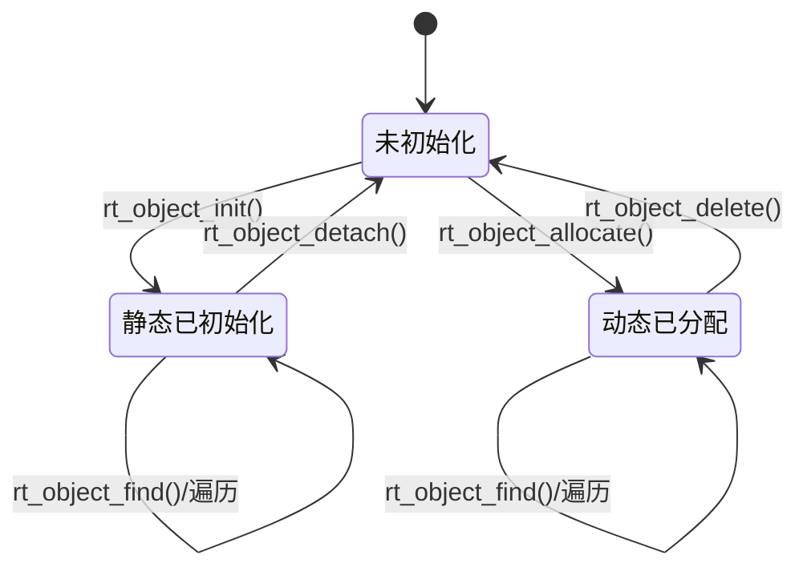
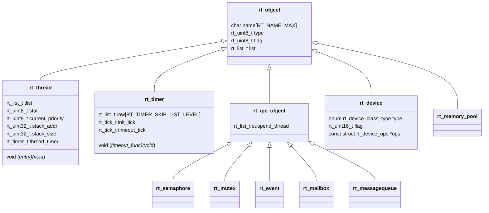

# 2. 内核对象模型

RT-Thread 的所有内核资源——线程、定时器、信号量、互斥量、事件、邮箱、消息队列、内存堆、内存池、设备——都以 `struct rt_object` 作为公共头部。这一设计使内核可以用**统一的方式**完成命名、查找、枚举、统计与调试。

---

## 2.1 `struct rt_object`

定义位于 [rtdef.h](file:///workspace/include/rtdef.h)：

```c
struct rt_object
{
    char       name[RT_NAME_MAX];   /* 对象名称，默认最长 8 字节（含 '\0'） */
    rt_uint8_t type;                /* 对象类型，见 enum rt_object_class_type */
    rt_uint8_t flag;                /* 对象标志，如 RT_OBJECT_FLAG_STATIC */
#ifdef RT_USING_SMP
    rt_uint8_t reserve;
#endif
    rt_list_t  list;                /* 挂入对应类型容器的链表节点 */
};
typedef struct rt_object *rt_object_t;
```

设计要点：

- **名称内嵌**：不依赖动态内存，静态对象也能拥有名字；代价是长度受 `RT_NAME_MAX` 限制，超长会被截断。
- **类型单字节**：低 7 位表示类，最高位 `RT_Object_Class_Static (0x80)` 表示静态对象。
- **链表内嵌**：对象本身即可挂链，无需额外节点分配。
- **SMP 预留字节**：`reserve` 用于保持后续字段对齐。

### 对象类型

```c
enum rt_object_class_type
{
    RT_Object_Class_Thread = 0,
    RT_Object_Class_Semaphore,
    RT_Object_Class_Mutex,
    RT_Object_Class_Event,
    RT_Object_Class_MailBox,
    RT_Object_Class_MessageQueue,
    RT_Object_Class_MemHeap,
    RT_Object_Class_MemPool,
    RT_Object_Class_Device,
    RT_Object_Class_Timer,
    RT_Object_Class_Module,
    RT_Object_Class_Unknown,
    RT_Object_Class_Static = 0x80
};
```

判断宏：

```c
rt_object_get_type(object)        /* type & ~RT_Object_Class_Static */
rt_object_is_systemobject(object) /* type & RT_Object_Class_Static */
```

> 重要：`RT_Object_Class_Static` 是**标志位**而非独立类型。因此 `type` 字段不能直接与枚举值比较，必须先用 `rt_object_get_type()` 去掉标志位。设备类还用 `RT_Device_Class_*` 占用 `RT_Object_Class_Device` 这一大类，具体设备类型记录在 `rt_device.type` 中。

---

## 2.2 对象容器

[object.c](file:///workspace/src/object.c) 维护一个按类型索引的容器数组：

```c
struct rt_object_information
{
    enum rt_object_class_type type;   /* 容器管理的对象类型 */
    rt_list_t                 object_list;
    rt_size_t                 object_size;  /* 该类型对象的大小 */
#ifdef RT_USING_SMP
    struct rt_spinlock        spinlock;
#endif
};

static struct rt_object_information _object_container[RT_Object_Class_Unknown];
```

每个容器保存：

| 字段 | 用途 |
| --- | --- |
| `object_list` | 该类型所有对象的双向链表头 |
| `object_size` | 供 `rt_object_get_pointers()` 等按类型遍历时计算步长/校验 |
| `spinlock` | SMP 下保护容器链表 |

获取容器：

```c
struct rt_object_information *rt_object_get_information(enum rt_object_class_type type);
```

内部会把 `type & ~RT_Object_Class_Static` 后索引数组，因此静态/动态对象进入**同一个**容器。

---

## 2.3 对象生命周期



### 静态对象

由用户提供存储（全局变量或栈上变量），内核只做登记：

```c
void rt_object_init(struct rt_object *object,
                    enum rt_object_class_type type,
                    const char *name);
```

流程：

1. 取对应类型的容器；
2. 拷贝名称（`rt_strncpy`，保证 `'\0'` 结尾）；
3. 设置 `type = type | RT_Object_Class_Static`；
4. 将 `object->list` 插入容器链表尾部；
5. 调用对象附加钩子 `rt_object_attach_hook`。

### 动态对象

由内核从堆上分配对象控制块：

```c
rt_object_t rt_object_allocate(enum rt_object_class_type type, const char *name);
```

流程：

1. 根据 `object_size` 计算实际大小并 `rt_malloc`；
2. 初始化名称、类型（**不带** Static 标志）、链表节点；
3. 插入容器并触发钩子；
4. 返回对象指针；内存不足返回 `RT_NULL`。

对应释放：

```c
void rt_object_detach(rt_object_t object);   /* 静态：仅从容器摘除 */
void rt_object_delete(rt_object_t object);   /* 动态：摘除 + rt_free */
```

> 注意：对静态对象调用 `rt_object_delete()` 属于未定义行为；对外接口（如 `rt_thread_delete`）内部会先判断 `rt_object_is_systemobject()`，静态对象应使用 `detach` 系列接口。

---

## 2.4 查找与枚举

### 按名称查找

```c
rt_object_t rt_object_find(const char *name, rt_uint8_t type);
```

实现要点：

- `type` 同样会去掉 Static 位；
- 遍历对应容器，用 `rt_strncmp` 比较名称；
- 找到后返回对象指针，未找到返回 `RT_NULL`；
- 上层封装为 `rt_thread_find()`、`rt_device_find()`、`rt_timer_find()` 等。

```c
rt_thread_t rt_thread_find(char *name);
rt_device_t rt_device_find(const char *name);
```

> 注意：名称查找是**线性遍历**，不适合放在高频路径；且对象删除后指针立即失效，跨线程共享句柄需要额外同步。

### 按类型枚举

```c
rt_size_t rt_object_get_length(enum rt_object_class_type type);
rt_size_t rt_object_get_pointers(enum rt_object_class_type type,
                                 rt_object_t *pointers,
                                 rt_size_t pointers_num);
```

这两个接口常用于 `msh` 命令（如 `list_thread`、`list_timer`、`list_sem`）遍历内核对象。调用方需提供缓冲区，内核在锁保护下拷贝指针。

---

## 2.5 对象钩子

`object.c` 暴露两个弱钩子，便于调试/追踪对象生命周期：

```c
void rt_object_attach_sethook(void (*hook)(struct rt_object *object));
void rt_object_detach_sethook(void (*hook)(struct rt_object *object));
```

可通过 `RT_USING_HOOK` 打开。典型用途：

- 统计对象创建/销毁次数；
- 检测内存泄漏（申请后未释放）；
- 在对象销毁时打印调用栈。

对象初始化/分配时调用 attach 钩子，detach/delete 时调用 detach 钩子。

---

## 2.6 与其他子系统的关系

对象模型是“地基”，各子系统只是在公共头上扩展自己的字段：



> 说明：上图为逻辑继承关系。C 语言中通过“结构体首成员为 `rt_object`”实现，因此任意 `rt_thread_t` 都可安全转换为 `rt_object_t`，反之需要类型判断。

---

## 2.7 常用 API 速查

| API | 作用 | 备注 |
| --- | --- | --- |
| `rt_object_init()` | 初始化静态对象并登记 | 名称被拷贝 |
| `rt_object_detach()` | 注销静态对象 | 不释放内存 |
| `rt_object_allocate()` | 动态创建对象 | 从堆分配 |
| `rt_object_delete()` | 删除动态对象 | 释放内存 |
| `rt_object_find()` | 按名称查找 | 线性遍历 |
| `rt_object_get_information()` | 取类型容器 | 内部使用 |
| `rt_object_get_length()` | 统计某类对象数量 | MSH 调试 |
| `rt_object_get_pointers()` | 批量取对象指针 | 需提供缓冲区 |
| `rt_object_is_systemobject()` | 是否静态对象 | 判断 Static 位 |
| `rt_object_get_type()` | 去标志位的真实类型 | 比较前必须调用 |

---

## 2.8 实现细节与注意事项

1. **名称截断**：`RT_NAME_MAX` 默认 8。`rt_thread_create("very_long_name", ...)` 实际只保留前 7 个字符加 `'\0'`，`rt_thread_find()` 也按截断后的名字匹配。
2. **容器不是哈希表**：对象数量多时查找退化，设备/线程数量通常有限，影响可接受。
3. **SMP 保护**：容器操作在 SMP 下持有自旋锁；单核下依赖调度器锁/关中断。用户态代码无需关心，但**不要在遍历容器时销毁对象**。
4. **对象初始化的顺序**：必须先 `rt_object_init()` 再初始化派生字段，否则钩子/调试工具可能读到未初始化内容。
5. **`flag` 字段的复用**：IPC 对象用 `parent.flag` 保存 `RT_IPC_FLAG_FIFO/PRIO`，线程对象用 `parent.flag` 保存 `RT_THREAD_FLAG_*`（如 `RT_THREAD_FLAG_CLOSED`），不要与对象 Static 位混淆——Static 位在 `type` 里。
