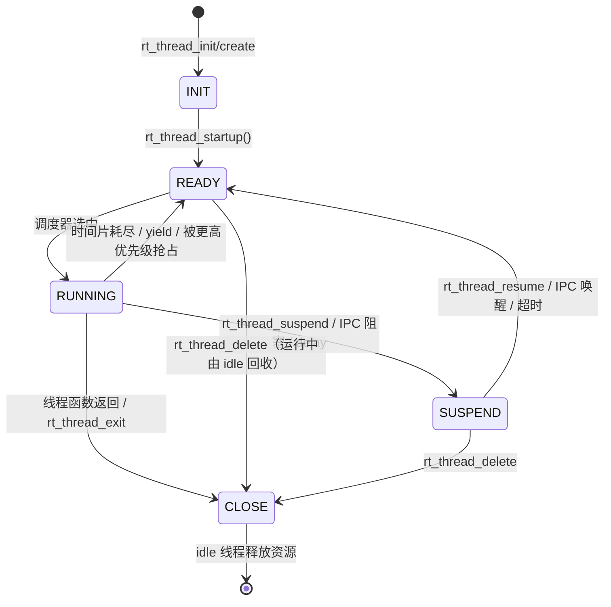

# 3. 线程与调度

线程是 RT-Thread 调度的基本单位。本章覆盖线程控制块、状态机、生命周期 API、调度器抽象（UP/SMP 两种实现）、时间片轮转、调度锁、栈检查与空闲线程。

相关源码：

- [thread.c](file:///workspace/src/thread.c)：线程创建/启动/挂起/恢复/延时/控制
- [rtsched.h](file:///workspace/include/rtsched.h)：调度上下文抽象
- [scheduler_comm.c](file:///workspace/src/scheduler_comm.c)：调度公共逻辑
- [scheduler_up.c](file:///workspace/src/scheduler_up.c)：单核调度
- [scheduler_mp.c](file:///workspace/src/scheduler_mp.c)：多核调度
- [idle.c](file:///workspace/src/idle.c)：空闲线程

---

## 3.1 线程控制块

`struct rt_thread` 是内核中最复杂的对象，字段可分组理解：

```c
struct rt_thread
{
    struct rt_object parent;              /* 公共对象头 */
    rt_list_t        tlist;               /* 就绪/挂起链表节点（兼容布局） */

    void            *sp;                  /* 当前栈指针（上下文切换保存点） */
    void            *entry;               /* 线程入口 */
    void            *parameter;           /* 入口参数 */
    void            *stack_addr;          /* 栈起始地址 */
    rt_uint32_t      stack_size;          /* 栈大小（字节） */

    rt_err_t         error;               /* 线程错误码（被唤醒时由 IPC 设置） */
    rt_uint8_t       stat;                /* 线程状态 */
    rt_uint8_t       current_priority;    /* 当前优先级（可能被继承提升） */
    rt_uint8_t       init_priority;       /* 初始优先级 */
    rt_uint32_t      init_tick;           /* 初始时间片 */
    rt_uint32_t      remaining_tick;      /* 剩余时间片 */

    struct rt_timer  thread_timer;        /* 内置超时定时器 */
    void (*cleanup)(struct rt_thread *tid);/* 线程退出清理回调 */
    rt_uint32_t      user_data;           /* 用户私有数据 */
    /* ... 架构/SMP/信号相关字段 ... */
};
typedef struct rt_thread *rt_thread_t;
```

### 3.1.1 布局差异：`RT_USING_SCHED_THREAD_CTX`

从 5.x 开始，调度相关字段被抽取为 `struct rt_sched_thread_ctx`，是否内联由 `RT_USING_SCHED_THREAD_CTX` 决定（SMP 会选中它）。[rtsched.h](file:///workspace/include/rtsched.h) 定义：

```c
struct rt_sched_thread_priv
{
    rt_tick_t  init_tick;
    rt_tick_t  remaining_tick;
    rt_uint8_t current_priority;
    rt_uint8_t init_priority;
#if RT_THREAD_PRIORITY_MAX > 32
    rt_uint8_t  number;
    rt_uint8_t  high_mask;
#endif
    rt_uint32_t number_mask;
};

struct rt_sched_thread_ctx
{
    rt_list_t thread_list_node;
    rt_uint8_t stat;
    rt_uint8_t sched_flag_locked:1;   /* 是否持有调度锁 */
    rt_uint8_t sched_flag_ttmr_set:1; /* 线程超时定时器是否已启动 */
#ifdef RT_USING_SMP
    rt_uint8_t  bind_cpu;
    rt_uint8_t  oncpu;
    rt_base_t   critical_lock_nest;
#endif
    struct rt_sched_thread_priv sched_thread_priv;
};
```

访问宏（内核代码统一通过这些宏，避免直接写字段）：

```c
#define RT_SCHED_CTX(thread)       ((thread)->sched_thread_ctx)
#define RT_SCHED_PRIV(thread)      ((thread)->sched_thread_ctx.sched_thread_priv)
#define RT_THREAD_LIST_NODE(t)     (RT_SCHED_CTX(t).thread_list_node)
```

未启用该特性时，宏退化为：

```c
#define RT_SCHED_CTX(thread)  (*thread)
#define RT_SCHED_PRIV(thread) (*thread)
```

这就是为什么 `thread->current_priority` 与 `RT_SCHED_PRIV(thread).current_priority` 在不同配置下都能工作。

> ⚠️ 注意：内核中个别日志语句仍直接访问 `thread->stat`。在 `RT_USING_SCHED_THREAD_CTX` 生效（SMP）时，该字段位于 `thread->sched_thread_ctx.stat`，直接访问属于**配置相关的不安全写法**，阅读/修改时需留意。

### 3.1.2 栈布局

- 栈由用户提供（`rt_thread_init`）或从堆分配（`rt_thread_create`）。
- 初始化时把整个栈填充为 `'#'`（`0x23`），用于统计历史最大栈使用量。
- 栈**向下增长**（ARM/RISC-V 等常见 ABI），`rt_hw_stack_init()` 负责构造初始栈帧，使首次切换后从 `entry` 开始执行。
- `thread->sp` 始终指向切换时保存的栈顶。

栈使用量可通过 MSH `list_thread` 查看 `max used` 列，其原理是统计从栈底开始连续 `'#'` 的长度。

---

## 3.2 线程状态机

状态常量定义在 [rtdef.h](file:///workspace/include/rtdef.h)：

```c
#define RT_THREAD_INIT      0x00
#define RT_THREAD_CLOSE     0x01
#define RT_THREAD_READY     0x02
#define RT_THREAD_RUNNING   0x03

#define RT_THREAD_SUSPEND_MASK             0x04
#define RT_THREAD_SUSPEND_INTERRUPTIBLE    (RT_THREAD_SUSPEND_MASK)
#define RT_THREAD_SUSPEND_KILLABLE         (RT_THREAD_SUSPEND_MASK | RT_SIGNAL_COMMON_WAKEUP_MASK)
#define RT_THREAD_SUSPEND_UNINTERRUPTIBLE  (RT_THREAD_SUSPEND_MASK | RT_SIGNAL_COMMON_WAKEUP_MASK | RT_SIGNAL_KILL_WAKEUP_MASK)

#define RT_THREAD_STAT_MASK           0x07
#define RT_THREAD_STAT_YIELD          0x08
#define RT_THREAD_STAT_SIGNAL         0x10
#define RT_THREAD_STAT_SIGNAL_READY   (RT_THREAD_STAT_SIGNAL | RT_THREAD_READY)
#define RT_THREAD_STAT_SIGNAL_WAIT    0x20
#define RT_THREAD_STAT_SIGNAL_PENDING 0x40
#define RT_THREAD_STAT_SIGNAL_MASK    0xf0
```

低 3 位（`STAT_MASK`）表示基本状态；`0x04` 是挂起位，配合信号位组合出三种可中断级别。



### 三种挂起语义

| 挂起方式 | `stat` 组合 | 能否被信号唤醒 | 典型 API |
| --- | --- | --- | --- |
| 可中断 `RT_INTERRUPTIBLE` | `0x04` | 是 | `rt_sem_take_interruptible`、`rt_thread_suspend` |
| 可杀死 `RT_KILLABLE` | `0x06` | 仅致命信号 | `rt_sem_take_killable` |
| 不可中断 `RT_UNINTERRUPTIBLE` | `0x07` | 否 | `rt_sem_take`、`rt_mutex_take` |

IPC 的 `suspend_flag` 参数最终写入线程状态，决定信号系统能否把它唤醒。

---

## 3.3 线程生命周期 API

### 3.3.1 创建与初始化

| API | 内存来源 | 说明 |
| --- | --- | --- |
| `rt_thread_init(tid, name, entry, parameter, stack_start, stack_size, priority, tick)` | 用户提供 TCB 与栈 | 静态创建 |
| `rt_thread_create(name, entry, parameter, stack_size, priority, tick)` | 堆 | 动态创建，失败返回 `RT_NULL` |
| `rt_thread_startup(tid)` | — | 把 INIT 线程置为 READY 并插入就绪表 |

`_thread_init()` 的关键工作：

1. `rt_object_init(&thread->parent, RT_Object_Class_Thread, name)`；
2. 校验优先级与栈大小、栈对齐；
3. 填充 `'#'`；
4. `rt_hw_stack_init(entry, parameter, stack_top, _thread_exit)` 构造初始栈帧，返回初始 `sp`；
5. 初始化 `thread_timer` 为 `RT_TIMER_FLAG_ONE_SHOT | RT_TIMER_FLAG_THREAD_TIMER`；
6. 设置 `stat = RT_THREAD_INIT`、`current_priority = init_priority = priority`、`init_tick = remaining_tick = tick`。

> 注意：`rt_thread_init()` 不会启动线程，必须再调用 `rt_thread_startup()`；`rt_thread_create()` 同样如此。

### 3.3.2 启动、运行与退出

```c
rt_err_t rt_thread_startup(rt_thread_t thread);
void     rt_thread_exit(void);          /* 线程内调用，进入 CLOSE 并调度 */
rt_err_t rt_thread_delete(rt_thread_t thread);  /* 删除线程（动态 TCB 由 idle 回收） */
rt_err_t rt_thread_detach(rt_thread_t thread);
```

- `rt_thread_startup()`：若线程已在就绪/运行态返回 `-RT_ERROR`；否则 `rt_sched_insert_thread()` 并触发调度。
- 线程函数返回时，启动栈帧中的返回地址指向 `_thread_exit()`，它把线程置为 CLOSE、从就绪表移除、挂入 defunct 链表，然后 `rt_schedule()`。
- **不能删除当前正在运行的线程自身并立即释放其栈**：`rt_thread_delete(self)` 会把 TCB 交给 idle 线程的 `rt_thread_idle_excute()` 延迟释放，避免在自身栈上释放栈。

### 3.3.3 延时与让出

```c
rt_err_t rt_thread_delay(rt_tick_t tick);          /* 相对延时（挂起 + 线程定时器） */
rt_err_t rt_thread_mdelay(rt_int32_t ms);          /* 毫秒延时，内部换算 tick */
rt_err_t rt_thread_delay_until(rt_tick_t *prev, rt_tick_t tick); /* 绝对周期延时 */
rt_err_t rt_thread_yield(void);                    /* 同优先级让出 CPU */
```

- `rt_thread_delay()` 本质是 `rt_thread_suspend` + 启动线程内置超时定时器 + `rt_schedule()`；超时回调 `_thread_timeout()` 把线程重新置为 READY。
- `rt_thread_delay_until()` 用“上次唤醒 tick + 周期”计算下一次绝对时刻，能自动补偿调度延迟，适合周期性任务。
- `rt_thread_yield()` 不改变线程状态（仍 READY），只把自身移到同优先级就绪链表尾部并打上 `RT_THREAD_STAT_YIELD` 标记，让同优先级线程获得执行机会。

### 3.3.4 挂起与恢复

```c
rt_err_t rt_thread_suspend(rt_thread_t thread);
rt_err_t rt_thread_suspend_to_list(rt_thread_t thread, rt_list_t *susp_list,
                                   rt_uint8_t flag, rt_uint8_t suspend_flag);
rt_err_t rt_thread_resume(rt_thread_t thread);
```

- `rt_thread_suspend()` 只能挂起**当前线程**（或由内核在受控路径调用），不能挂起其他线程，否则返回 `-RT_ERROR`。
- `rt_thread_suspend_to_list()` 是 IPC 使用的内部接口：把线程从就绪表摘除、置挂起状态、插入指定挂起链表。
- `rt_thread_resume()` 要求线程处于挂起态，内部会停止线程定时器并重新插入就绪表。

### 3.3.5 控制接口

```c
rt_err_t rt_thread_control(rt_thread_t thread, int cmd, void *arg);
```

常用命令：

| 命令 | 作用 |
| --- | --- |
| `RT_THREAD_CTRL_CHANGE_PRIORITY` | 修改优先级（会重新插入就绪表） |
| `RT_THREAD_CTRL_STARTUP` | 等价启动 |
| `RT_THREAD_CTRL_CLOSE` | 关闭线程 |
| `RT_THREAD_CTRL_BIND_CPU` | SMP 下绑定 CPU |

---

## 3.4 调度器抽象 `rtsched.h`

为了让 UP 与 SMP 共享线程/IPC 代码，内核定义了统一的内部调度 API（仅 `__RT_KERNEL_SOURCE__` / `__RT_IPC_SOURCE__` 可见）：

| 函数 | 作用 |
| --- | --- |
| `rt_sched_thread_init_ctx()` | 初始化调度上下文（状态、SMP 绑定信息） |
| `rt_sched_thread_init_priv()` | 初始化优先级/时间片等私有字段 |
| `rt_sched_thread_startup()` | 启动线程 |
| `rt_sched_post_ctx_switch()` | 上下文切换后的收尾（如信号处理） |
| `rt_sched_tick_increase()` | tick 递减时间片，必要时触发重调度 |
| `rt_sched_thread_get_stat()` | 取线程状态（屏蔽标志位） |
| `rt_sched_thread_is_suspended()` | 是否挂起 |
| `rt_sched_thread_yield()` | 时间片重置 + YIELD 标记 |
| `rt_sched_thread_close()` | 置 CLOSE |
| `rt_sched_thread_ready()` | 从挂起态转就绪 |
| `rt_sched_thread_change_priority()` | 优先级变更 |
| `rt_sched_thread_timer_start/stop()` | 线程超时定时器开关 |
| `rt_sched_insert_thread()` / `rt_sched_remove_thread()` | 就绪表插入/移除 |
| `rt_sched_lock()/unlock()/unlock_n_resched()` | 调度锁 |

调度锁语义：

```c
rt_sched_lock(&level);        /* 保存并加锁 */
/* 临界区：不可被调度器切换 */
rt_sched_unlock(level);       /* 解锁，若期间有重调度请求则立即切换 */
rt_sched_unlock_n_resched(level); /* 解锁但“不在此处切换”，由调用者稍后调度 */
```

`rt_enter_critical()` / `rt_exit_critical()` 是对调度锁的嵌套封装，常用于保护一段不允许被切换的代码；**它不关中断**，因此不能替代临界区保护 ISR 也会访问的数据。

---

## 3.5 单核调度（UP）

[scheduler_up.c](file:///workspace/src/scheduler_up.c) 使用**优先级位图 + 双向链表**实现 O(1) 选择：

```c
rt_list_t rt_thread_priority_table[RT_THREAD_PRIORITY_MAX];
rt_uint32_t rt_thread_ready_priority_group;          /* 32 级优先级位图 */
#if RT_THREAD_PRIORITY_MAX > 32
rt_uint8_t rt_thread_ready_table[32];                /* 二级位图，支持 256 级 */
#endif
```

### 选择算法

1. 取 `rt_thread_ready_priority_group` 中最低置位（数值最小 = 优先级最高）；
2. `__rt_ffs()`（硬件 `CLZ`/`CTZ` 或查表）得到位号；
3. 若优先级 > 32，再用二级位图 `rt_thread_ready_table[]` 定位具体优先级；
4. 取该优先级链表首节点，即下一个线程。

```c
static struct rt_thread *_scheduler_get_highest_priority_thread(rt_ubase_t *highest_prio)
{
    /* 取最高就绪优先级，再从对应链表头取线程 */
}
```

### 插入规则

- 普通就绪：插入同优先级链表**尾部**（FIFO，保证时间片轮转公平）。
- `RT_THREAD_STAT_YIELD`：插入链表**头部**，让出 CPU 的线程排到同优先级队首之后？实际实现为按 yield 标记决定插入位置，使刚让出的线程不会立即又抢回 CPU。

### 时间片

- 每个 tick 调用 `rt_sched_tick_increase()`：`remaining_tick--`；
- 归零时调用 `rt_sched_thread_yield()` 重置时间片并置 YIELD 标记，然后 `rt_sched_unlock_n_resched()` 请求重调度；
- 若系统中只有一个就绪线程，仍会走一遍选择流程，但结果相同。

### 调度入口

```c
void rt_schedule(void)
{
    /* 关调度、取最高优先级线程 */
    if (to_thread != rt_current_thread) {
        rt_current_thread = to_thread;
        rt_hw_context_switch(from, to);   /* 由 libcpu 实现 */
    }
}
```

`rt_system_scheduler_start()` 则调用 `rt_hw_context_switch_to()` 完成**首次**切换（没有“from”线程）。

---

## 3.6 多核调度（SMP）

[scheduler_mp.c](file:///workspace/src/scheduler_mp.c) 在 UP 的基础上增加“本地/全局”两级就绪表与核间中断。

### 数据结构

```c
struct rt_cpu
{
    rt_list_t   priority_table[RT_THREAD_PRIORITY_MAX]; /* 本 CPU 私有就绪表 */
    rt_uint32_t priority_group;
    rt_uint8_t  ready_table[32];
    rt_tick_t   tick;                                   /* 本 CPU tick */
    /* ... idle 线程、当前线程等 ... */
};

rt_list_t   rt_thread_priority_table[RT_THREAD_PRIORITY_MAX]; /* 全局（未绑定） */
rt_uint32_t rt_thread_ready_priority_group;
```

- **未绑定线程**（`bind_cpu == RT_CPUS_NR`）挂全局表，任何 CPU 都可运行；
- **已绑定线程**（`rt_thread_control(..., RT_THREAD_CTRL_BIND_CPU, ...)`）挂目标 CPU 的私有表；
- `oncpu` 记录线程当前所在 CPU，`RT_CPU_DETACHED` 表示未运行。

### 选择算法

```c
static struct rt_thread *_scheduler_get_highest_priority_thread(rt_ubase_t *highest_prio)
{
    highest_ready_priority         = _get_global_highest_ready_prio();
    local_highest_ready_priority   = _get_local_highest_ready_prio(pcpu);

    if (highest_ready_priority < local_highest_ready_priority)
        /* 全局表中有更高优先级线程 */
    else
        /* 使用本 CPU 私有表 */
}
```

### 插入与 IPI

`_sched_insert_thread_locked()` 的关键行为：

1. 已 READY 则直接返回；
2. 若线程 `oncpu != RT_CPU_DETACHED`，恢复为 RUNNING；
3. 置 READY；
4. 未绑定 → 插入全局表，并向**其他所有 CPU** 发送 `RT_SCHEDULE_IPI`；
5. 已绑定 → 插入目标 CPU 表，仅向目标 CPU 发 IPI（若目标不是本核）。

收到 IPI 的 CPU 在 `rt_scheduler_ipi_handler()` 中触发 `rt_schedule()`，从而及时抢占。

### 调度锁与临界区

SMP 下调度锁还包含 `critical_lock_nest`，并配合全局自旋锁 `_mp_scheduler_lock`：

- `rt_sched_lock()`：获取调度器自旋锁、关本地中断、增加嵌套计数；
- `rt_sched_unlock()`：递减计数，归零时释放锁并按需重调度；
- `rt_enter_critical()` 在 SMP 下会**同时**阻止其他核进入调度临界区。

### CPU 绑定

```c
rt_err_t rt_thread_control(rt_thread_t thread, RT_THREAD_CTRL_BIND_CPU, (void *)cpu_id);
```

- 绑定后线程只在指定 CPU 上运行；
- 迁移线程时内核会先把线程从旧 CPU 就绪表摘除，再插入新表并发送 IPI；
- 中断亲和性由 `rt_hw_interrupt_*` / PIC 组件负责，不在调度器内。

---

## 3.7 栈溢出检测

`rt_scheduler_stack_check()`（位于 [scheduler_comm.c](file:///workspace/src/scheduler_comm.c)）在每次切换前检查：

1. 若启用 `RT_USING_HW_STACK_GUARD`，由硬件 MPU/Guard 负责，软件跳过；
2. 检查栈末尾填充字节是否仍为 `'#'`；
3. 检查 `sp` 是否落在 `[stack_addr, stack_addr + stack_size]` 内；
4. 接近栈底时打印警告（`RT_USING_OVERFLOW_CHECK`）；
5. 真正溢出时打印线程名与栈信息，并执行 `while (dummy);` 停机，便于调试器接管。

> 注意：SMART 模式下用户态线程的 SP 指向用户地址空间，软件检查会跳过，需依赖 MMU/Guard 页。

---

## 3.8 空闲线程与资源回收

[idle.c](file:///workspace/src/idle.c)：

- 每个 CPU 一个空闲线程：名称 `tidle0`/`tidle1`…，优先级 `RT_THREAD_PRIORITY_MAX - 1`（最低），时间片 32；
- 空闲线程循环调用 `rt_thread_idle_excute()`：
  - 回收 defunct 链表中的线程/动态对象（`_rt_thread_defunct`）；
  - 执行 idle 钩子；
  - 若启用 `RT_USING_PM`，调用 `rt_system_power_manager()` 进入低功耗；
- SMP 下额外创建 `"tsystem"` 线程（优先级 `MAX - 2`），通过 `system_sem` 触发跨核资源回收。

```c
void rt_thread_idle_sethook(void (*hook)(void));
void rt_thread_idle_delhook(void (*hook)(void));
```

> 注意：idle 钩子运行在最低优先级上下文，**不能阻塞**，否则系统无法回收资源，且低功耗无法进入。

---

## 3.9 调度器钩子

```c
void rt_scheduler_sethook(void (*hook)(struct rt_thread *from, struct rt_thread *to));
void rt_scheduler_switch_sethook(void (*hook)(struct rt_thread *from, struct rt_thread *to));
```

- `rt_scheduler_sethook`：每次 `rt_schedule()` 决策后调用；
- `rt_scheduler_switch_sethook`：真正完成上下文切换后调用。

可用于统计切换次数、记录切换轨迹、实现调度可视化。钩子运行在调度器临界区内，必须极短且不能阻塞。

---

## 3.10 关键注意事项

1. **优先级反转**：普通信号量不继承优先级；需要时使用互斥量（支持优先级继承/天花板）。
2. **在中断中不能调用会阻塞的线程 API**：`rt_thread_delay`、`rt_sem_take`（无超时 0）等在 ISR 中非法；应使用 `_interruptible` 之外的 ISR 安全接口（如 `rt_sem_release`、`rt_mb_send`）。
3. **不要在调度锁内调用可能阻塞的 API**，否则会触发断言或死锁。
4. **线程栈大小要含中断开销**：中断使用当前线程栈（未配置独立中断栈时），深调用链需预留余量。
5. **同优先级线程依赖时间片**：`tick = 0` 表示不轮转，只有主动让出或阻塞才会切换。
6. **SMP 下共享数据需自旋锁**：调度锁只保护调度器内部结构，不保护业务数据。
