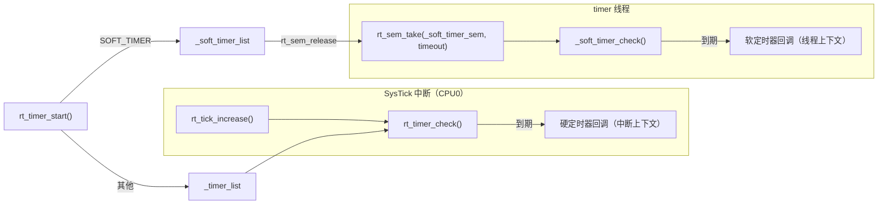
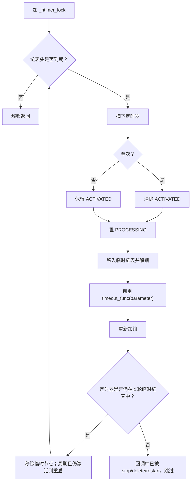

# 4. 时钟与定时器

时钟是 RTOS 的心跳：tick 驱动时间片、线程延时、定时器超时和 IPC 超时。本章说明 tick 的产生与推进、硬/软定时器的区别、跳表（skip list）插入算法，以及线程内置定时器与调度器的耦合。

相关源码：

- [clock.c](file:///workspace/src/clock.c)：tick 计数与钩子
- [timer.c](file:///workspace/src/timer.c)：定时器管理与软定时器线程
- [rtdef.h](file:///workspace/include/rtdef.h)：`struct rt_timer` 与标志位

---

## 4.1 系统时基

### 4.1.1 tick 频率

`RT_TICK_PER_SECOND` 默认 **1000**（即 1 tick = 1 ms），可在 Kconfig 中修改。由此派生：

```c
#define RT_TICK_MAX  (0xFFFFFFFFu)     /* 32 位 tick 上限，约 49.7 天 @1kHz */
```

> 注意：定时器比较使用**无符号差值 + 半区间**判断（`(a - b) < RT_TICK_MAX / 2`），因此可以安全跨越 tick 回绕；但用户自己计算时间差时也应使用 `rt_tick_t` 无符号减法。

### 4.1.2 tick 的推进

tick 由 BSP 的 SysTick（或硬件定时器）中断驱动，中断服务程序最终调用：

```c
void rt_tick_increase(void)
{
    RT_ASSERT(rt_interrupt_get_nest() > 0);

    RT_OBJECT_HOOK_CALL(rt_tick_hook, ());

#ifdef RT_USING_SMP
    rt_atomic_add(&(rt_cpu_self()->tick), 1);
#else
    rt_atomic_add(&rt_tick, 1);
#endif

    rt_sched_tick_increase();       /* 递减当前线程时间片，必要时请求调度 */

#ifdef RT_USING_SMP
    if (rt_hw_cpu_id() != 0)
        return;                     /* 硬定时器只在 CPU0 上检查 */
#endif
    rt_timer_check();               /* 处理到期硬定时器 */
}
```

要点：

1. 必须在中断上下文中调用（断言嵌套 > 0）；
2. SMP 下 tick 是**每 CPU 独立**的，`rt_tick_get()` 返回当前 CPU 的 tick；全局语义由上层保证（各核 tick 基本同步）；
3. 只有 CPU0 负责硬定时器检查，避免多核重复执行回调；
4. `rt_sched_tick_increase()` 负责时间片，`rt_timer_check()` 负责超时。

### 4.1.3 时间 API

```c
rt_tick_t rt_tick_get(void);
void      rt_tick_set(rt_tick_t tick);
void      rt_tick_sethook(void (*hook)(void));
rt_tick_t rt_tick_from_millisecond(rt_int32_t ms);
```

- `rt_tick_from_millisecond()`：毫秒转 tick；传入负数返回 `RT_WAITING_FOREVER`，0 返回 0；
- `rt_tick_set()`：仅允许在系统未运行时或特殊场景使用，会破坏已启动定时器的相对关系，慎用；
- `rt_tick_sethook()`：每个 tick 调用一次，必须极短（运行在中断上下文）。

---

## 4.2 定时器控制块

```c
struct rt_timer
{
    struct rt_object parent;                        /* 对象头 */
    rt_list_t        row[RT_TIMER_SKIP_LIST_LEVEL]; /* 跳表各层节点 */
    void (*timeout_func)(void *parameter);          /* 超时回调 */
    void            *parameter;                     /* 回调参数 */
    rt_tick_t        init_tick;                     /* 定时长度（tick） */
    rt_tick_t        timeout_tick;                  /* 绝对到期 tick */
};
typedef struct rt_timer *rt_timer_t;
```

### 标志位

| 宏 | 值 | 含义 |
| --- | --- | --- |
| `RT_TIMER_FLAG_DEACTIVATED` | `0x0` | 未启动 |
| `RT_TIMER_FLAG_ACTIVATED` | `0x1` | 已启动，在定时器链表中 |
| `RT_TIMER_FLAG_PROCESSING` | `0x2` | 回调正在执行（防重入/防删除） |
| `RT_TIMER_FLAG_ONE_SHOT` | `0x0` | 单次触发 |
| `RT_TIMER_FLAG_PERIODIC` | `0x4` | 周期触发 |
| `RT_TIMER_FLAG_HARD_TIMER` | `0x0` | 中断上下文中执行回调 |
| `RT_TIMER_FLAG_SOFT_TIMER` | `0x8` | `timer` 线程中执行回调 |
| `RT_TIMER_FLAG_THREAD_TIMER` | `0x10 \| HARD` | 线程内置超时定时器，与调度器联动 |

组合示例：

```c
/* 周期软定时器 */
rt_timer_create("tick", cb, RT_NULL, 100,
                RT_TIMER_FLAG_PERIODIC | RT_TIMER_FLAG_SOFT_TIMER);

/* 单次硬定时器（默认） */
rt_timer_create("oneshot", cb, RT_NULL, 50, RT_TIMER_FLAG_ONE_SHOT);
```

> 注意：`ACTIVATED = 0x1` 与 `ONE_SHOT = 0x0` 共用位置并不冲突——前者描述运行状态，后者描述触发模式，判断时需按位与对应掩码。

---

## 4.3 硬定时器 vs 软定时器

| 维度 | 硬定时器 | 软定时器 |
| --- | --- | --- |
| 执行上下文 | tick 中断（CPU0） | `"timer"` 线程 |
| 链表/锁 | `_timer_list` / `_htimer_lock` | `_soft_timer_list` / `_stimer_lock` |
| 能否阻塞 | 否 | 是 |
| 回调时长要求 | 极短（微秒级） | 可较长，但会延迟其他软定时器 |
| 适用场景 | 精确时间戳、唤醒、驱动节拍 | 业务逻辑、需要调用 IPC 的周期任务 |
| 默认类型 | 是 | 需显式 `RT_TIMER_FLAG_SOFT_TIMER` |



### 软定时器线程

`rt_system_timer_thread_init()` 创建：

- 线程名 `"timer"`；
- 优先级 `RT_TIMER_THREAD_PRIO`（默认 0，最高）；
- 栈 `RT_TIMER_THREAD_STACK_SIZE`（默认 512 字节）；
- 时间片 10。

线程主体 `_timer_thread_entry()`：

1. 把信号量 `_soft_timer_sem` 的 vlimit 设为 1（合并重复释放）；
2. 计算距离下一个软定时器到期还有多少 tick；
3. `rt_sem_take(&_soft_timer_sem, next_timeout)` 睡眠等待；
4. 被唤醒后调用 `_soft_timer_check()` 执行到期回调。

因此 `rt_timer_start()` 启动软定时器成功后会 `rt_sem_release(&_soft_timer_sem)` 唤醒线程重新计算睡眠时长。

---

## 4.4 跳表与插入算法

定时器链表按 `timeout_tick` 升序排列。若每次插入都从头线性查找，定时器多时复杂度为 O(n)。RT-Thread 采用**跳表**优化：

```c
rt_list_t _timer_list[RT_TIMER_SKIP_LIST_LEVEL];   /* 默认 LEVEL = 1 */
```

- 第 0 层包含所有定时器，是有序链表；
- 更高层是稀疏索引，理想情况下查找接近 O(log n)；
- 每个 `rt_timer` 的 `row[]` 数组对应各层节点。

### 插入流程 `_timer_start()`

1. 拒绝已处于 `PROCESSING` 的定时器（正在回调中不允许重启）；
2. 若已激活，先 `_timer_remove()`；
3. `timeout_tick = rt_tick_get() + init_tick`；
4. 从最高层向下遍历，用**回绕安全比较**找插入点：

```c
if ((t->timeout_tick - timer->timeout_tick) < RT_TICK_MAX / 2)
    /* t 比 timer 更早到期，继续前进 */
else
    /* 找到插入位置 */
```

5. 根据 `random_nr & RT_TIMER_SKIP_LIST_MASK` 决定是否提升到更高层（层数由 `RT_TIMER_SKIP_LIST_LEVEL` 限制）；
6. 置 `RT_TIMER_FLAG_ACTIVATED`。

> 说明：源码使用一个伪随机数做层级提升，属于**确定性近似跳表**，目的是让层级分布均匀，不要求严格概率保证。

---

## 4.5 定时器 API

### 创建/初始化

```c
void     rt_timer_init(rt_timer_t timer, const char *name,
                       void (*timeout)(void *parameter), void *parameter,
                       rt_tick_t time, rt_uint8_t flag);
rt_timer_t rt_timer_create(const char *name,
                           void (*timeout)(void *parameter), void *parameter,
                           rt_tick_t time, rt_uint8_t flag);
rt_err_t rt_timer_delete(rt_timer_t timer);
rt_err_t rt_timer_detach(rt_timer_t timer);
```

### 启停

```c
rt_err_t rt_timer_start(rt_timer_t timer);
rt_err_t rt_timer_stop(rt_timer_t timer);
```

- `start` 会把定时器插入对应链表（硬/软），软定时器还会唤醒 `timer` 线程；
- `stop` 从链表摘除并清除 `ACTIVATED`；
- 对已停止的定时器重复 `stop` 返回 `-RT_ERROR`。

### 控制

```c
rt_err_t rt_timer_control(rt_timer_t timer, int cmd, void *arg);
```

| 命令 | `arg` 方向 | 说明 |
| --- | --- | --- |
| `RT_TIMER_CTRL_SET_TIME` | 输入 `rt_tick_t*` | 修改定时长度；若已激活会先摘除再按新值重插 |
| `RT_TIMER_CTRL_GET_TIME` | 输出 `rt_tick_t*` | 读取 `init_tick` |
| `RT_TIMER_CTRL_SET_ONESHOT` | 无 | 改为单次 |
| `RT_TIMER_CTRL_SET_PERIODIC` | 无 | 改为周期 |
| `RT_TIMER_CTRL_GET_STATE` | 输出 `rt_uint8_t*` | 是否 `ACTIVATED` |
| `RT_TIMER_CTRL_GET_REMAIN_TIME` | 输出 `rt_tick_t*` | 距到期还剩多少 tick |
| `RT_TIMER_CTRL_GET_FUNC` / `SET_FUNC` | 函数指针 | 读写回调 |
| `RT_TIMER_CTRL_GET_PARM` / `SET_PARM` | 参数指针 | 读写回调参数 |

`SET_TIME` 内有断言：新周期必须 `< RT_TICK_MAX / 2`，否则会破坏回绕比较。

---

## 4.6 超时处理 `rt_timer_check()`

仅在中断中调用，SMP 下仅 CPU0 执行。核心流程：



设计要点：

- **解锁调用回调**：避免用户回调中操作定时器导致死锁；
- **PROCESSING 标记**：防止回调中 `rt_timer_start()` 自身造成重入；
- **临时链表**：回调可能 `stop`、`delete` 或重启定时器，回调返回后必须重新校验节点归属；
- **周期定时器**：回调完成后重新插入链表，`timeout_tick += init_tick`（若已严重滞后，会连续追平）。

软定时器的 `_soft_timer_check()` 使用相同算法，只是锁与链表不同，且在 `timer` 线程上下文执行。

---

## 4.7 线程内置定时器

每个 `rt_thread` 都内嵌一个 `thread_timer`，用于：

- `rt_thread_delay()` / IPC 超时；
- 定时把线程从挂起态唤醒。

它与普通定时器的区别：

1. 标志为 `RT_TIMER_FLAG_ONE_SHOT | RT_TIMER_FLAG_THREAD_TIMER`；
2. 不通过 `RT_THREAD_LIST_NODE` 之外的结构管理，而是由调度器直接联动：

```c
/* rt_timer_start() 中 */
if (timer->parent.flag & RT_TIMER_FLAG_THREAD_TIMER)
{
    struct rt_thread *thread = rt_container_of(timer, struct rt_thread, thread_timer);
    rt_sched_thread_timer_start(thread);   /* 置 sched_flag_ttmr_set */
}
```

3. `rt_sched_thread_timer_start/stop()` 维护 `sched_flag_ttmr_set`，并在停止时调用 `rt_timer_stop()`；
4. 超时回调 `_thread_timeout()` 把线程重新置为 READY 并触发调度。

> 关键：线程超时定时器是**硬定时器**，因此到期唤醒发生在中断上下文，这也是 IPC 超时能精确到 tick 的原因。

---

## 4.8 时间换算与常用宏

```c
rt_tick_from_millisecond(ms);      /* 毫秒 -> tick */
rt_tick_get();                     /* 当前 tick */
rt_tick_get() - start;             /* 无符号差值，天然处理回绕 */
```

MSH 中常用：

```
msh > list_timer          # 查看所有定时器及剩余 tick
msh > date                # 若启用 RTC，查看/设置墙上时间
```

---

## 4.9 常见问题

1. **硬定时器回调里调用了阻塞 API**：会导致断言失败或系统异常。需要阻塞就用软定时器或 `workqueue`。
2. **软定时器回调执行过久**：会推迟同链表中其他软定时器，也会占用 `timer` 线程（最高优先级），影响实时性。
3. **周期定时器漂移**：回调执行时间不计入周期补偿之外的修正；对严格周期任务建议用 `rt_thread_delay_until()`。
4. **在回调中删除自身**：`rt_timer_delete()` 在 `PROCESSING` 状态下会延迟释放，回调返回后由定时器框架完成清理；不要自行 `rt_free` 定时器内存。
5. **tick 频率过高**：中断开销增大；过低则延时/超时精度下降。一般 100–1000 Hz 之间取舍。
