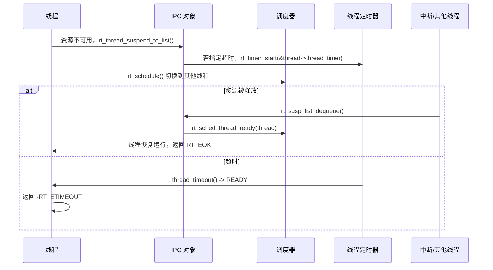
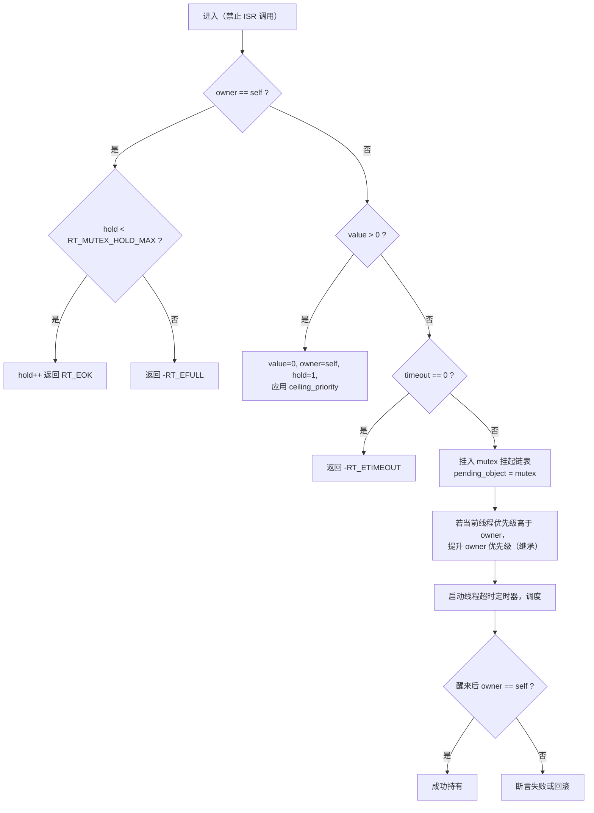
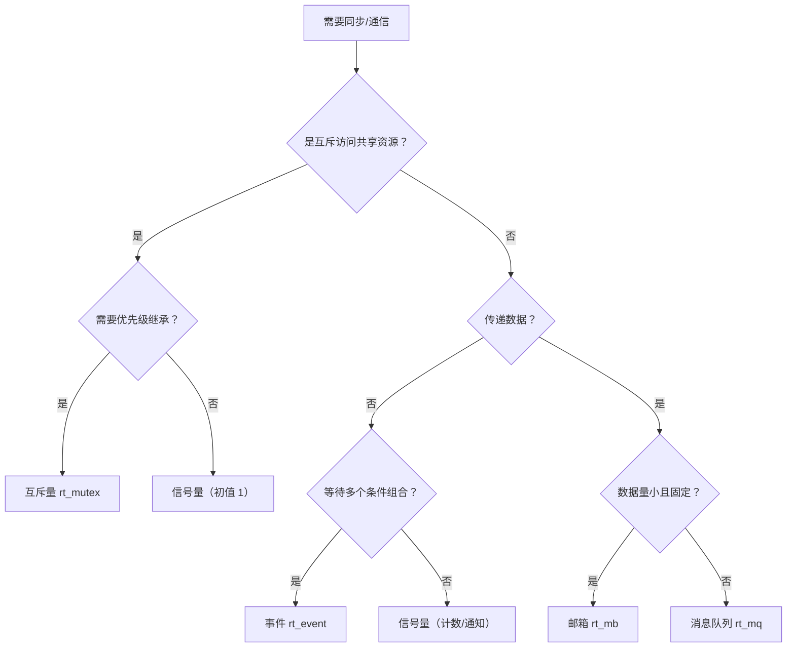

# 5. 线程间通信与同步

RT-Thread 提供五类 IPC 原语：**信号量、互斥量、事件、邮箱、消息队列**。它们共享同一套“挂起链表 + 线程超时定时器 + 调度器唤醒”机制，差异只在于资源语义与唤醒规则。

相关源码：[ipc.c](file:///workspace/src/ipc.c)（约 4000 行，包含全部实现）。

---

## 5.1 统一的 IPC 骨架

### 5.1.1 IPC 对象

```c
struct rt_ipc_object
{
    struct rt_object parent;        /* 对象头 */
    rt_list_t        suspend_thread;/* 等待该资源的线程链表 */
};
```

信号量、互斥量、事件、邮箱、消息队列的 TCB 都以 `rt_ipc_object` 开头：

```c
struct rt_semaphore { struct rt_ipc_object parent; rt_uint16_t value; rt_uint16_t max_value; };
struct rt_mutex     { struct rt_ipc_object parent; rt_uint16_t value; rt_uint8_t hold;
                      rt_uint8_t ceiling_priority; struct rt_thread *owner;
                      rt_uint8_t priority; rt_list_t taken_object_list; };
struct rt_event     { struct rt_ipc_object parent; rt_uint32_t set; };
struct rt_mailbox   { struct rt_ipc_object parent; rt_ubase_t *msg_pool; rt_uint16_t size;
                      rt_uint16_t entry; rt_uint16_t in_offset; rt_uint16_t out_offset; };
struct rt_messagequeue { struct rt_ipc_object parent; void *msg_pool; rt_uint16_t msg_size;
                         rt_uint16_t max_msgs; rt_uint16_t entry;
                         void *msg_queue_head; void *msg_queue_tail; void *msg_free_list; };
```

### 5.1.2 挂起链表与排队策略

创建对象时通过 `flag` 指定等待队列排序：

| 标志 | 值 | 行为 |
| --- | --- | --- |
| `RT_IPC_FLAG_FIFO` | `0x00` | 先进先出：先阻塞的线程先被唤醒 |
| `RT_IPC_FLAG_PRIO` | `0x01` | 按优先级：高优先级线程插到队首方向 |

插入函数 `rt_susp_list_enqueue()`：

```c
if (flag & RT_IPC_FLAG_PRIO)
{
    /* 从头遍历，找到第一个优先级低于当前线程的节点，插在其前面 */
    rt_list_insert_before(&node, &thread->tlist);
}
else
{
    /* 插入链表尾部 */
    rt_list_insert_before(susp_list, &thread->tlist);
}
```

> 注意：即使是 PRIO 模式，同优先级线程仍保持阻塞先后顺序（稳定插入）。

### 5.1.3 阻塞与唤醒的完整路径

以“获取信号量失败”为例：



关键内部函数（[ipc.c](file:///workspace/src/ipc.c) 顶部）：

```c
struct rt_thread *rt_susp_list_dequeue(rt_list_t *susp_list, rt_err_t thread_error);
rt_err_t rt_susp_list_resume_all(rt_list_t *susp_list, rt_err_t thread_error);
rt_err_t rt_susp_list_resume_all_irq(rt_list_t *susp_list, rt_err_t thread_error,
                                     struct rt_spinlock *lock);
void rt_susp_list_enqueue(rt_list_t *susp_list, struct rt_thread *thread, rt_uint8_t flag);
void rt_susp_list_print(rt_list_t *susp_list);
```

- `dequeue`：取队首线程，调用 `rt_sched_thread_ready()` 使其就绪，并写入 `thread->error`；
- `resume_all`：对象删除/控制时唤醒全部等待者（通常返回 `-RT_ERROR`）；
- `resume_all_irq`：在关中断/持锁场景下批量唤醒；
- `print`：调试用，打印等待线程列表（MSH `list_sem` 等命令）。

> 源码细节：`rt_susp_list_dequeue()` 在链表为空时会走 `LOG_D("resume thread:%s\n", thread->parent.name)` 分支，此时 `thread == RT_NULL`，存在空指针解引用风险。阅读/移植时建议加上 `if (thread)` 判断。

### 5.1.4 等待时间语义

```c
#define RT_WAITING_FOREVER  (-1)
#define RT_WAITING_NO       0
```

| 传入值 | 行为 |
| --- | --- |
| `0` | 不等待，立即返回 `-RT_ETIMEOUT` 或 `-RT_EEMPTY` |
| `> 0` | 等待指定 tick，超时后返回 `-RT_ETIMEOUT` |
| `RT_WAITING_FOREVER` | 永久等待，直到资源可用或被删除/控制唤醒 |

---

## 5.2 信号量（Semaphore）

### 语义

- 计数器 `value`，表示可用资源数；
- `take` 使 `value--`，`value == 0` 时阻塞；
- `release` 使 `value++`，若有等待线程则直接唤醒一个（不增加计数）；
- 支持上限 `max_value`，超过返回 `-RT_EFULL`。

适合：**资源计数、事件通知、生产者-消费者节拍**。

### API

```c
rt_err_t rt_sem_init(rt_sem_t sem, const char *name, rt_uint32_t value, rt_uint8_t flag);
rt_sem_t rt_sem_create(const char *name, rt_uint32_t value, rt_uint8_t flag);
rt_err_t rt_sem_delete(rt_sem_t sem);      /* 唤醒所有等待者，返回 -RT_ERROR */
rt_err_t rt_sem_detach(rt_sem_t sem);
rt_err_t rt_sem_take(rt_sem_t sem, rt_int32_t timeout);
rt_err_t rt_sem_take_interruptible(rt_sem_t sem, rt_int32_t timeout);
rt_err_t rt_sem_take_killable(rt_sem_t sem, rt_int32_t timeout);
rt_err_t rt_sem_trytake(rt_sem_t sem);     /* 等价 timeout = 0 */
rt_err_t rt_sem_release(rt_sem_t sem);
rt_err_t rt_sem_control(rt_sem_t sem, int cmd, void *arg);
```

### 实现要点

`_rt_sem_take()`：

1. `rt_spin_lock_irqsave(&sem->parent.parent.spinlock)`（SMP 保护）；
2. `value > 0` → `value--`，直接返回 `RT_EOK`；
3. `timeout == 0` → 返回 `-RT_ETIMEOUT`；
4. 否则 `rt_thread_suspend_to_list(thread, &sem->parent.suspend_thread,
   sem->parent.parent.flag, suspend_flag)`；
5. 若 `timeout > 0`：`rt_timer_control()` 设置时间并 `rt_timer_start()`；
6. 解锁、`rt_schedule()`；
7. 醒来后把 `thread->error` 转成返回值（正错误码取负）。

`rt_sem_release()`：

1. 若挂起链表非空 → `rt_susp_list_dequeue(..., RT_EOK)` 唤醒一个线程；
2. 否则若 `value < max_value` → `value++`；
3. 否则返回 `-RT_EFULL`；
4. 若唤醒了线程，触发重调度。

### 示例：中断通知线程

```c
static rt_sem_t rx_sem;

void uart_isr(void)
{
    /* 读数据 ... */
    rt_sem_release(rx_sem);          /* ISR 中释放信号量是安全的 */
}

void rx_thread(void *arg)
{
    while (1) {
        rt_sem_take(rx_sem, RT_WAITING_FOREVER);
        /* 处理数据 */
    }
}
```

> 注意：中断中**不能** `rt_sem_take()`；只能 `release`。

---

## 5.3 互斥量（Mutex）

### 语义

- 二值锁，`value` 表示可用性；
- 记录 `owner`（持有线程）、`hold`（嵌套持有次数）；
- 支持**优先级继承**与**优先级天花板**，用于抑制优先级反转；
- 同一线程可重复获取（递归锁），`hold` 递增，需相同次数释放。

适合：**临界资源互斥、需要优先级继承的共享外设**。

### API

```c
rt_err_t rt_mutex_init(rt_mutex_t mutex, const char *name, rt_uint8_t flag);
rt_mutex_t rt_mutex_create(const char *name, rt_uint8_t flag);
rt_err_t rt_mutex_delete(rt_mutex_t mutex);
rt_err_t rt_mutex_detach(rt_mutex_t mutex);
rt_err_t rt_mutex_take(rt_mutex_t mutex, rt_int32_t timeout);
rt_err_t rt_mutex_take_interruptible(rt_mutex_t mutex, rt_int32_t timeout);
rt_err_t rt_mutex_take_killable(rt_mutex_t mutex, rt_int32_t timeout);
rt_err_t rt_mutex_trytake(rt_mutex_t mutex);
rt_err_t rt_mutex_release(rt_mutex_t mutex);
rt_err_t rt_mutex_control(rt_mutex_t mutex, int cmd, void *arg);
rt_err_t rt_mutex_drop_thread(rt_mutex_t mutex, rt_thread_t thread);
```

### 获取流程 `_rt_mutex_take()`



### 优先级继承

- 等待线程把自己的优先级“借”给持有者：若等待者优先级更高，调用 `_thread_update_priority(owner, ...)` 临时提升 `owner->current_priority`；
- 持有者释放后，按 `taken_object_list` 重新计算自身应恢复的优先级；
- `taken_object_list` 记录该线程当前持有的所有互斥量，用于多锁场景下的正确恢复。

### 优先级天花板

创建时 `flag` 可携带天花板优先级（`RT_IPC_FLAG_PRIO` 之外的高位编码，具体见 `rt_mutex_init` 文档）：

```c
/* 让持有者至少提升到 ceiling 优先级，防止中等优先级任务抢占 */
rt_mutex_init(&mutex, "m", RT_IPC_FLAG_PRIO);
```

`ceiling_priority` 字段保存天花板值；首次获取时立即应用。

### 释放与异常处理

`rt_mutex_release()`：

1. 校验 `owner == self`，否则返回 `-RT_EPERM`；
2. `hold--`，未归零直接返回；
3. 归零后若挂起链表非空：取最高优先级等待者，转移所有权（`owner`/`hold`），恢复自身优先级；
4. 否则 `value = 1`、`owner = RT_NULL`；
5. 触发重调度。

`rt_mutex_drop_thread()`：强制把某个线程从互斥量等待队列移除（用于线程被删除时的清理）。

> 注意：互斥量**不可在中断中使用**，源码中通过 `RT_DEBUG_SCHEDULER_AVAILABLE(RT_TRUE)` 断言；且不支持 `RT_WAITING_FOREVER` 之外的特殊语义——永久等待时不会有超时回调。

---

## 5.4 事件（Event）

### 语义

- 32 位事件集合 `set`，每位一个事件；
- 一个线程可等待**多个**事件的组合；
- 支持 `AND`（全部满足）与 `OR`（任一满足）；
- 可选择等待后是否清除对应位（`RT_EVENT_FLAG_CLEAR`）。

适合：**多条件同步、状态组合触发**。

### API

```c
rt_err_t rt_event_init(rt_event_t event, const char *name, rt_uint8_t flag);
rt_event_t rt_event_create(const char *name, rt_uint8_t flag);
rt_err_t rt_event_delete(rt_event_t event);
rt_err_t rt_event_detach(rt_event_t event);
rt_err_t rt_event_send(rt_event_t event, rt_uint32_t set);
rt_err_t rt_event_recv(rt_event_t event, rt_uint32_t set, rt_uint8_t option,
                       rt_int32_t timeout, rt_uint32_t *recved);
rt_err_t rt_event_recv_interruptible(...);
rt_err_t rt_event_recv_killable(...);
rt_err_t rt_event_control(rt_event_t event, int cmd, void *arg);
```

### 接收选项

| 选项 | 含义 |
| --- | --- |
| `RT_EVENT_FLAG_OR` | 任一事件位置位即满足 |
| `RT_EVENT_FLAG_AND` | 所有请求位都置位才满足 |
| `RT_EVENT_FLAG_CLEAR` | 满足后清除对应位 |

### 实现要点

- `send` 置位后遍历挂起链表，对每个等待者检查其请求掩码与选项，满足则唤醒；
- 若多个线程同时满足，按挂起链表顺序（FIFO/PRIO）依次唤醒；
- 超时路径与信号量一致；
- 事件位是“粘滞”的，除非显式 `CLEAR` 或线程接收时清除，否则一直保持。

```c
#define EVT_A (1 << 0)
#define EVT_B (1 << 1)

rt_event_recv(evt, EVT_A | EVT_B, RT_EVENT_FLAG_AND | RT_EVENT_FLAG_CLEAR,
              RT_WAITING_FOREVER, &recved);
```

> 注意：事件不会计数。多次 `send` 同一事件位只相当于置位一次；需要计数请用信号量。

---

## 5.5 邮箱（Mailbox）

### 语义

- 固定长度邮件：每封邮件就是一个 `rt_ubase_t`（指针或 32/64 位整数）；
- 底层是一个环形缓冲区 `msg_pool`，容量 `size`；
- 支持“发送等待”（队列满时阻塞）与“紧急发送”（插到队首）。

适合：**传递指针/小数据、线程间轻量消息**。

### API

```c
rt_err_t rt_mb_init(rt_mb_t mb, const char *name, void *msgpool, rt_size_t size, rt_uint8_t flag);
rt_mb_t rt_mb_create(const char *name, rt_size_t size, rt_uint8_t flag);
rt_err_t rt_mb_delete(rt_mb_t mb);
rt_err_t rt_mb_detach(rt_mb_t mb);
rt_err_t rt_mb_send(rt_mb_t mb, rt_ubase_t value);
rt_err_t rt_mb_send_wait(rt_mb_t mb, rt_ubase_t value, rt_int32_t timeout);
rt_err_t rt_mb_urgent(rt_mb_t mb, rt_ubase_t value);
rt_err_t rt_mb_recv(rt_mb_t mb, rt_ubase_t *value, rt_int32_t timeout);
rt_err_t rt_mb_recv_interruptible(...);
rt_err_t rt_mb_recv_killable(...);
rt_err_t rt_mb_control(rt_mb_t mb, int cmd, void *arg);
```

### 行为

| API | 队列满时 | 队列空时 |
| --- | --- | --- |
| `rt_mb_send` | 返回 `-RT_EFULL` | 入队并唤醒等待者 |
| `rt_mb_send_wait` | 阻塞直到超时或有空间 | 入队 |
| `rt_mb_urgent` | 返回 `-RT_EFULL` | 插入队首（LIFO 语义） |
| `rt_mb_recv` | — | 阻塞直到有邮件或超时，返回 `-RT_ETIMEOUT` |

> 注意：邮箱传递的是**值**而非数据拷贝。如果传指针，发送方必须保证所指内存在接收方使用期间有效（常见做法是传递静态/堆上对象，并约定所有权）。

---

## 5.6 消息队列（Message Queue）

### 语义

- 每条消息长度固定为 `msg_size` 字节，队列最多 `max_msgs` 条；
- 底层是一块连续内存，被划分为“消息数据区 + 空闲链表 + 消息链表”；
- 支持按优先级发送/接收（`rt_mq_send_wait_prio` / `rt_mq_recv_prio`）。

适合：**变长业务数据（定长分片）、线程间数据拷贝传递**。

### API

```c
rt_err_t rt_mq_init(rt_mq_t mq, const char *name, void *msgpool, rt_size_t msg_size,
                    rt_size_t pool_size, rt_uint8_t flag);
rt_mq_t rt_mq_create(const char *name, rt_size_t msg_size, rt_size_t max_msgs, rt_uint8_t flag);
rt_err_t rt_mq_delete(rt_mq_t mq);
rt_err_t rt_mq_detach(rt_mq_t mq);
rt_err_t rt_mq_send(rt_mq_t mq, const void *buffer, rt_size_t size);
rt_err_t rt_mq_send_wait(rt_mq_t mq, const void *buffer, rt_size_t size, rt_int32_t timeout);
rt_err_t rt_mq_send_wait_prio(rt_mq_t mq, const void *buffer, rt_size_t size,
                              rt_int32_t timeout, rt_uint8_t prio);
rt_err_t rt_mq_urgent(rt_mq_t mq, const void *buffer, rt_size_t size);
rt_err_t rt_mq_recv(rt_mq_t mq, void *buffer, rt_size_t size, rt_int32_t timeout);
rt_err_t rt_mq_recv_prio(rt_mq_t mq, void *buffer, rt_size_t size,
                         rt_int32_t timeout, rt_uint8_t *prio);
rt_err_t rt_mq_control(rt_mq_t mq, int cmd, void *arg);
```

### 行为与注意事项

- `size` 必须 ≤ `msg_size`，否则返回 `-RT_ERROR`；
- 发送是**拷贝**语义：调用返回后 `buffer` 可复用；
- 接收缓冲区必须至少 `msg_size` 字节；
- `rt_mq_urgent()` 把消息插到队首，用于控制命令优先处理；
- 队列满时 `rt_mq_send` 返回 `-RT_EFULL`，`send_wait` 阻塞等待。

### 邮箱 vs 消息队列

| 维度 | 邮箱 | 消息队列 |
| --- | --- | --- |
| 消息大小 | 固定 `sizeof(rt_ubase_t)` | 固定 `msg_size`（可配置） |
| 数据传递 | 值/指针 | 拷贝 |
| 内存开销 | 小 | 较大（消息池） |
| 适用 | 轻量通知、指针传递 | 结构化数据传递 |

---

## 5.7 错误码约定

| 错误码 | 值 | 场景 |
| --- | --- | --- |
| `RT_EOK` | 0 | 成功 |
| `-RT_ETIMEOUT` | 超时 | 等待超时或非阻塞获取失败 |
| `-RT_EFULL` | 资源满 | 信号量超上限、邮箱/队列满、互斥量嵌套超限 |
| `-RT_EEMPTY` | 资源空 | 邮箱/队列无数据 |
| `-RT_ERROR` | 通用错误 | 对象被删除、参数非法、状态不符 |
| `-RT_EPERM` | 权限 | 非持有者释放互斥量 |
| `-RT_EINVAL` | 参数 | 非法参数 |

上层封装（如 POSIX `sem_timedwait`）会把这些错误码映射为 `errno`。

---

## 5.8 选型建议



补充原则：

1. **中断只用非阻塞接口**：`rt_sem_release`、`rt_event_send`、`rt_mb_send`、`rt_mq_send`（队列满时返回错误，不要在 ISR 中等待）。
2. **优先级反转敏感场景用互斥量**；纯计数用信号量。
3. **避免在持有互斥量时做长时间阻塞操作**，否则继承链会拖慢高优先级线程。
4. **对象删除前确保没有线程永久等待**，否则 `delete` 会以 `-RT_ERROR` 唤醒它们，调用方需处理。
5. **SMP 下共享数据仍需额外锁**：IPC 只保证自身内部状态一致，不保护你传进去的缓冲区。
