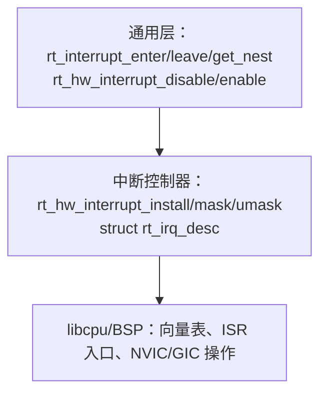
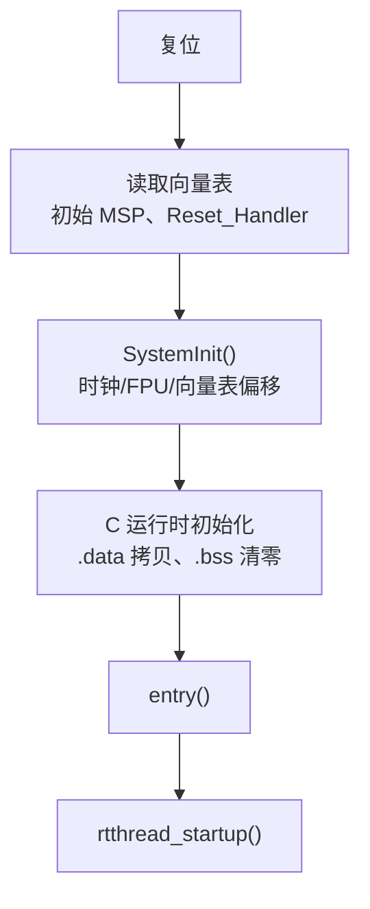
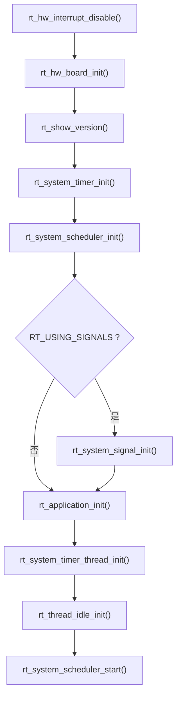

# 7. 中断、异常与启动

本章说明中断上下文的管理方式、临界区与调度锁的区别、断言与回溯机制，以及从复位向量到 `main()` 的完整启动过程和自动初始化表。

相关源码：

- [rthw.h](file:///workspace/include/rthw.h)：中断/上下文切换/移植接口
- [rtthread.h](file:///workspace/include/rtthread.h)：`rt_interrupt_enter/leave/get_nest`
- [irq.c](file:///workspace/src/irq.c)：中断进入/退出钩子
- [components.c](file:///workspace/src/components.c)：启动链与自动初始化
- [kservice.c](file:///workspace/src/kservice.c)：断言、回溯、控制台输出

---

## 7.1 中断接口分层

RT-Thread 的中断相关 API 分为三层：



### 7.1.1 开关中断

定义在 [rthw.h](file:///workspace/include/rthw.h)：

```c
#ifdef RT_USING_SMP
rt_base_t rt_hw_local_irq_disable(void);
void      rt_hw_local_irq_enable(rt_base_t level);

rt_base_t rt_cpus_lock(void);
void      rt_cpus_unlock(rt_base_t level);

#define rt_hw_interrupt_disable rt_cpus_lock
#define rt_hw_interrupt_enable  rt_cpus_unlock
#else
rt_base_t rt_hw_interrupt_disable(void);
void      rt_hw_interrupt_enable(rt_base_t level);

#define rt_hw_local_irq_disable rt_hw_interrupt_disable
#define rt_hw_local_irq_enable  rt_hw_interrupt_enable
#endif
```

关键差异：

| 接口 | 单核含义 | SMP 含义 |
| --- | --- | --- |
| `rt_hw_interrupt_disable()` | 关中断，返回原状态 | 获取全局 CPU 锁（阻止其他核进入临界区）并关本地中断 |
| `rt_hw_local_irq_disable()` | 同关中断 | 仅关**本核**中断 |
| `rt_hw_interrupt_enable(level)` | 恢复中断状态 | 释放 CPU 锁并恢复本地中断 |

使用范式：

```c
rt_base_t level = rt_hw_interrupt_disable();
/* 临界区：不能阻塞、不能调用可能调度的 API */
rt_hw_interrupt_enable(level);
```

> 注意：必须保存并恢复返回值，不要直接 `rt_hw_interrupt_enable(0)`，否则会破坏嵌套。

### 7.1.2 中断进入/退出

由 libcpu 的 ISR 入口（或 BSP 的汇编桩）调用：

```c
void rt_interrupt_enter(void);   /* 嵌套计数 +1，记录中断上下文 */
void rt_interrupt_leave(void);   /* 嵌套计数 -1，离开时按需触发调度 */
rt_uint8_t rt_interrupt_get_nest(void);
```

`rt_interrupt_enter/leave` 的实现位于 libcpu 的 `context_*.c` / `interrupt.c` 中，`src/irq.c` 只提供钩子：

```c
void rt_interrupt_enter_sethook(void (*hook)(void));
void rt_interrupt_leave_sethook(void (*hook)(void));
```

典型汇编桩逻辑（ARM Cortex-M）：

```asm
PendSV_Handler:
    rt_interrupt_enter()
    保存当前线程上下文
    rt_interrupt_leave()        /* 返回时若 need_switch 则切换 */
    rt_hw_context_switch_interrupt()
```

> `rt_interrupt_get_nest() == 0` 是判断“当前处于线程上下文”的标准方式，大量 API 用它做合法性断言。

### 7.1.3 中断描述符

```c
typedef void (*rt_isr_handler_t)(int vector, void *param);

struct rt_irq_desc
{
    rt_isr_handler_t handler;
    void            *param;
#ifdef RT_USING_INTERRUPT_INFO
    char             name[RT_NAME_MAX];
    rt_uint32_t      counter;
#endif
};

void rt_hw_interrupt_init(void);
void rt_hw_interrupt_mask(int vector);
void rt_hw_interrupt_umask(int vector);
rt_isr_handler_t rt_hw_interrupt_install(int vector, rt_isr_handler_t handler,
                                         void *param, const char *name);
void rt_hw_interrupt_uninstall(int vector, rt_isr_handler_t handler, void *param);
```

- `vector` 是中断号；
- `handler` 在中断上下文执行，必须短小、不可阻塞；
- `RT_USING_INTERRUPT_INFO` 打开后可统计每个中断的触发次数（MSH `list_irq`）。

---

## 7.2 临界区、调度锁与自旋锁

三者的保护范围不同，混用是常见 bug 来源：

| 机制 | API | 保护对象 | 是否关中断 | 是否阻止调度 | 是否跨核 |
| --- | --- | --- | --- | --- | --- |
| 关中断 | `rt_hw_interrupt_disable()` | 与 ISR 共享的数据 | 是 | 是（间接） | SMP 下是 |
| 调度锁 | `rt_enter_critical()` / `rt_exit_critical()` | 不允许线程切换的代码段 | 否 | 是 | SMP 下是 |
| 自旋锁 | `rt_spin_lock()` / `rt_spin_lock_irqsave()` | 多核共享数据 | 可选 | 否（忙等） | 是 |

### `rt_enter_critical()` 的语义

```c
void rt_enter_critical(void);   /* 调度锁嵌套 +1 */
void rt_exit_critical(void);    /* 嵌套 -1，归零时按需调度 */
```

- 只阻止**线程切换**，中断仍然可以进来；
- 因此它保护不了“ISR 也会写”的数据；
- 临界区内调用 `rt_thread_delay()`、`rt_sem_take()` 等会触发断言或导致调度延迟。

### 自旋锁

```c
void rt_spin_lock_init(struct rt_spinlock *lock);
void rt_spin_lock(struct rt_spinlock *lock);
void rt_spin_unlock(struct rt_spinlock *lock);
rt_base_t rt_spin_lock_irqsave(struct rt_spinlock *lock);
void rt_spin_unlock_irqrestore(struct rt_spinlock *lock, rt_base_t level);
```

- 单核下退化为调度锁/关中断；
- SMP 下是真正的忙等锁，持锁期间**不能睡眠**；
- 内核中的对象容器、定时器链表、IPC 对象都用自旋锁保护。

> 经验法则：与 ISR 共享 → 关中断；只与线程共享且需要跨核 → 自旋锁；只防线程切换 → 调度锁。

---

## 7.3 异常、断言与回溯

### 7.3.1 断言

```c
#define RT_ASSERT(EX)                     \
    if (!(EX)) {                          \
        rt_assert_handler(#EX, __FUNCTION__, __LINE__); \
    }

void rt_assert_handler(const char *ex_string, const char *func, rt_size_t line);
void rt_assert_sethook(void (*hook)(const char *ex_string, const char *func, rt_size_t line));
```

默认行为：

1. 关中断；
2. 打印断言表达式、函数名、行号；
3. 打印当前线程名与栈信息（若启用）；
4. 进入死循环，等待调试器接管。

可通过 `rt_assert_sethook()` 注册自定义处理器（例如重启系统、写日志、点亮故障灯）。

### 7.3.2 硬件异常

libcpu 提供异常向量（HardFault、MemManage、BusFault、UsageFault 等），通常会：

- 保存现场寄存器；
- 打印 `PSR`、`PC`、`LR`、`SP` 等；
- 调用 `rt_hw_exception_install()` 注册的回调（若存在）；
- 停机。

```c
void rt_hw_exception_install(rt_err_t (*exception_handle)(void *context));
```

### 7.3.3 回溯

```c
void rt_backtrace(void);
void rt_backtrace_frame(struct rt_hw_backtrace_frame *frame);
void rt_backtrace_thread(rt_thread_t thread);
```

配合 libcpu 的帧指针展开：

```c
rt_err_t rt_hw_backtrace_frame_get(rt_thread_t thread, struct rt_hw_backtrace_frame *frame);
rt_err_t rt_hw_backtrace_frame_unwind(rt_thread_t thread, struct rt_hw_backtrace_frame *frame);
```

MSH 命令 `backtrace` / `list_thread` 可打印线程调用栈，前提是编译时保留帧指针（`-fno-omit-frame-pointer`）。

---

## 7.4 启动流程详解

### 7.4.1 从复位到 `rtthread_startup()`

以 Cortex-M + GCC 为例：



不同工具链的入口适配（[components.c](file:///workspace/src/components.c)）：

| 工具链 | 入口方式 |
| --- | --- |
| GCC | `entry()`，链接时 `-eentry` |
| ArmCC | `$Sub$$main()` 劫持 `main` |
| IAR | `__low_level_init()` |

### 7.4.2 `rtthread_startup()` 内部顺序



各步骤职责：

| 步骤 | 作用 | 依赖 |
| --- | --- | --- |
| `rt_hw_board_init()` | HAL、时钟、堆、引脚、串口、控制台 | BSP |
| `rt_show_version()` | 打印版本/编译时间 | 控制台 |
| `rt_system_timer_init()` | 初始化硬定时器跳表与锁 | 无 |
| `rt_system_scheduler_init()` | 初始化就绪表/位图/自旋锁 | 无 |
| `rt_system_signal_init()` | 初始化信号 | `RT_USING_SIGNALS` |
| `rt_application_init()` | 创建 `main` 线程 | 堆或静态栈 |
| `rt_system_timer_thread_init()` | 创建 `timer` 线程 | 堆/静态栈 |
| `rt_thread_idle_init()` | 创建每 CPU 空闲线程 | 调度器已初始化 |
| `rt_system_scheduler_start()` | 首次切换，永不返回 | 至少一个就绪线程 |

### 7.4.3 `main` 线程

`rt_application_init()` 创建名为 `"main"` 的线程：

- 栈：`RT_MAIN_THREAD_STACK_SIZE`（默认 2048，64 位平台 6144）；
- 优先级：`RT_THREAD_PRIORITY_MAX / 3`；
- 时间片：20 tick；
- 入口：`main_thread_entry()`。

`main_thread_entry()` 先执行 `rt_components_init()`，再调用用户 `main()`。若启用 SMP，还会在组件初始化后调用 `rt_hw_secondary_cpu_up()` 启动从核。

---

## 7.5 自动初始化机制

### 7.5.1 原理

利用链接器“按段名排序”的特性，把初始化函数指针放入 `.rti_fn.<level>` 段：

```c
typedef int (*init_fn_t)(void);

#define INIT_EXPORT(fn, level) \
    rt_used const init_fn_t __rt_init_##fn rt_section(".rti_fn." level) = fn

#define INIT_BOARD_EXPORT(fn)          INIT_EXPORT(fn, "1")
#define INIT_CORE_EXPORT(fn)           INIT_EXPORT(fn, "1.0")
#define INIT_FRAMEWORK_EXPORT(fn)      INIT_EXPORT(fn, "1.1")
#define INIT_PLATFORM_EXPORT(fn)       INIT_EXPORT(fn, "1.2")
#define INIT_SUBSYS_EARLY_EXPORT(fn)   INIT_EXPORT(fn, "1.3.0")
#define INIT_SUBSYS_EXPORT(fn)         INIT_EXPORT(fn, "1.3.1")
#define INIT_DRIVER_EARLY_EXPORT(fn)   INIT_EXPORT(fn, "1.4")
#define INIT_PREV_EXPORT(fn)           INIT_EXPORT(fn, "2")
#define INIT_DEVICE_EXPORT(fn)         INIT_EXPORT(fn, "3")
#define INIT_COMPONENT_EXPORT(fn)      INIT_EXPORT(fn, "4")
#define INIT_ENV_EXPORT(fn)            INIT_EXPORT(fn, "5")
#define INIT_APP_EXPORT(fn)            INIT_EXPORT(fn, "6")
#define INIT_FS_EXPORT(fn)             INIT_EXPORT(fn, "6.0")
#define INIT_SECONDARY_CPU_EXPORT(fn)  INIT_EXPORT(fn, "7")
```

`components.c` 中还定义了三个“哨兵”：

```c
INIT_EXPORT(rti_start,       "0");
INIT_EXPORT(rti_board_start, "0.end");
INIT_EXPORT(rti_board_end,   "1.end");
INIT_EXPORT(rti_end,         "6.end");
```

### 7.5.2 两阶段调用

```c
/* 板级阶段：只执行 level 0 ~ 1.end */
void rt_components_board_init(void)
{
    for (fn_ptr = &__rt_init_rti_board_start; fn_ptr < &__rt_init_rti_board_end; fn_ptr++)
        (*fn_ptr)();
}

/* 组件阶段：执行 1.end ~ 6.end */
void rt_components_init(void)
{
    for (fn_ptr = &__rt_init_rti_board_end; fn_ptr < &__rt_init_rti_end; fn_ptr++)
        (*fn_ptr)();
}
```

- `rt_components_board_init()` 通常在 `rt_hw_board_init()` 末尾调用，完成板级驱动初始化；
- `rt_components_init()` 在 `main` 线程中调用，完成组件/环境/应用初始化；
- 若启用 `RT_DEBUGING_AUTO_INIT`，会逐个打印函数名与返回值，便于定位启动卡死。

### 7.5.3 链接脚本要求

必须把 `.rti_fn.*` 段收集到镜像中，并保证**按名称升序**排列。GCC 链接脚本典型写法：

```ld
.rti_fn :
{
    . = ALIGN(4);
    __rt_init_start = .;
    KEEP(*(SORT(.rti_fn*)))
    __rt_init_end = .;
} > FLASH
```

> 注意：若链接脚本缺少 `KEEP` 或 `SORT`，初始化函数可能被 `--gc-sections` 回收，表现为“驱动没有自动初始化”。

---

## 7.6 镜像内存布局

一个典型 MCU 镜像包含：

```
+----------------------+ 0x08000000
| 向量表 .isr_vector   |
+----------------------+
| .text 代码 / .rodata |
+----------------------+
| .data 初值（加载区） |
+----------------------+
| .rti_fn 初始化表     |
+----------------------+
| ...                  |
+----------------------+ RAM 起始
| .data 运行区         |
| .bss 零初始化区      |
+----------------------+
| 堆（HEAP_BEGIN~END） |
+----------------------+
| 栈（MSP/线程栈）     |
+----------------------+ RAM 结束
```

链接脚本需定义 BSP 使用的符号：

- `__bss_start/__bss_end`：清零范围；
- `HEAP_BEGIN/HEAP_END`：系统堆范围；
- `_estack` / `__initial_sp`：主栈顶；
- `Reset_Handler`：复位入口。

---

## 7.7 SMP 从核启动

SMP 配置下：

1. 主核执行完整启动流程；
2. `rt_hw_secondary_cpu_up()`（libcpu 实现）通过 PSCI/Spin-Table 等方式唤醒从核；
3. 从核进入 `rt_hw_secondary_cpu_bsp_start()`，初始化自己的 CPU 结构、中断控制器，然后调用 `rt_system_scheduler_start()` 进入调度；
4. `INIT_SECONDARY_CPU_EXPORT()` 注册的函数在从核上执行，用于初始化每核私有外设。

> 注意：从核启动前不能访问未初始化的全局调度结构；BSP 需保证内存屏障与缓存一致性。

---

## 7.8 调试启动问题的清单

| 现象 | 可能原因 | 排查手段 |
| --- | --- | --- |
| 停在 `rt_hw_board_init` | 时钟/串口/堆配置错误 | 打开 `RT_DEBUGING_AUTO_INIT`，逐步打印 |
| 进不了 `main` | 初始化函数死循环/断言 | 用调试器看 PC，检查断言输出 |
| 驱动未初始化 | `.rti_fn` 段被回收或未排序 | 检查链接脚本 `KEEP/SORT` |
| 一运行就 HardFault | 栈溢出、堆越界、向量表偏移 | 看 `list_thread` 栈用量、开 MPU/Guard |
| 中断不触发 | 未 `rt_hw_interrupt_umask` 或优先级配置错误 | 读 NVIC/GIC 寄存器，开 `RT_USING_INTERRUPT_INFO` |
| SMP 从核不启动 | PSCI/Spin-Table 地址错误 | 查 BSP 从核启动代码与设备树 |
