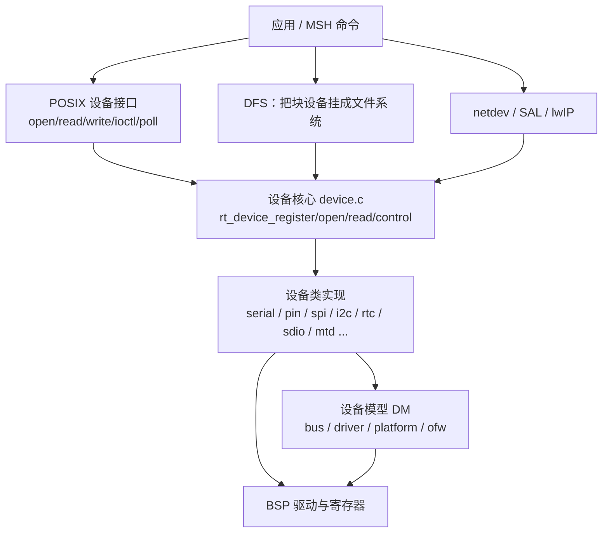
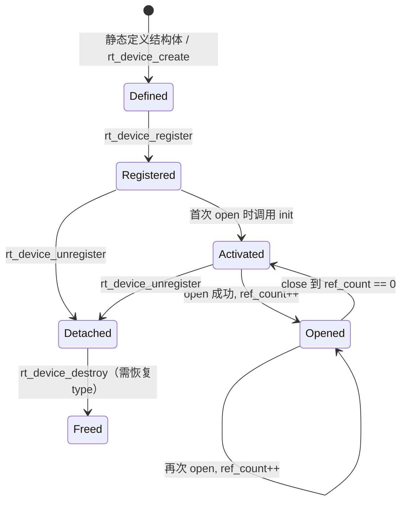
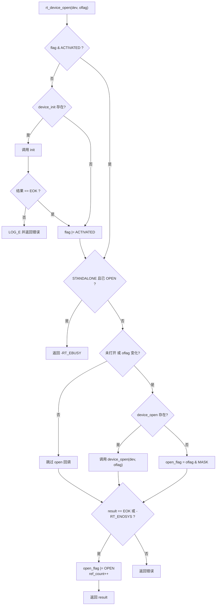
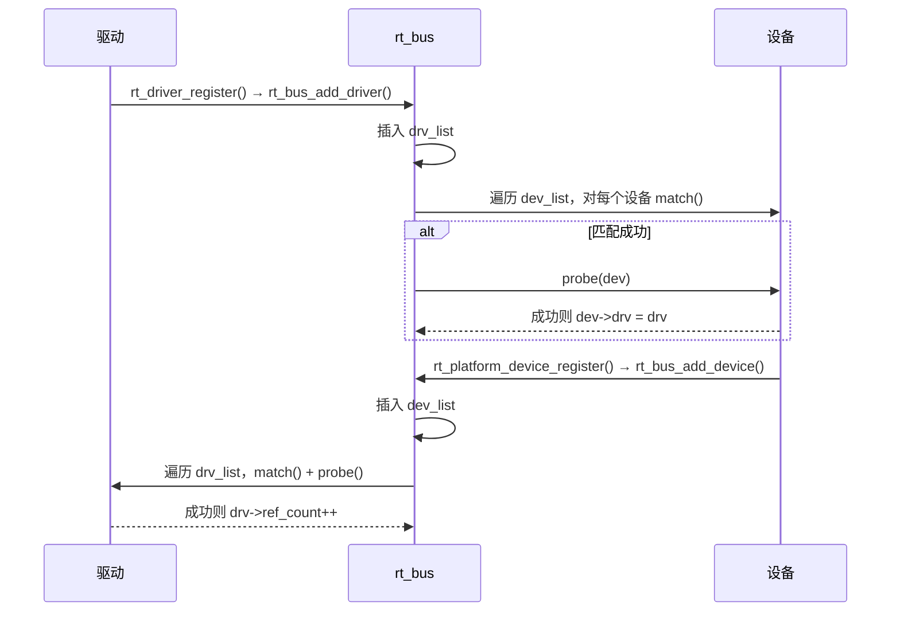

# 8. 设备框架

内核提供线程、IPC、内存等基础能力，但真正让应用“看见硬件”的是**设备框架**。本章说明 `rt_device` 的对象结构、操作集分发、注册/查找/打开/读写全流程、设备类与控制命令编码，以及新的 DM（设备模型）/OFW（设备树）机制。

相关源码：

- [device.c](file:///workspace/components/drivers/core/device.c)：设备注册、查找、打开、读写、控制
- [rtdef.h](file:///workspace/include/rtdef.h#L1213-L1380)：`rt_device`、`rt_device_ops`、设备类与标志位
- [rtdevice.h](file:///workspace/components/drivers/include/rtdevice.h)：设备框架总入口头文件
- [bus.c](file:///workspace/components/drivers/core/bus.c)：总线与驱动/设备的匹配探测
- [driver.c](file:///workspace/components/drivers/core/driver.c)：驱动注册
- [platform.c](file:///workspace/components/drivers/core/platform.c)：platform 总线
- [dm.c](file:///workspace/components/drivers/core/dm.c)：设备模型辅助接口（寄存器地址、IRQ、设备树属性）
- [serial.c](file:///workspace/components/drivers/serial/serial.c)：串口设备类实现（本章实例）

---

## 8.1 设备框架的定位与目录

应用并不直接操作寄存器，而是通过统一的 `rt_device` 接口访问外设。设备框架位于内核之上、组件与驱动之下：



`components/drivers/` 的组成：

| 路径 | 职责 |
| --- | --- |
| `core/device.c` | 设备对象生命周期与统一 IO 入口 |
| `core/bus.c`、`core/driver.c`、`core/platform.c` | DM 的总线/驱动/平台设备模型 |
| `core/dm.c`、`core/platform_ofw.c` | 设备树属性读取、地址映射、中断号解析 |
| `include/rtdevice.h` | 汇总包含所有设备类头文件，应用通常只需包含它 |
| `include/drivers/core/` | `bus.h`、`driver.h`、`dm.h` |
| `include/drivers/classes/` | `char.h`、`block.h`、`net.h`、`mtd.h`、`graphic.h` 等经典设备类 |
| `serial/`、`pin/`、`spi/`、`i2c/`、`rtc/`、`sdio/`、`mtd/`、`usb/` … | 各设备类的通用逻辑 |
| `ipc/` | `ringbuffer`、`completion`、`dataqueue`、`workqueue`、`waitqueue`、`pipe` 等驱动常用辅助设施 |

`core/SConscript` 按配置裁剪：

```python
src = ['device.c']
if GetDepend(['RT_USING_DEV_BUS']) or GetDepend(['RT_USING_DM']):
    src = src + ['bus.c']
if GetDepend(['RT_USING_DM']):
    src = src + ['dm.c', 'driver.c', 'platform.c']
if GetDepend(['RT_USING_OFW']):
    src += ['platform_ofw.c']
group = DefineGroup('DeviceDrivers', src, depend = ['RT_USING_DEVICE'], CPPPATH = CPPPATH)
```

对应关系：[core/SConscript](file:///workspace/components/drivers/core/SConscript#L1-L16)。注意整个设备框架的开关是 `RT_USING_DEVICE`，只要它关闭，`device.c` 的全部实现都不会参与编译。

---

## 8.2 `rt_device` 对象

### 8.2.1 结构体

定义见 [rtdef.h](file:///workspace/include/rtdef.h#L1335-L1380)：

```c
struct rt_device
{
    struct rt_object          parent;                   /* 继承自 rt_object */

#ifdef RT_USING_DM
    struct rt_bus *bus;                                 /* 挂在哪条总线上 */
    rt_list_t node;                                     /* 挂到 bus->dev_list */
    struct rt_driver *drv;                              /* 匹配到的驱动 */
#ifdef RT_USING_OFW
    void *ofw_node;                                     /* 设备树节点 */
#endif
#endif

    enum rt_device_class_type type;                     /* 设备类 */
    rt_uint16_t               flag;                     /* 设备能力/状态标志 */
    rt_uint16_t               open_flag;                /* 打开方式标志 */

    rt_uint8_t                ref_count;                /* 引用计数 */
    rt_uint8_t                device_id;                /* 0 - 255 */

    rt_err_t (*rx_indicate)(rt_device_t dev, rt_size_t size);
    rt_err_t (*tx_complete)(rt_device_t dev, void *buffer);

#ifdef RT_USING_DEVICE_OPS
    const struct rt_device_ops *ops;                    /* 操作集指针 */
#else
    rt_err_t  (*init)   (rt_device_t dev);
    rt_err_t  (*open)   (rt_device_t dev, rt_uint16_t oflag);
    rt_err_t  (*close)  (rt_device_t dev);
    rt_ssize_t (*read)  (rt_device_t dev, rt_off_t pos, void *buffer, rt_size_t size);
    rt_ssize_t (*write) (rt_device_t dev, rt_off_t pos, const void *buffer, rt_size_t size);
    rt_err_t  (*control)(rt_device_t dev, int cmd, void *args);
#endif

#ifdef RT_USING_POSIX_DEVIO
    const struct dfs_file_ops *fops;                    /* POSIX 文件操作集 */
    struct rt_wqueue wait_queue;                        /* poll/select 等待队列 */
#endif

    rt_err_t (*readlink)(rt_device_t dev, char *buf, int len);
    void                     *user_data;                /* 驱动私有数据 */
};
```

字段分四组理解：

| 组 | 字段 | 说明 |
| --- | --- | --- |
| 身份 | `parent` | 继承 `rt_object`，因此可被 `rt_object_find("uart0", RT_Object_Class_Device)` 找到 |
| 分类与能力 | `type`、`flag` | `type` 决定“是什么设备”，`flag` 描述支持哪些打开方式（中断/DMA/只读等） |
| 运行状态 | `open_flag`、`ref_count`、`device_id` | 当前打开方式、被打开次数、同名校验用的编号 |
| 行为 | `ops` 或函数指针、`rx_indicate`、`tx_complete`、`fops`、`user_data` | 上层调用的实际实现 |

`device_id` 只占 1 字节，主要用于 DM 下自动命名（`rt_dm_dev_set_name_auto()` 生成 `uart1`、`i2c2` 这类名字，见 [dm.c](file:///workspace/components/drivers/core/dm.c#L66-L160)）。

### 8.2.2 设备类枚举

[rtdef.h](file:///workspace/include/rtdef.h#L1213-L1245) 定义了全部设备类：

| 枚举 | 含义 | 典型设备名 |
| --- | --- | --- |
| `RT_Device_Class_Char` | 字符设备 | `uart0`、`console` |
| `RT_Device_Class_Block` | 块设备 | `sd0`、`mmcsd0` |
| `RT_Device_Class_NetIf` | 网络接口 | `e0`、`wlan0` |
| `RT_Device_Class_MTD` | 存储设备（NOR/NAND） | `norflash0`、`nand0` |
| `RT_Device_Class_CAN` | CAN 设备 | `can1` |
| `RT_Device_Class_RTC` | 实时时钟 | `rtc` |
| `RT_Device_Class_Sound` | 音频设备 | `sound0` |
| `RT_Device_Class_Graphic` | 图形设备 | `lcd` |
| `RT_Device_Class_I2CBUS` | I2C 总线 | `i2c1` |
| `RT_Device_Class_SPIBUS` / `SPIDevice` | SPI 总线 / 从设备 | `spi1`、`spi10` |
| `RT_Device_Class_SDIO` | SDIO 总线 | `sdio0` |
| `RT_Device_Class_PM` / `Pipe` / `Portal` | 伪设备 | — |
| `RT_Device_Class_Timer` / `Miscellaneous` | 定时器 / 杂项 | `timer0` |
| `RT_Device_Class_Sensor` / `Touch` / `PHY` / `Security` / `WLAN` | 传感器 / 触摸 / PHY / 安全 / WLAN | — |
| `RT_Device_Class_Pin` / `ADC` / `DAC` / `WDT` / `PWM` | 引脚 / ADC / DAC / 看门狗 / PWM | `pin`、`adc1`、`pwm1` |
| `RT_Device_Class_Bus` | 通用总线设备 | `bus0` |
| `RT_Device_Class_Unknown` | 未知（`rt_device_find` 可忽略类别） | — |

`rt_device_find()` 查找时会校验对象类型是否为 `RT_Object_Class_Device`，设备类 `type` 只是设备内部的细分标签，**不是**内核对象类。

### 8.2.3 设备标志与打开标志

设备能力标志（注册时写入 `dev->flag`）：

| 标志 | 值 | 含义 |
| --- | --- | --- |
| `RT_DEVICE_FLAG_DEACTIVATE` | `0x000` | 尚未初始化 |
| `RT_DEVICE_FLAG_RDONLY` | `0x001` | 只读 |
| `RT_DEVICE_FLAG_WRONLY` | `0x002` | 只写 |
| `RT_DEVICE_FLAG_RDWR` | `0x003` | 读写 |
| `RT_DEVICE_FLAG_REMOVABLE` | `0x004` | 可移除 |
| `RT_DEVICE_FLAG_STANDALONE` | `0x008` | 独占设备，只允许一个打开者 |
| `RT_DEVICE_FLAG_ACTIVATED` | `0x010` | 已初始化（由 `rt_device_open` 自动置位） |
| `RT_DEVICE_FLAG_SUSPENDED` | `0x020` | 已挂起 |
| `RT_DEVICE_FLAG_STREAM` | `0x040` | 流式设备（如控制台，`\n` 触发换行处理） |
| `RT_DEVICE_FLAG_DYNAMIC` | `0x080` | 打开时才确定具体设备 |
| `RT_DEVICE_FLAG_INT_RX` / `DMA_RX` | `0x100` / `0x200` | 接收支持中断 / DMA |
| `RT_DEVICE_FLAG_INT_TX` / `DMA_TX` | `0x400` / `0x800` | 发送支持中断 / DMA |

打开标志（调用 `rt_device_open()` 时传入，写入 `dev->open_flag`）：

| 标志 | 值 | 含义 |
| --- | --- | --- |
| `RT_DEVICE_OFLAG_CLOSE` | `0x000` | 已关闭 |
| `RT_DEVICE_OFLAG_RDONLY` | `0x001` | 只读打开 |
| `RT_DEVICE_OFLAG_WRONLY` | `0x002` | 只写打开 |
| `RT_DEVICE_OFLAG_RDWR` | `0x003` | 读写打开 |
| `RT_DEVICE_OFLAG_OPEN` | `0x008` | 已打开（内部状态位） |
| `RT_DEVICE_OFLAG_MASK` | `0xf0f` | 上述位的掩码，用于判断打开方式是否变化 |

---

## 8.3 操作集与分发

### 8.3.1 两种驱动写法

[device.c](file:///workspace/components/drivers/core/device.c#L38-L52) 用一组宏屏蔽了两种驱动写法：

```c
#ifdef RT_USING_DEVICE_OPS
#define device_init     (dev->ops ? dev->ops->init : RT_NULL)
#define device_open     (dev->ops ? dev->ops->open : RT_NULL)
#define device_close    (dev->ops ? dev->ops->close : RT_NULL)
#define device_read     (dev->ops ? dev->ops->read : RT_NULL)
#define device_write    (dev->ops ? dev->ops->write : RT_NULL)
#define device_control  (dev->ops ? dev->ops->control : RT_NULL)
#else
#define device_init     (dev->init)
#define device_open     (dev->open)
#define device_close    (dev->close)
#define device_read     (dev->read)
#define device_write    (dev->write)
#define device_control  (dev->control)
#endif
```

| 写法 | 开启条件 | 结构体形态 | 适用 |
| --- | --- | --- | --- |
| 操作集 | `RT_USING_DEVICE_OPS` | 一个 `const struct rt_device_ops *ops` | 推荐，节省 `rt_device` 体积，支持多实例共用一张表 |
| 直接函数指针 | 默认（未开 `RT_USING_DEVICE_OPS`） | 6 个函数指针内嵌在 `rt_device` 中 | 兼容老驱动 |

操作集定义见 [rtdef.h](file:///workspace/include/rtdef.h#L1304-L1313)：

```c
struct rt_device_ops
{
    rt_err_t  (*init)   (rt_device_t dev);
    rt_err_t  (*open)   (rt_device_t dev, rt_uint16_t oflag);
    rt_err_t  (*close)  (rt_device_t dev);
    rt_ssize_t (*read)  (rt_device_t dev, rt_off_t pos, void *buffer, rt_size_t size);
    rt_ssize_t (*write) (rt_device_t dev, rt_off_t pos, const void *buffer, rt_size_t size);
    rt_err_t  (*control)(rt_device_t dev, int cmd, void *args);
};
```

### 8.3.2 缺失回调的语义

设备框架对“没实现某个操作”有明确的兜底规则，这也是很多“为什么没报错”的根源：

| 回调 | 缺失时的行为 |
| --- | --- |
| `init` | 跳过初始化，**仍然置位** `RT_DEVICE_FLAG_ACTIVATED` |
| `open` | 不调用驱动，直接把 `oflag & RT_DEVICE_OFLAG_MASK` 写入 `open_flag` |
| `close` | 不调用驱动，直接清 `open_flag` |
| `read` / `write` | 设置 `errno = -RT_ENOSYS`，返回 0 |
| `control` | 返回 `-RT_ENOSYS` |

因此 `rt_device_open()` 返回 `RT_EOK` 不代表驱动真的做了硬件初始化，只代表“框架层面打开了”。

---

## 8.4 注册、查找与生命周期

### 8.4.1 生命周期状态



### 8.4.2 注册

[rt_device_register()](file:///workspace/components/drivers/core/device.c#L65-L91)：

```c
rt_err_t rt_device_register(rt_device_t dev, const char *name, rt_uint16_t flags)
{
    if (dev == RT_NULL)
        return -RT_ERROR;
    if (rt_device_find(name) != RT_NULL)     /* 重名直接失败 */
        return -RT_ERROR;

    rt_object_init(&(dev->parent), RT_Object_Class_Device, name);
    dev->flag      = flags;
    dev->ref_count = 0;
    dev->open_flag = 0;

#ifdef RT_USING_POSIX_DEVIO
    dev->fops = RT_NULL;
    rt_wqueue_init(&(dev->wait_queue));      /* 为 poll/select 准备等待队列 */
#endif
#ifdef RT_USING_DFS_V2
    dfs_devfs_device_add(dev);               /* 自动出现在 /dev 下 */
#endif
    return RT_EOK;
}
```

要点：

1. **名字唯一**：`rt_device_find()` 先查重，同名注册返回 `-RT_ERROR`。
2. **对象化**：`rt_object_init()` 把设备挂入 `RT_Object_Class_Device` 的对象容器，并把 `parent.type` 打上 `RT_Object_Class_Static` 位。
3. **状态清零**：`ref_count`、`open_flag` 由框架重置，驱动不必自己清。
4. **自动挂 devfs**：开启 DFS v2 时，注册即创建设备节点，无需手工 `mknod`。

### 8.4.3 查找

```c
rt_device_t rt_device_find(const char *name)
{
    return (rt_device_t)rt_object_find(name, RT_Object_Class_Device);
}
```

见 [device.c](file:///workspace/components/drivers/core/device.c#L120-L124)。底层是对该对象类链表的一次线性遍历（见[内核对象模型](02-kernel-objects.md)），复杂度 `O(n)`；高频查找应自行缓存 `rt_device_t`。

### 8.4.4 动态创建与销毁

```c
rt_device_t rt_device_create(int type, int attach_size)
{
    int size = RT_ALIGN(sizeof(struct rt_device), RT_ALIGN_SIZE);
    attach_size = RT_ALIGN(attach_size, RT_ALIGN_SIZE);
    size += attach_size;                     /* 预留私有数据区 */

    rt_device_t device = (rt_device_t)rt_malloc(size);
    if (device)
    {
        rt_memset(device, 0x0, sizeof(struct rt_device));
        device->type = (enum rt_device_class_type)type;
    }
    return device;
}
```

见 [device.c](file:///workspace/components/drivers/core/device.c#L136-L155)。`attach_size` 让驱动把私有结构体紧跟在 `rt_device` 之后分配，减少一次内存分配；但 `rt_device_create()` **不会**注册对象，仍需调用 `rt_device_register()`。

> **注意：销毁顺序有坑。**
> [rt_device_destroy()](file:///workspace/components/drivers/core/device.c#L162-L175) 先断言 `rt_object_get_type(&dev->parent) == RT_Object_Class_Device` 且 `rt_object_is_systemobject(&dev->parent) == RT_FALSE`；而 `rt_object_detach()` 会把 `object->type` 直接清零（[object.c:424-432](file:///workspace/src/object.c#L424-L432)）。因此“先 unregister 再 destroy”并不能直接通过断言，仓库自身在 [bus.c](file:///workspace/components/drivers/core/bus.c#L75-L82) 中的写法是：
>
> ```c
> rt_device_unregister(dev);
> dev->parent.type = RT_Object_Class_Device;   /* detach 清零了 type，需恢复 */
> rt_device_destroy(dev);
> ```

### 8.4.5 注销

```c
rt_err_t rt_device_unregister(rt_device_t dev)
{
    RT_ASSERT(dev != RT_NULL);
    RT_ASSERT(rt_object_get_type(&dev->parent) == RT_Object_Class_Device);
    RT_ASSERT(rt_object_is_systemobject(&dev->parent));

    rt_object_detach(&(dev->parent));
    return RT_EOK;
}
```

见 [device.c](file:///workspace/components/drivers/core/device.c#L100-L111)。注销只把对象从容器摘除，**不释放内存**，也不检查 `ref_count`；注销一个正在被打开的设备需要驱动自己保证安全。

---

## 8.5 打开与关闭：引用计数

### 8.5.1 `rt_device_open()`

完整实现见 [device.c](file:///workspace/components/drivers/core/device.c#L220-L281)，决策流程：



对应的源码骨架：

```c
if (!(dev->flag & RT_DEVICE_FLAG_ACTIVATED))
{
    if (device_init != RT_NULL)
    {
        result = device_init(dev);
        if (result != RT_EOK) { LOG_E(...); return result; }
    }
    dev->flag |= RT_DEVICE_FLAG_ACTIVATED;
}

if ((dev->flag & RT_DEVICE_FLAG_STANDALONE) &&
    (dev->open_flag & RT_DEVICE_OFLAG_OPEN))
    return -RT_EBUSY;

if (!(dev->open_flag & RT_DEVICE_OFLAG_OPEN) ||
    ((dev->open_flag & RT_DEVICE_OFLAG_MASK) != (oflag & RT_DEVICE_OFLAG_MASK)))
{
    if (device_open != RT_NULL)
        result = device_open(dev, oflag);
    else
        dev->open_flag = (oflag & RT_DEVICE_OFLAG_MASK);
}

if (result == RT_EOK || result == -RT_ENOSYS)
{
    dev->open_flag |= RT_DEVICE_OFLAG_OPEN;
    dev->ref_count++;
    RT_ASSERT(dev->ref_count != 0);          /* 防止 uint8_t 溢出回绕 */
}
```

行为矩阵：

| 场景 | 结果 |
| --- | --- |
| 首次打开 | 先 `init`，再 `open`，`ref_count = 1` |
| 重复打开、`oflag` 相同 | **不再调用** `open`，仅 `ref_count++` |
| 重复打开、`oflag` 不同 | 再次调用 `open` 以切换模式，`ref_count++` |
| `STANDALONE` 且已打开 | 返回 `-RT_EBUSY` |
| 驱动没实现 `open` | 直接记录 `open_flag`，仍算打开成功 |
| 驱动返回 `-RT_ENOSYS` | **视为成功**，照样 `ref_count++` |
| `init` 失败 | 直接返回错误，不置 `ACTIVATED` |

### 8.5.2 `rt_device_close()`

```c
rt_err_t rt_device_close(rt_device_t dev)
{
    if (dev->ref_count == 0)
        return -RT_ERROR;

    dev->ref_count--;
    if (dev->ref_count != 0)
        return RT_EOK;                /* 还有使用者，不真正关闭 */

    if (device_close != RT_NULL)
        result = device_close(dev);

    if (result == RT_EOK || result == -RT_ENOSYS)
        dev->open_flag = RT_DEVICE_OFLAG_CLOSE;

    return result;
}
```

见 [device.c](file:///workspace/components/drivers/core/device.c#L290-L318)。核心语义是**“最后一个关闭者才触发硬件关闭”**，因此 `open`/`close` 必须严格配对。`ACTIVATED` 标志在 `close` 后**不会**清除，下次 `open` 不会再次 `init`；需要重新初始化只能显式调用 `rt_device_init()`（或由 PM 框架处理）。

---

## 8.6 读写与控制

### 8.6.1 读写

[rt_device_read()](file:///workspace/components/drivers/core/device.c#L335-L361) 与 [rt_device_write()](file:///workspace/components/drivers/core/device.c#L378-L404) 的结构完全对称：

```c
if (dev->ref_count == 0)
{
    rt_set_errno(-RT_ERROR);        /* 未打开 */
    return 0;
}

if (device_read != RT_NULL)
    return device_read(dev, pos, buffer, size);

rt_set_errno(-RT_ENOSYS);           /* 驱动未实现 */
return 0;
```

| 条件 | 返回值 | `errno` |
| --- | --- | --- |
| 设备未打开（`ref_count == 0`） | 0 | `-RT_ERROR` |
| 驱动未实现 read/write | 0 | `-RT_ENOSYS` |
| 正常 | 实际读写的字节数或块数 | 不变 |

注意返回值类型是 `rt_ssize_t`，出错时**不返回负数**而是返回 0 并设置 `errno`，所以判断失败要看 `rt_get_errno()`。

`pos` 的单位由设备类决定：字符设备通常忽略 `pos`；块设备中 `pos` 与 `size` 的单位是**块**（block），需要乘/除块大小。

### 8.6.2 控制

```c
rt_err_t rt_device_control(rt_device_t dev, int cmd, void *arg)
{
    if (device_control != RT_NULL)
        return device_control(dev, cmd, arg);
    return -RT_ENOSYS;
}
```

见 [device.c](file:///workspace/components/drivers/core/device.c#L417-L431)。`control` 是设备框架的“万能入口”：配置参数、启停、获取状态、读写寄存器都通过它完成。与 `read/write` 不同，`control` **不检查** `ref_count`，未打开也可调用。

### 8.6.3 异步回调

```c
rt_err_t rt_device_set_rx_indicate(rt_device_t dev,
                                   rt_err_t (*rx_ind)(rt_device_t dev, rt_size_t size));
rt_err_t rt_device_set_tx_complete(rt_device_t dev,
                                   rt_err_t (*tx_done)(rt_device_t dev, void *buffer));
```

见 [device.c](file:///workspace/components/drivers/core/device.c#L443-L479)。两者只是把回调登记到 `dev->rx_indicate` / `dev->tx_complete`，**由驱动在中断中调用**：

- `rx_indicate`：收到数据后通知上层“有 `size` 字节可读”，应用通常在回调里释放信号量。
- `tx_complete`：发送完成后通知上层缓冲区可复用。

回调运行在中断上下文，禁止阻塞、禁止调用 `rt_thread_mdelay()` 一类接口。

### 8.6.4 POSIX 等待队列

开启 `RT_USING_POSIX_DEVIO` 后，`rt_device` 内嵌 `struct rt_wqueue wait_queue`：

```c
struct rt_wqueue
{
    rt_uint32_t flag;
    rt_list_t waiting_list;
    struct rt_spinlock spinlock;
};
```

接口见 [waitqueue.h](file:///workspace/components/drivers/include/ipc/waitqueue.h#L46-L52)：`rt_wqueue_add/remove/wakeup/wakeup_all`。它是 `poll/select` 的底层机制：应用把当前线程挂到 `waiting_list`，驱动在数据到达时 `rt_wqueue_wakeup()` 唤醒。串口、pipe、socket 都依赖它实现非阻塞/超时语义。

---

## 8.7 设备类与控制命令编码

### 8.7.1 通用命令

[rtdef.h](file:///workspace/include/rtdef.h#L1281-L1290) 规定 `control` 命令号的分段：

| 区段 | 用途 |
| --- | --- |
| `0x01 - 0x1F` | 通用设备命令 |
| `0x20 - 0x3F` | 用户态设备命令（udevice） |
| `0x40 -` | 设备类私有命令 |

通用命令：

| 命令 | 值 | 含义 |
| --- | --- | --- |
| `RT_DEVICE_CTRL_RESUME` | `0x01` | 恢复设备 |
| `RT_DEVICE_CTRL_SUSPEND` | `0x02` | 挂起设备 |
| `RT_DEVICE_CTRL_CONFIG` | `0x03` | 配置设备 |
| `RT_DEVICE_CTRL_CLOSE` | `0x04` | 关闭设备 |
| `RT_DEVICE_CTRL_NOTIFY_SET` | `0x05` | 设置通知回调 |
| `RT_DEVICE_CTRL_SET_INT` | `0x06` | 使能中断 |
| `RT_DEVICE_CTRL_CLR_INT` | `0x07` | 关闭中断 |
| `RT_DEVICE_CTRL_GET_INT` | `0x08` | 查询中断状态 |
| `RT_DEVICE_CTRL_CONSOLE_OFLAG` | `0x09` | 查询控制台打开标志 |
| `RT_DEVICE_CTRL_MASK` | `0x1f` | 通用命令掩码 |

### 8.7.2 类私有命令基址

```c
#define RT_DEVICE_CTRL_BASE(Type)  ((RT_Device_Class_##Type + 1) * 0x100)
```

每个设备类分到 256 个命令号。以 RTC 为例（[rtc.h](file:///workspace/components/drivers/include/drivers/rtc.h#L24-L32)）：

```c
#define RT_DEVICE_CTRL_RTC_GET_TIME   (RT_DEVICE_CTRL_BASE(RTC) + 0x01)
#define RT_DEVICE_CTRL_RTC_SET_TIME   (RT_DEVICE_CTRL_BASE(RTC) + 0x02)
#define RT_DEVICE_CTRL_RTC_GET_ALARM  (RT_DEVICE_CTRL_BASE(RTC) + 0x05)
#define RT_DEVICE_CTRL_RTC_SET_ALARM  (RT_DEVICE_CTRL_BASE(RTC) + 0x06)
```

`RT_Device_Class_RTC` 在枚举中排第 5，因此基址为 `(5 + 1) * 0x100 = 0x600`。新增设备类时**不要**在类枚举中间插值，否则会破坏已有 ABI 的命令号。

---

## 8.8 实例：串口设备

串口是最典型的字符设备，完整展示了“设备类封装 + 硬件 ops + ISR”三层结构。

### 8.8.1 设备结构

[serial.h](file:///workspace/components/drivers/include/drivers/serial.h#L159-L187)：

```c
struct rt_serial_device
{
    struct rt_device          parent;      /* 继承设备对象 */
    const struct rt_uart_ops *ops;         /* 硬件相关操作（BSP 实现） */
    struct serial_configure   config;      /* 波特率/数据位/停止位/校验/缓冲区 */
    void *serial_rx;                       /* 中断或 DMA 接收上下文 */
    void *serial_tx;                       /* 中断或 DMA 发送上下文 */
    struct rt_spinlock spinlock;
    struct rt_device_notify rx_notify;
};

struct rt_uart_ops
{
    rt_err_t (*configure)(struct rt_serial_device *serial, struct serial_configure *cfg);
    rt_err_t (*control)(struct rt_serial_device *serial, int cmd, void *arg);
    int (*putc)(struct rt_serial_device *serial, char c);
    int (*getc)(struct rt_serial_device *serial);
    rt_ssize_t (*dma_transmit)(struct rt_serial_device *serial,
                               rt_uint8_t *buf, rt_size_t size, int direction);
};
```

分工非常清晰：`rt_serial_device` 与 `serial.c` 负责**与硬件无关**的缓冲区、阻塞、中断模式管理；`rt_uart_ops` 由 BSP 实现，只做寄存器级读写。

### 8.8.2 注册

```c
const static struct rt_device_ops serial_ops =
{
    rt_serial_init, rt_serial_open, rt_serial_close,
    rt_serial_read, rt_serial_write, rt_serial_control
};

rt_err_t rt_hw_serial_register(struct rt_serial_device *serial,
                               const char *name, rt_uint32_t flag, void *data)
{
    rt_spin_lock_init(&(serial->spinlock));
    struct rt_device *device = &(serial->parent);

    device->type        = RT_Device_Class_Char;
    device->rx_indicate = RT_NULL;
    device->tx_complete = RT_NULL;
#ifdef RT_USING_DEVICE_OPS
    device->ops         = &serial_ops;
#else
    device->init = rt_serial_init;  /* ... 逐个赋值 ... */
#endif
    device->user_data   = data;

    ret = rt_device_register(device, name, flag);
#ifdef RT_USING_POSIX_STDIO
    device->fops = &_serial_fops;    /* 支持 /dev/ttyX 与 open/read/write */
#endif
    return ret;
}
```

见 [serial.c](file:///workspace/components/drivers/serial/serial.c#L1337-L1393)。BSP 侧通常在 `rt_hw_usart_init()` 中遍历 UART 配置表并逐个注册，例如 STM32 的 [drv_usart.c](file:///workspace/bsp/stm32/libraries/HAL_Drivers/drivers/drv_usart.c#L1226-L1250)。

### 8.8.3 打开时的模式选择

`rt_serial_open()` 会校验“请求的打开方式”是否是设备支持的能力（[serial.c](file:///workspace/components/drivers/serial/serial.c#L620-L706)）：

```c
if ((oflag & RT_DEVICE_FLAG_DMA_RX) && !(dev->flag & RT_DEVICE_FLAG_DMA_RX))
    return -RT_EIO;
if ((oflag & RT_DEVICE_FLAG_INT_RX) && !(dev->flag & RT_DEVICE_FLAG_INT_RX))
    return -RT_EIO;
```

随后按 `INT_RX` / `DMA_RX` / 轮询三种模式分配 `serial_rx` 上下文，并调用 `serial->ops->control(RT_DEVICE_CTRL_SET_INT/CONFIG, ...)` 真正开启硬件中断或 DMA。

### 8.8.4 控制命令

`rt_serial_control()`（[serial.c](file:///workspace/components/drivers/serial/serial.c#L1047-L1334)）先处理通用命令，其余转发给 BSP：

| 命令 | 行为 |
| --- | --- |
| `RT_DEVICE_CTRL_SUSPEND` / `RESUME` | 置位/清除 `RT_DEVICE_FLAG_SUSPENDED` |
| `RT_DEVICE_CTRL_CONFIG` | 应用新的 `serial_configure`；已打开时立即调用 `ops->configure()` |
| `RT_DEVICE_CTRL_NOTIFY_SET` | 保存 `struct rt_device_notify` |
| `RT_DEVICE_CTRL_CONSOLE_OFLAG` | 返回控制台推荐的打开标志 |
| `TCGETS/TCSETS/FIONREAD` 等 | POSIX termios 兼容 |
| `default` | `serial->ops->control(serial, cmd, args)` |

注意 `RT_DEVICE_CTRL_CONFIG` 在设备已打开且 `bufsz` 改变时返回 `-RT_EBUSY`，这是“运行中不能改接收缓冲区大小”的保护。

### 8.8.5 中断服务

BSP 的 ISR 统一调用 `rt_hw_serial_isr(serial, event)`（[serial.c](file:///workspace/components/drivers/serial/serial.c#L1396-L1520)），事件类型：

| 事件 | 值 | 处理 |
| --- | --- | --- |
| `RT_SERIAL_EVENT_RX_IND` | `0x01` | 读空硬件 FIFO 写入环形缓冲，必要时唤醒等待者、调用 `rx_indicate` |
| `RT_SERIAL_EVENT_TX_DONE` | `0x02` | 中断发送完成，继续发送下一段或调用 `tx_complete` |
| `RT_SERIAL_EVENT_RX_DMADONE` | `0x03` | DMA 接收完成，更新索引 |
| `RT_SERIAL_EVENT_TX_DMADONE` | `0x04` | DMA 发送完成 |
| `RT_SERIAL_EVENT_RX_TIMEOUT` | `0x05` | 接收超时（不定长数据帧结束） |

典型应用阻塞读的写法：

```c
rt_device_t dev = rt_device_find("uart2");
rt_device_open(dev, RT_DEVICE_FLAG_INT_RX);

rt_size_t n = rt_device_read(dev, 0, buf, sizeof(buf));
if (n == 0 && rt_get_errno() == -RT_EAGAIN)
{
    /* 数据未就绪，等待 rx_indicate 释放的信号量 */
}
```

`rt_device_read()` 本身**不会阻塞**，阻塞语义由驱动 + 信号量/等待队列实现。

---

## 8.9 设备模型 DM：bus / driver / platform / OFW

### 8.9.1 为什么需要 DM

传统写法里，每个 BSP 驱动自己 `rt_device_register()`，硬件资源（寄存器基址、中断号、引脚）硬编码在 C 代码中。DM（Device Model）把这件事拆成三部分：

- **device**：描述“有什么硬件”（地址、IRQ、兼容字符串）
- **driver**：描述“怎么驱动这类硬件”
- **bus**：负责把两者按规则匹配起来并调用 `probe`

好处是同一份驱动可被多个 SoC 复用，板级差异沉到设备树或 platform 设备表里。

### 8.9.2 三个核心结构

`rt_bus`（[bus.h](file:///workspace/components/drivers/include/drivers/core/bus.h#L20-L37)）：

```c
struct rt_bus
{
    struct rt_object parent;
    const char *name;
    rt_list_t list;          /* 所有总线 */
    rt_list_t dev_list;      /* 挂在本总线上的设备 */
    rt_list_t drv_list;      /* 挂在本总线上的驱动 */
    struct rt_spinlock dev_lock;
    struct rt_spinlock drv_lock;

    rt_bool_t (*match)(rt_driver_t drv, rt_device_t dev);
    rt_err_t  (*probe)(rt_device_t dev);
    rt_err_t  (*remove)(rt_device_t dev);
    rt_err_t  (*shutdown)(rt_device_t dev);
};
```

`rt_driver`（[driver.h](file:///workspace/components/drivers/include/drivers/core/driver.h#L16-L41)）：

```c
struct rt_driver
{
    struct rt_object parent;
    struct rt_bus *bus;
    rt_list_t node;
    rt_uint32_t ref_count;              /* 被多少设备使用 */

    const struct rt_device_ops *dev_ops; /* 或内嵌 6 个函数指针 */
    const struct filesystem_ops *fops;

    int (*probe)(struct rt_device *dev);
    int (*remove)(struct rt_device *dev);
    int (*shutdown)(struct rt_device *dev);
};
```

`rt_platform_driver` / `rt_platform_device`（[platform.h](file:///workspace/components/drivers/include/drivers/platform.h#L21-L58)）在二者之上增加 `name`、`ids`（OFW 匹配表）与 `priv`：

```c
struct rt_platform_device
{
    struct rt_device parent;
    int dev_id;
    const char *name;
    const struct rt_ofw_node_id *id;
    void *priv;
};

struct rt_platform_driver
{
    struct rt_driver parent;
    const char *name;
    const struct rt_ofw_node_id *ids;
    rt_err_t (*probe)(struct rt_platform_device *pdev);
    rt_err_t (*remove)(struct rt_platform_device *pdev);
    rt_err_t (*shutdown)(struct rt_platform_device *pdev);
};
```

### 8.9.3 匹配与探测流程



关键函数：

- [rt_bus_add_driver()](file:///workspace/components/drivers/core/bus.c#L253-L268)：插入驱动后立刻遍历已有设备尝试 probe。
- [rt_bus_add_device()](file:///workspace/components/drivers/core/bus.c#L279-L294)：插入设备后立刻遍历已有驱动尝试 probe。
- [bus_probe()](file:///workspace/components/drivers/core/bus.c#L190-L213)：要求 `dev->drv == NULL` 且 `bus->match()` 为真，才调用 `bus->probe()`；失败会回滚 `dev->drv`。

platform 总线的匹配规则（[platform.c](file:///workspace/components/drivers/core/platform.c#L76-L115)）：

1. 若设备有 `ofw_node`，先用 `rt_ofw_node_match(np, pdrv->ids)` 按设备树 `compatible` 匹配；
2. 否则比较 `pdev->name` 与 `pdrv->name`。

### 8.9.4 驱动导出宏

```c
#define RT_DRIVER_EXPORT(driver, bus_name, mode)    \
static int ___##driver##_register(void)             \
{                                                   \
    rt_##bus_name##_driver_register(&driver);       \
    return 0;                                       \
}                                                   \
INIT_DEVICE_EXPORT(___##driver##_register);

#define RT_PLATFORM_DRIVER_EXPORT(driver)  RT_DRIVER_EXPORT(driver, platform, BUILIN)
```

见 [driver.h](file:///workspace/components/drivers/include/drivers/core/driver.h#L46-L52) 与 [platform.h](file:///workspace/components/drivers/include/drivers/platform.h#L58)。它把注册函数挂到 `INIT_DEVICE_EXPORT`（level 3），启动时自动执行——这正是[自动初始化表](07-interrupt-boot.md)在设备层的应用。

### 8.9.5 设备树辅助接口

开启 `RT_USING_OFW` 后，驱动不再硬编码资源，而是通过 [dm.h](file:///workspace/components/drivers/include/drivers/core/dm.h#L30-L67) 读取：

| 接口 | 用途 |
| --- | --- |
| `rt_dm_dev_get_address_count/dev_get_address()` | 读取 `reg` 属性（地址 + 长度） |
| `rt_dm_dev_iomap()` / `iomap_by_name()` | 把寄存器地址映射为可访问虚拟地址 |
| `rt_dm_dev_get_irq_count/get_irq()` | 读取中断号 |
| `rt_dm_dev_prop_read_u32_index()` 等 | 读取任意设备树属性 |
| `rt_dm_dev_prop_read_bool()` | 读取布尔属性 |
| `rt_dm_dev_set_name_auto()` | 按 `prefix + id` 自动命名 |

在带 MMU 的平台上（如 Cortex-A、RISC-V），`rt_dm_dev_iomap()` 是必须的；在 Cortex-M 上通常直接返回物理地址。

### 8.9.6 传统 BSP 与 DM 的选择

| 维度 | 传统方式 | DM 方式 |
| --- | --- | --- |
| 开关 | 无需额外宏 | `RT_USING_DM`（+ `RT_USING_OFW`） |
| 资源来源 | C 代码硬编码 | 设备树 / platform 设备表 |
| 注册方式 | `rt_device_register()` | `RT_PLATFORM_DRIVER_EXPORT()` + probe |
| 适用 | Cortex-M 中小型 BSP | 多 SoC 复用、带设备树的平台 |

两条路径可以共存：`rt_device_register()` 仍是所有设备的最终落点，DM 只是在它之前多了一层“匹配 + probe”。

---

## 8.10 与上层组件的关系

| 上层 | 依赖方式 |
| --- | --- |
| **DFS** | 把块设备当作后端存储：`dfs_mount_device(dev, "elm", "/", 0)`（见 [dfs_fs.c](file:///workspace/components/dfs/dfs_v1/src/dfs_fs.c#L528-L563)），文件系统通过 `rt_device_read/write/control` 访问扇区 |
| **POSIX / devfs** | `RT_USING_POSIX_DEVIO` 下每个设备有 `fops` 与 `wait_queue`，DFS v2 注册时自动创建 `/dev/<name>`，应用用 `open/read/write/ioctl/poll` 访问 |
| **网络** | 以太网驱动把设备标为 `RT_Device_Class_NetIf`（如 [ethernetif.c](file:///workspace/components/net/lwip/port/ethernetif.c#L579-L581)），再由 netdev/SAL 注册为 `struct netdev` 供 socket 层使用 |
| **FinSH/MSH** | `list_device` 命令遍历 `RT_Object_Class_Device` 容器，打印名称、类型与打开计数 |
| **PM 电源管理** | 通过 `RT_DEVICE_CTRL_SUSPEND/RESUME` 与 `RT_DEVICE_FLAG_SUSPENDED` 协调设备休眠 |

一个容易混淆的点：**netdev 不是 `rt_device`**。它有独立的 `struct netdev` 与 `netdev_register()`（[netdev.h](file:///workspace/components/net/netdev/include/netdev.h#L82-L149)），设备框架中的 `NetIf` 类只是驱动侧的对象标签，二者通过 lwIP 的 `netif` 桥接。

---

## 8.11 常见问题与注意事项

1. **`rt_device_find()` 返回 `RT_NULL`**
   先确认驱动是否真的注册成功：检查 `INIT_DEVICE_EXPORT`/`INIT_BOARD_EXPORT` 是否执行、名字是否超过 `RT_NAME_MAX`（默认 8 字节，超长会被截断）、`rtconfig.h` 是否开启了对应外设宏。

2. **`read` 返回 0 且没有数据**
   用 `rt_get_errno()` 区分：`-RT_ERROR` 表示忘了 `open`；`-RT_ENOSYS` 表示驱动没实现 `read`；`-RT_EAGAIN` 表示非阻塞模式下暂无数据。

3. **`open` 返回 `-RT_EBUSY`**
   设备带 `RT_DEVICE_FLAG_STANDALONE`，已被其他使用者打开。需要先 `close`，或让驱动改为支持共享。

4. **`ref_count` 只增不减**
   每次 `open` 都必须有对应的 `close`，否则硬件永远不会真正关闭。`ref_count` 是 `rt_uint8_t`，泄漏 255 次会触发 `RT_ASSERT(dev->ref_count != 0)`。

5. **改了 `oflag` 却没生效**
   重复 `open` 时若 `oflag` 与 `open_flag` 的 `RT_DEVICE_OFLAG_MASK` 部分相同，框架**不会**再次调用驱动的 `open`。

6. **`close` 之后 `init` 不会重跑**
   `RT_DEVICE_FLAG_ACTIVATED` 一旦置位就保持，需要重新初始化请显式调用 `rt_device_init()`。

7. **中断里调用设备 API**
   `rt_device_read/write` 可能内部阻塞（取决于驱动），中断中只能使用非阻塞路径；`rx_indicate`/`tx_complete` 回调同样运行在中断上下文。

8. **DMA 与 cache 一致性**
   带 D-cache 的平台上，DMA 缓冲区需要按 BSP 要求做 cache clean/invalidate，否则会出现“数据看起来没更新”。这属于驱动职责，设备框架不介入。

9. **设备注销后仍被引用**
   `rt_device_unregister()` 不检查 `ref_count`，也不等待正在进行的 IO。卸载驱动前必须确保没有线程持有该设备。

10. **动态设备销毁断言失败**
    见 8.4.4 的注意事项：`rt_object_detach()` 会清零 `parent.type`，销毁前需要恢复为 `RT_Object_Class_Device`。

---

## 8.12 小结

- `rt_device` 是“对象 + 能力标志 + 操作集 + 引用计数”的统一抽象，所有外设最终都落到 `rt_device_register()`。
- `rt_device_open()` 承担了**按需初始化**、**独占检查**、**模式切换**、**引用计数**四件事，是理解设备行为的关键函数。
- 操作集缺失时框架有兜底语义，`-RT_ENOSYS` 被视为成功，这会导致“打开成功但什么也没发生”，排查时要看驱动是否真的挂上了 `ops`。
- DM 在 `rt_device` 之上增加了 bus/driver/platform/OFW 的匹配探测层，把硬件描述从 C 代码迁移到设备树，适合多平台复用；传统 BSP 仍然可以直接注册设备。
- 上层（DFS、POSIX、netdev、PM）全部建立在 `rt_device` 的 `read/write/control` 与回调机制之上，因此设备框架是“内核 → 组件”之间最重要的粘合层。

下一章将转向组件层，说明 FinSH、DFS、网络协议栈、libc/POSIX、LWP 等如何在这些基础能力之上构建完整系统。
