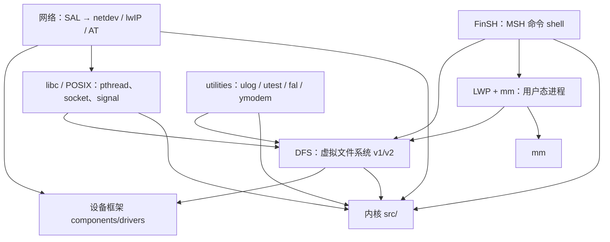
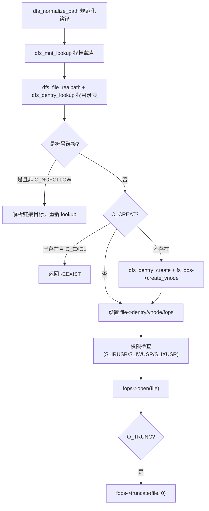
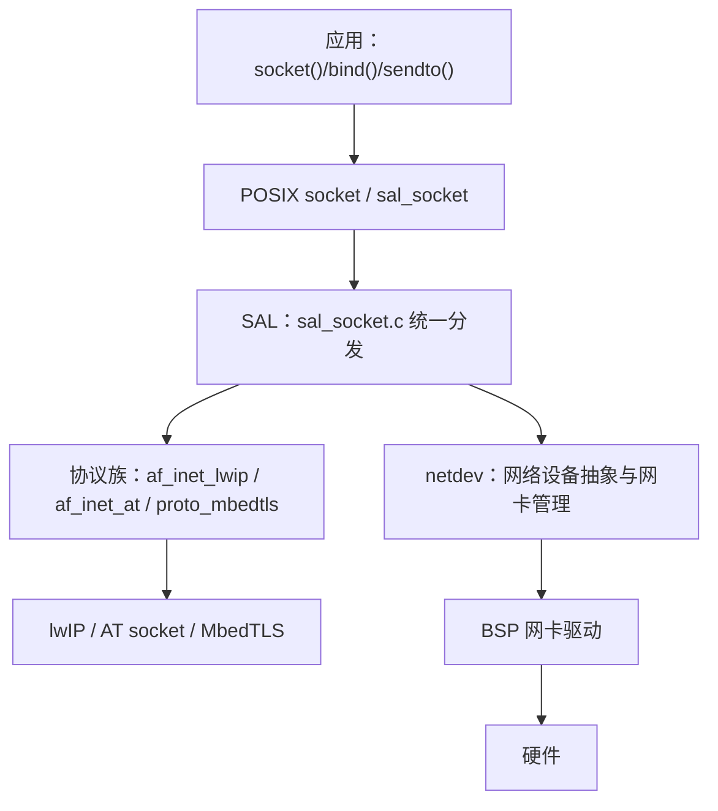
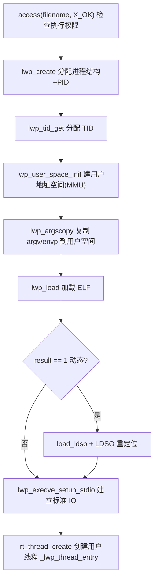

# 9. 组件层

内核与设备框架提供了“能跑线程、能访问硬件”的地基，但一个可用的系统还需要**文件系统、网络、命令行、标准库、用户态进程**这些“上半身”能力。它们都位于 `components/` 下，由 `rtconfig.h` 中的 `RT_USING_*` 宏按需裁剪。

本章说明各组件的定位、关键数据结构与函数、以及它们之间的依赖关系。

相关源码：

- [components/Kconfig](file:///workspace/components/Kconfig)：组件装配总入口
- [components/SConscript](file:///workspace/components/SConscript)：组件源码遍历与裁剪
- [finsh/](file:///workspace/components/finsh)：FinSH 命令行（`msh.c`、`shell.c`、`msh_file.c`、`cmd.c`）
- [dfs/](file:///workspace/components/dfs)：DFS 虚拟文件系统（`dfs_v1/`、`dfs_v2/`）
- [net/](file:///workspace/components/net)：SAL、netdev、lwIP、AT
- [libc/](file:///workspace/components/libc)：C 库适配与 POSIX 接口
- [lwp/](file:///workspace/components/lwp)、[mm/](file:///workspace/components/mm)：用户态进程与地址空间（RT-Thread Smart）
- [utilities/](file:///workspace/components/utilities)：ulog、utest、ymodem、var_export、resource_id
- [fal/](file:///workspace/components/fal)：Flash 抽象层
- [vbus/](file:///workspace/components/vbus)、[mprotect/](file:///workspace/components/mprotect)：虚拟总线与内存保护

---

## 9.1 组件层总览

### 9.1.1 装配规则

组件目录本身并不“总是被编译”，是否纳入构建由 [components/SConscript](file:///workspace/components/SConscript#L10-L16) 决定：遍历每个子目录，跳过 `remove_components` 列表中的项，再递归调用其 `SConscript`。而**是否把某个组件写成源码**则由各 `SConscript` 内部的 `GetDepend()` 判定。

配置侧的装配顺序见 [components/Kconfig](file:///workspace/components/Kconfig#L28-L46)：

| 条件 | 才 `source` 的组件 |
| --- | --- |
| `RT_USING_CONSOLE` | `finsh/Kconfig` |
| `!RT_USING_NANO` | dfs、fal、drivers、libc、net、mprotect、utilities、vbus |
| `RT_USING_SMART` | lwp、mm |

也就是说，**Nano 版**（`RT_USING_NANO`）只保留内核与 FinSH，其余组件全部不进配置树；**Smart 版**（`RT_USING_SMART`）额外启用用户态进程与 MMU 地址空间。

### 9.1.2 依赖关系概览



关键依赖链：**POSIX socket 依赖 SAL，SAL 依赖 netdev，netdev 底层是设备框架里的网卡设备**；**LWP 依赖 DFS v2（可执行文件加载）与 mm（地址空间）**；**FinSH 的文件命令依赖 DFS**。

---

## 9.2 FinSH 命令行

FinSH 是 RT-Thread 的组件化命令行，相当于系统的“交互终端”。它包含两套执行器：

- **MSH**（`msh.c`）：现代命令行，支持带参数命令与自动补全，是实际使用的入口。
- **传统 FinSH 表达式解释器**：只支持无参数函数调用，在 5.2.0 中已基本退化为导出机制。

### 9.2.1 目录结构

| 文件 | 职责 |
| --- | --- |
| `shell.c` | shell 线程主循环、行编辑、历史记录、`finsh_system_init()` |
| `msh.c` | 命令查找、参数切分、执行分发、自动补全 |
| `msh_file.c` | `ls`/`cd`/`cat`/`mount` 等文件系统命令，以及脚本执行 |
| `cmd.c` | `clear`/`version`/`list` 等基础命令 |
| `msh_parse.c` | `msh_isint`/`msh_ishex`/`msh_strtohex` 等解析辅助 |
| `finsh.h` | 命令导出宏与 `struct finsh_syscall` 定义 |

### 9.2.2 命令导出机制

用户在任意 `.c` 文件中写一行 `MSH_CMD_EXPORT(func, desc)`，函数就会被 shell “看见”。其原理是把描述符放入一个名叫 `FSymTab` 的链接段。定义见 [finsh.h](file:///workspace/components/finsh/finsh.h#L46-L82)：

```c
#define MSH_FUNCTION_EXPORT_CMD(name, cmd, desc, opt)                  \
    const char __fsym_##cmd##_name[] rt_section(".rodata.name") = #cmd; \
    const char __fsym_##cmd##_desc[] rt_section(".rodata.name") = #desc;\
    rt_used const struct finsh_syscall __fsym_##cmd rt_section("FSymTab") = \
    { __fsym_##cmd##_name, FINSH_DESC(cmd, desc) FINSH_COND(opt) (syscall_func)&name };

struct finsh_syscall
{
    const char *name;
#ifdef FINSH_USING_DESCRIPTION
    const char *desc;
#endif
#ifdef FINSH_USING_OPTION_COMPLETION
    struct msh_cmd_opt *opt;
#endif
    syscall_func func;          /* typedef long (*syscall_func)(void) */
};
```

`MSH_FUNCTION_EXPORT_CMD` 针对编译器有三套实现：MSVC 用 `__declspec(allocate("FSymTab$f"))`，TI 用 `PRAGMA(DATA_SECTION)`，其余（GCC/ArmCC/IAR）统一使用段属性宏 `rt_section()`。

在此之上封装了两个“用户友好”的宏（[finsh.h](file:///workspace/components/finsh/finsh.h#L142-L160)）：

- `MSH_CMD_EXPORT(...)`：由 `__MSH_GET_MACRO` 在 2 参 / 3 参（多一个 `a0##_msh_options` 选项描述）之间选择；
- `MSH_CMD_EXPORT_ALIAS(...)`：由 `__MSH_GET_EXPORT_MACRO` 在 3 参 / 4 参之间选择，可把函数以别名注册为命令。

**注意**：历史上用于导出“无参数函数”的 `FINSH_FUNCTION_EXPORT(name, desc)` 与 `FINSH_FUNCTION_EXPORT_ALIAS(...)`，在 5.2.0 中已经是**空宏**（[finsh.h](file:///workspace/components/finsh/finsh.h#L119-L130)）。也就是说：

```c
#define FINSH_FUNCTION_EXPORT(name, desc)              /* 什么都不做 */
#define FINSH_FUNCTION_EXPORT_ALIAS(name, alias, desc) /* 什么都不做 */
```

当前版本命令**只能通过 `MSH_CMD_EXPORT*` 注册**。若从旧代码移植，看到 `FINSH_FUNCTION_EXPORT` 需替换为 `MSH_CMD_EXPORT`。

### 9.2.3 命令表如何被发现

`FSymTab` 段的边界符号由编译器/链接器提供，`finsh_system_function_init()` 把它们取出来作为命令表起止。不同工具链的符号名不同：

| 工具链 | 段边界符号 |
| --- | --- |
| ArmCC | `FSymTab$$Base` / `FSymTab$$Limit` |
| IAR | `__section_begin("FSymTab")` / `__section_end("FSymTab")` |
| GCC / TI | `__fsymtab_start` / `__fsymtab_end` |
| MSC | 手工扫描 `__fsym_begin` / `__fsym_end` |

**注意**：如果 Kconfig 中关闭了 `FINSH_USING_SYMTAB`，则整张命令表不会被建立，所有 `MSH_CMD_EXPORT` 的命令在 shell 中都不可见。

### 9.2.4 shell 线程与行编辑

`finsh_system_init()`（[shell.c](file:///workspace/components/finsh/shell.c#L757)）通过 `INIT_APP_EXPORT`（level 6）在启动阶段自动执行，创建 shell 结构、信号量与线程：

```c
rt_thread_create(FINSH_THREAD_NAME, finsh_thread_entry, RT_NULL,
                 FINSH_THREAD_STACK_SIZE, FINSH_THREAD_PRIORITY, 10);
rt_sem_init(&shell->rx_sem, "shrx", 0, RT_IPC_FLAG_FIFO);
```

线程名默认 `tshell`（`FINSH_THREAD_NAME`），优先级 `FINSH_THREAD_PRIORITY`（默认 20），栈 `FINSH_THREAD_STACK_SIZE`（默认 4096）。

`finsh_thread_entry()`（[shell.c](file:///workspace/components/finsh/shell.c#L471)）的核心循环：

1. 从 `finsh_getchar()` 取一个字符；
2. 处理转义序列 `ESC [ A/B/C/D`（上/下/左/右方向键），实现历史回溯与光标移动；
3. `\t` 触发 `shell_auto_complete()` → `msh_auto_complete()` 补全；
4. `\r` / `\n` 把整行交给 `msh_exec(shell->line, shell->line_position)` 执行，然后重新打印提示符并清行；
5. 退格键（`0x7f` / `0x08`）用 `rt_memmove` 整理行内字符。

超过 `FINSH_CMD_SIZE`（默认 80）的行会被截断或丢弃。

### 9.2.5 命令的解析与执行

`msh_exec()`（[msh.c](file:///workspace/components/finsh/msh.c#L484)）是一条**逐级兜底链**：

```c
if (_msh_exec_cmd(cmd, length, &cmd_ret) == 0)   /* 1. 内置命令 */
    return cmd_ret;
if (msh_exec_script(cmd, length) == 0)           /* 2. 脚本文件（.sh 逐行执行） */
    return 0;
if (msh_exec_module(cmd, length) == 0)           /* 3. 动态模块 .mo（dlmodule_exec） */
    return 0;
cmd_ret = _msh_exec_lwp(0, cmd, length);         /* 4. LWP 可执行文件（Smart） */
if (cmd_ret > 0)
    return 0;
rt_kprintf("%s: command not found.\n", cmd);     /* 全部失败 */
```

- `_msh_exec_cmd()` → `msh_split()` 把命令行按空格切成参数（支持双引号与 `\"` 转义，超 `FINSH_ARG_MAX` 截断），再 `msh_get_cmd()` 拿首个参数去命令表里线性 `strncmp` 精确匹配（要求 `name[size]=='\0'`）；
- `msh_get_cmd()` 返回 `struct finsh_syscall *`，进而调用其 `func()`；
- 脚本执行见 [msh_file.c](file:///workspace/components/finsh/msh_file.c#L69) 的 `msh_exec_script()`；
- LWP 路径见 [msh.c](file:///workspace/components/finsh/msh.c#L423) 的 `_msh_exec_lwp()`。

这解释了为什么同一个命令可能走不同路径：`ps` 是内置命令，`hello.sh` 走脚本，`/bin/hello` 走 LWP 可执行文件。

### 9.2.6 内置文件命令

`msh_file.c` 通过 `MSH_CMD_EXPORT_ALIAS` 注册了整套 UNIX 风格文件命令（[msh_file.c](file:///workspace/components/finsh/msh_file.c#L182-L1140)）：

| 命令 | 函数 | 命令 | 函数 |
| --- | --- | --- | --- |
| `ls` | `cmd_ls` | `mkdir` | `cmd_mkdir` |
| `cd` | `cmd_cd` | `mkfs` | `cmd_mkfs` |
| `pwd` | `cmd_pwd` | `mount` | `cmd_mount` |
| `cat` | `cmd_cat` | `umount` | `cmd_umount` |
| `rm` | `cmd_rm` | `df` | `cmd_df` |
| `cp` | `cmd_cp` | `echo` | `cmd_echo` |
| `mv` | `cmd_mv` | `tail` | `cmd_tail` |
| `ln` / `link` | `cmd_ln` / `cmd_link` | `chmod` | `cmd_chmod` |

### 9.2.7 Kconfig 选项

[finsh/Kconfig](file:///workspace/components/finsh/Kconfig) 的要点：

- `RT_USING_MSH`：Nano 下默认 n，其余默认 y；选中后隐式启用 `RT_USING_FINSH` 与 `FINSH_USING_MSH`。
- `FINSH_THREAD_NAME "tshell"`、`FINSH_THREAD_PRIORITY 20`、`FINSH_THREAD_STACK_SIZE 4096`。
- `FINSH_USING_HISTORY` + `FINSH_HISTORY_LINES 5`：方向键历史。
- `FINSH_USING_SYMTAB`：命令表开关（**关闭则命令全部不可用**）。
- `MSH_USING_BUILT_IN_COMMANDS`：是否编入 `cmd.c`/`msh_file.c` 的内置命令。
- `FINSH_USING_DESCRIPTION`：是否保存命令描述（`msh_help` 用）。
- `FINSH_USING_AUTH` + 默认密码 `"rtthread"`：串口登录鉴权。
- `FINSH_ARG_MAX 10`：单条命令最大参数数。
- `FINSH_USING_OPTION_COMPLETION`：命令参数级自动补全。

---

## 9.3 DFS 虚拟文件系统

DFS（Device File System）把块设备、内存、Flash 等统一抽象成“文件”，对上提供 POSIX 风格接口，对下对接各种具体文件系统。

### 9.3.1 v1 与 v2 两代实现

`dfs/Kconfig` 用 choice 在两者间切换：

| 版本 | 条件 | 特点 |
| --- | --- | --- |
| `RT_USING_DFS_V1` | `depends on !RT_USING_SMART`（默认） | 静态数组表，轻量 |
| `RT_USING_DFS_V2` | `select RT_USING_DEVICE_OPS`，Smart 下默认 | 链表 + dentry/vnode，支持挂载树、page cache |

通用选项：`DFS_USING_POSIX`（暴露 POSIX 接口）、`DFS_USING_WORKDIR`（支持工作目录）、`DFS_FD_MAX 16`。

v1 专属：`DFS_FILESYSTEMS_MAX 4`、`DFS_FILESYSTEM_TYPES_MAX 4`、`RT_USING_DFS_MNTTABLE`（静态挂载表）、RAMFS、NFS。
v2 专属：`RT_USING_PAGECACHE`（`depends on RT_USING_SMART`）。

### 9.3.2 支持的子文件系统

`dfs/*/filesystems/` 下按 `SConscript` 独立裁剪：

| 文件系统 | v1 | v2 | 说明 |
| --- | --- | --- | --- |
| `elmfat`（`dfs_elm.c` + FatFs `ff.c`） | ✓ | ✓ | FAT/exFAT，配合块设备 |
| `devfs` | ✓ | ✓(+`devtmpfs`) | 把 `rt_device` 映射成 `/dev/*` |
| `ramfs` | ✓ | ✓ | 内存文件系统 |
| `romfs` | ✓ | ✓ | 只读 ROM 文件系统 |
| `tmpfs` | ✓ | ✓ | 临时文件系统 |
| `mqueue` | ✓ | ✓ | POSIX 消息队列文件 |
| `cromfs` | ✓ | ✓ | 压缩 ROM 文件系统 |
| `nfs` | ✓ | — | 网络文件系统 |
| `ptyfs` | — | ✓ | 伪终端文件系统（LWP 终端） |
| `skeleton` | ✓ | ✓ | 新文件系统移植模板 |

### 9.3.3 v1：静态表模型

v1 用两个固定长度数组承载全部挂载信息：

```c
static struct dfs_filesystem_ops *filesystem_operation_table[DFS_FILESYSTEM_TYPES_MAX];
static struct dfs_filesystem      filesystem_table[DFS_FILESYSTEMS_MAX];
```

- `dfs_register(ops)`（[dfs_fs.c](file:///workspace/components/dfs/dfs_v1/src/dfs_fs.c#L31)）把文件系统操作集填入 ops 表；
- `dfs_mount(device_name, path, filesystemtype, rwflag, data)`（[dfs_fs.c](file:///workspace/components/dfs/dfs_v1/src/dfs_fs.c#L214)）：
  1. `rt_device_find()` 找设备；
  2. 扫 ops 表按名字 `strncmp` 匹配文件系统；
  3. `dfs_normalize_path()` 规范化挂载点路径；
  4. 非 `"/"`、非 `"/dev"` 时用 `dfs_file_open(O_RDONLY|O_DIRECTORY)` 校验挂载点存在；
  5. 在 `filesystem_table` 找空槽并查重（重复挂载返回 `-EINVAL`）；
  6. 填 `path/ops/dev_id/data`，`rt_device_open(dev, RT_DEVICE_OFLAG_RDWR)`；
  7. 调 `(*ops)->mount(fs, rwflag, data)`，失败则清槽并 `rt_device_close`。

关键结构（[dfs_fs.h](file:///workspace/components/dfs/dfs_v1/include/dfs_fs.h#L30-L101)）：

```c
struct dfs_filesystem_ops
{
    char *name;                         /* 文件系统名 */
    rt_uint32_t flags;                  /* DFS_FS_FLAG_* */
    const struct dfs_file_ops *fops;   /* 文件操作集 */
    int (*mount)(struct dfs_filesystem *fs, unsigned long rwflag, const void *data);
    int (*unmount)(struct dfs_filesystem *fs);
    int (*mkfs)(rt_device_t dev_id);    /* 格式化 */
    int (*statfs)(struct dfs_filesystem *fs, struct statfs *buf);
    int (*unlink)(struct dfs_filesystem *fs, const char *pathname);
    int (*stat)(struct dfs_filesystem *fs, const char *filename, struct stat *buf);
    int (*rename)(struct dfs_filesystem *fs, const char *old, const char *new);
};

struct dfs_filesystem
{
    rt_device_t dev_id;   /* 底层设备 */
    char *path;           /* 挂载点 */
    const struct dfs_filesystem_ops *ops;
    void *data;           /* 文件系统私有数据 */
};
```

### 9.3.4 v2：dentry / vnode / mnt 模型

v2 借用类 UNIX 的树形结构，四级对象相互作用：

- **`struct dfs_mnt`（挂载点）**：`parent/sibling/child` 构成挂载树，含 `fullpath`、`ref_count`、`dev_id`、`fs_ops`、`data` 与标志位 `MNT_IS_ALLOCED/MNT_IS_ADDLIST/MNT_IS_MOUNTED/MNT_IS_UMOUNT/MNT_IS_LOCKED/MNT_FORCE`（[dfs_mnt.h](file:///workspace/components/dfs/dfs_v2/include/dfs_mnt.h)）。
- **`struct dfs_dentry`（目录项）**：`pathname`、`vnode`、`mnt`、`ref_count` 及标志 `DENTRY_IS_MOUNTED/ALLOCED/ADDHASH/OPENED`。
- **`struct dfs_vnode`（虚拟节点）**：描述文件本身——`mode`、`type`、`size`、`nlink`、`fops`、`uid/gid`、`atime/mtime/ctime`、可选 `aspace`（page cache 地址空间）。
- **`struct dfs_file`（打开的文件）**：`magic 0xfdfd`、`flags`、`fpos`、`fops`、`dentry`、`vnode`、`mmap_context`。

v2 用**单向链表**管理已注册的文件系统类型，`_find_filesystem()` 按名查找；`dfs_mount()`（[dfs_fs.c](file:///workspace/components/dfs/dfs_v2/src/dfs_fs.c#L106)）分两条路：

- **根文件系统**：`dfs_mnt_create(path)` → 校验 `MNT_IS_MOUNTED` → `dfs_mnt_insert(NULL, mnt)`；
- **子挂载**：先 `dfs_dentry_lookup()` 找到挂载点目录，再插入。

两条路都要 `dfs_mnt_unref()` 平衡 `dfs_mnt_create()` 时建立的引用（源码注释专门解释了根 mnt 的两个引用来源）。错误码从 v1 的 `-ENODEV/-ENOSYS/-ENOTDIR/-EINVAL/-ENOSPC` 改为 `-EPERM/-ENOENT/-ENODEV/-ENOTDIR/-EEXIST/-ENOMEM`。卸载由 `dfs_umount(specialfile, flags)`（支持 `MNT_FORCE` 强制）与 `dfs_unmount()` 承担。

文件系统操作集也随之变化（[dfs_fs.h](file:///workspace/components/dfs/dfs_v2/include/dfs_fs.h)）：

```c
struct dfs_filesystem_ops
{
    const char *name;
    rt_uint32_t flags;                        /* FS_NEED_DEVICE 0x1 */
    int (*mount)(struct dfs_mnt *mnt);
    int (*umount)(struct dfs_mnt *mnt);
    int (*statfs)(struct dfs_mnt *mnt, struct statfs *buf);
    struct dfs_vnode *(*lookup)(struct dfs_dentry *dentry, ...);
    struct dfs_vnode *(*create_vnode)(struct dfs_dentry *dentry, int type, mode_t mode);
    int (*free_vnode)(struct dfs_vnode *vnode);
};
```

### 9.3.5 打开文件的全流程（v2）

`dfs_file_open()`（[dfs_file.c](file:///workspace/components/dfs/dfs_v2/src/dfs_file.c#L409)）是 v2 的核心路径：



`dfs_dentry_lookup()`（[dfs_dentry.c](file:///workspace/components/dfs/dfs_v2/src/dfs_dentry.c#L199)）先查哈希表，未命中再调文件系统的 `fs_ops->lookup()` 现场创建 vnode 并挂入哈希，体现了“按需缓存”的设计。

### 9.3.6 POSIX 接口层

`dfs_posix.c` 是面向应用的接口，v2 提供（[dfs_posix.c](file:///workspace/components/dfs/dfs_v2/src/dfs_posix.c)）：

| 类别 | 函数 |
| --- | --- |
| 打开关闭 | `open`(38)、`openat`(84)、`close`(258) |
| 读写 | `read`(299)、`write`(344)、`pread`(1345)、`pwrite`(1392) |
| 定位 | `lseek`(386) |
| 属性 | `stat`(492)、`fstat`(520)、`fsync`(560)、`fcntl`(591)、`ioctl`(639)、`ftruncate`(663)、`statfs`(704) |
| 目录 | `mkdir`(772)、`rmdir`(822)、`opendir`(888)、`readdir`(947)、`closedir`(1099)、`chdir`(1143)、`setcwd`(1266) |
| 其他 | `rename`(422)、`unlink`(452) |

`dfs_v2/include/dfs.h` 中还定义了 `dfs_fflags()` / `dfs_oflags()` 两个 inline 函数，在 POSIX `O_*` 标志与 DFS 内部 `DFS_F_*` 标志之间互转。

### 9.3.7 v2 page cache

开启 `RT_USING_PAGECACHE` 后，v2 增加一层页缓存（[dfs_pcache.h](file:///workspace/components/dfs/dfs_v2/include/dfs_pcache.h)）：

- `struct dfs_page`：单个缓存页；
- `struct dfs_aspace`：地址空间，挂在 vnode 的 `aspace` 上，含 `ops`、`lock`、`ref_count`；
- `struct dfs_pcache`：全局缓存器，`head[RT_PAGECACHE_HASH_NR=1024]` 哈希桶 + `list_active/inactive` 活跃/非活跃 LRU 链表，另有 `mqueue`、`last_time_wb`（回写时间）；
- 接口：`dfs_aspace_mmap/unmap/page_dirty`、`dfs_aspace_clean`（truncate 前调用，见 [dfs_file.c](file:///workspace/components/dfs/dfs_v2/src/dfs_file.c#L638-L643)）。

### 9.3.8 SConscript 裁剪

- [dfs/SConscript](file:///workspace/components/dfs/SConscript)：遍历子目录；
- [dfs_v1/SConscript](file:///workspace/components/dfs/dfs_v1/SConscript)：仅当 `RT_USING_DFS && !RT_USING_DFS_V2` 时编 `dfs.c` / `dfs_file.c` / `dfs_fs.c`（`DFS_USING_POSIX` 时加 `dfs_posix.c`）；
- [dfs_v2/SConscript](file:///workspace/components/dfs/dfs_v2/SConscript)：`Glob('src/*.c')`，`!RT_USING_SMART` 时移除 `src/dfs_file_mmap.c`。

---

## 9.4 网络组件

网络栈采用**三层解耦**：SAL（统一 socket 抽象）→ netdev（网络设备抽象）→ 具体协议栈（lwIP / AT）。

### 9.4.1 分层结构



### 9.4.2 SAL 套接字抽象层

`RT_USING_SAL` 默认关闭，开启时 `select RT_USING_NETDEV`（[sal/Kconfig](file:///workspace/components/net/sal/Kconfig)）。对接的协议栈由 `SAL_USING_LWIP` / `SAL_USING_AT` / `SAL_USING_TLS` 选择；`SAL_USING_POSIX` 让 BSD socket 可被文件系统 API 操作（`read`/`write`/`select`/`poll`）。

`sal_init()`（[sal_socket.c](file:///workspace/components/net/sal/src/sal_socket.c#L133)，`INIT_COMPONENT_EXPORT`，level 4）在组件初始化阶段建立：

- `socket_table`：SAL 自己的套接字表（大小按 `SAL_SOCKETS_NUM` 或 POSIX 步长）；
- `sal_dev_res_tbl`：设备资源表；
- `rt_mutex_init(&sal_core_lock, "sal_lock", RT_IPC_FLAG_PRIO)`。

`sal_socket()`（[sal_socket.c](file:///workspace/components/net/sal/src/sal_socket.c#L1033)）体现了抽象层的关键转换：

```c
socket_new()                        /* 分配 SAL 套接字对象 */
sal_get_socket()
socket_init(domain, type, protocol, &sock)  /* 绑定协议族 */
SAL_NETDEV_SOCKETOPS_VALID(...)             /* 校验网卡可用 */
pf->skt_ops->socket()                       /* 调协议栈真正的 socket() */
sock->user_data = 协议栈 fd                 /* 保存底层 fd */
return sock->socket;                        /* 返回 SAL 自己的 fd 给应用 */
```

关键结构见 [sal_low_lvl.h](file:///workspace/components/net/sal/include/sal_low_lvl.h#L45-L122)：

```c
struct sal_socket {                  /* SAL 层套接字 */
    int32_t magic; int socket; int domain; int type; int protocol;
    struct netdev *netdev; void *user_data;   /* user_data 存协议栈 fd */
};

struct sal_socket_ops {              /* 协议栈需实现的 19 个操作 */
    int (*socket)(...); int (*bind)(...); int (*listen)(...);
    int (*connect)(...); int (*accept)(...);
    int (*sendto)(...); int (*recvfrom)(...);
    int (*getsockopt)(...); int (*setsockopt)(...);
    int (*shutdown)(...); int (*getpeername)(...); int (*getsockname)(...);
    int (*ioctlsocket)(...); int (*poll)(...); /* 可选 */
    ...
};

struct sal_proto_family {            /* 协议族：AF_INET 等 */
    int family; int sec_family;
    const struct sal_socket_ops *skt_ops;
    const struct sal_netdb_ops *netdb_ops;   /* gethostbyname/getaddrinfo */
};
```

### 9.4.3 lwIP 对接

`af_inet_lwip.c` 把 lwIP 适配成 SAL 的协议族（[af_inet_lwip.c](file:///workspace/components/net/sal/impl/af_inet_lwip.c#L280-L350)）：

- `lwip_socket_ops`：`inet_socket` / `lwip_close/bind/listen/connect` / `inet_accept` / `lwip_sendto/recvfrom` / `lwip_getsockopt/setsockopt/shutdown` / `inet_poll` 等；`sendmsg/recvmsg` 仅在 `LWIP_VERSION >= 0x20102ff` 时提供，`socketpair` 恒为 `NULL`；
- `lwip_netdb_ops`：把 `gethostbyname` / `getaddrinfo` 映射到 lwIP 的 DNS；
- `lwip_inet_family`：`family = AF_INET`，在 lwIP 2.0+ 时附带 `AF_INET6` 副族。

最关键的绑定函数是 `sal_lwip_netdev_set_pf_info()`（[af_inet_lwip.c](file:///workspace/components/net/sal/impl/af_inet_lwip.c#L342)）：它把 `&lwip_inet_family` 写入 `netdev->sal_user_data`，从而让每个网卡知道“我是由哪个协议族驱动的”。

lwIP 本身支持三个版本（[lwip/Kconfig](file:///workspace/components/net/lwip/Kconfig)）：v1.4.1（`0x10401`）、v2.0.3（`0x20003`，默认）、v2.1.2（`0x20102`），或在线最新版（`0x99999`）。`RT_USING_LWIP_VER_NUM` 十六进制值驱动版本条件编译。

### 9.4.4 netdev 网络设备

**注意**：netdev 是**独立于 `rt_device` 的抽象**——网卡不注册为常规 `rt_device`，而是挂入自己的 `netdev_list`。这是它与串口、SPI 等设备类最大的不同。

`struct netdev` 与标志定义在 [netdev.h](file:///workspace/components/net/netdev/include/netdev.h#L40-L149)：

```c
struct netdev
{
    rt_slist_t list;                  /* 全局网络设备链表 */
    char name[RT_NAME_MAX];
    struct netdev_ipaddr ip_addr;     /* ip/netmask/gw */
    struct netdev_ipaddr netmask;
    struct netdev_ipaddr gw;
#ifdef NETDEV_USING_IPV6
    struct netdev_ipaddr ip6_addr[NETDEV_IPV6_NUM_ADDRESSES];
#endif
    struct netdev_ipaddr dns_servers[NETDEV_DNS_SERVERS_NUM];
    rt_uint8_t hwaddr_len; rt_uint8_t hwaddr[NETDEV_HWADDR_MAX_LEN];
    rt_uint16_t flags;
    rt_uint16_t mtu;
    const struct netdev_ops *ops;
    netdev_callback_t status_callback;   /* 状态/地址变化回调 */
    netdev_callback_t addr_callback;
#ifdef RT_USING_SAL
    void *sal_user_data;                 /* 指向协议族 */
#endif
    void *user_data;
};

struct netdev_ops
{
    int (*set_up)(struct netdev *);
    int (*set_down)(struct netdev *);
    int (*set_addr_info)(...);
    int (*set_dns_server)(...);
    int (*set_dhcp)(struct netdev *, rt_bool_t);
    int (*ping)(...); int (*netstat)(...);   /* 可选 */
    int (*set_default)(struct netdev *);
};
```

标志位：`NETDEV_FLAG_UP 0x01`、`BROADCAST 0x02`、`LINK_UP 0x04`、`ETHARP 0x08`、`ETHERNET 0x10`、`IGMP 0x20`、`MLD6 0x40`、`INTERNET_UP 0x80`、`DHCP 0x100`。`enum netdev_cb_type` 定义了 14 种事件（注册/注销、UP/DOWN、LINK、INTERNET、地址变化、DHCP 等）。

`netdev_register(netdev, name, user_data)`（[netdev.c](file:///workspace/components/net/netdev/src/netdev.c#L56)）流程：

1. 清 `UP/LINK_UP/INTERNET_UP/DHCP` 标志位，清零 IP 并设 `IPADDR_TYPE_V4`；
2. 名字超 `RT_NAME_MAX` 打警告并截断；
3. `rt_spin_lock_irqsave` 保护下把设备头插或尾插 `netdev_list`；
4. 若是首个设备则设为默认；
5. 触发 `NETDEV_CB_REGISTER` 回调与 `rtnl_ip_notify` 通知。

其余常用接口：`netdev_set_up/down`(448/484)、`netdev_get_by_name`(308)、`netdev_set_default`(408)、`netdev_low_level_set_status/link_status/internet_status`(867/900/944)，以及 `ifconfig`/`ping`/`netstat` 命令实现（1168/1302/1423）。

### 9.4.5 AT 组件

`RT_USING_AT`（[at/Kconfig](file:///workspace/components/net/at/Kconfig)）用于通过串口跑 AT 命令：

- `AT_USING_SERVER`：设备作为 AT 服务器（默认 `uart3`）；
- `AT_USING_CLIENT`：设备作为 AT 客户端，`AT_CLIENT_NUM_MAX` 控制数量；
- `AT_USING_SOCKET`：`select RT_USING_SAL` + `SAL_USING_AT`，让 AT 模组提供标准 BSD socket；
- `AT_USING_CLI`：提供 `at` 命令行（依赖 FinSH）。

AT 与 SAL 的对接实现在 `af_inet_at.c`，与 lwIP 的对接方式完全对称。

---

## 9.5 libc / POSIX

### 9.5.1 C 库适配层

`components/libc/compilers/` 下按工具链选择 libc 适配：

| 子目录 | 适用 | 关键宏 |
| --- | --- | --- |
| `newlib` | GCC（`GetNewLibVersion`） | `RT_USING_NEWLIBC`、`_POSIX_C_SOURCE=1`，链接 `-lc -lm` |
| `armlibc` | ArmCC / ArmClang | `RT_USING_ARMLIBC`、`__STDC_LIMIT_MACROS` |
| `dlib` | IAR（`iccarm`） | `RT_USING_DLIBC`、`_DLIB_FILE_DESCRIPTOR` |
| `musl` / `picolibc` | 对应工具链 | — |
| `common` | 所有 | `cstring.c`/`cstdlib.c`/`ctime.c`/`cunistd.c` 等自实现 |

各工具链的 `syscalls.c` 把 `_open`/`_read`/`_write`/`_close`/`_lseek`/`_fstat` 等系统调用转接到 RT-Thread 的 DFS/POSIX 接口，这是“让 `printf` 能输出、让 `fopen` 能读文件”的桥梁。

[libc/SConscript](file:///workspace/components/libc/SConscript#L10-L14) 在 `RT_USING_NANO` 下**整体跳过** libc 组件。

### 9.5.2 POSIX 子功能

`RT_USING_POSIX_FS`（[posix/Kconfig](file:///workspace/components/libc/posix/Kconfig)）是 POSIX 的总开关，`select` DFS 与 `DFS_USING_POSIX`。其下逐项开启：

| 选项 | 作用 | 依赖 |
| --- | --- | --- |
| `POSIX_DEVIO` | `open("/dev/xxx")` 设备读写 | `select RT_USING_DEVICE` |
| `POSIX_STDIO` | `stdin/stdout/stderr` | — |
| `POSIX_POLL` / `POSIX_SELECT` | I/O 多路复用 | — |
| `POSIX_EVENTFD` / `POSIX_EPOLL` / `POSIX_SIGNALFD` / `POSIX_TIMERFD` | 事件/EPOLL/信号/定时器 fd | Smart 相关 |
| `POSIX_SOCKET` | BSD socket | `select RT_USING_SAL` |
| `POSIX_TERMIOS` | 终端属性 | — |
| `POSIX_AIO` | 异步 I/O | — |
| `POSIX_MMAN` | `mmap` 等 | — |

并列的还有 `POSIX_DELAY`（`select RT_USING_KTIME`）、`POSIX_CLOCK`、`POSIX_TIMER`、`RT_USING_PTHREADS`（`PTHREAD_NUM_MAX 8`）、`RT_USING_MODULE`（dlopen/dlsym/dlclose）。

### 9.5.3 pthread 实现

`posix/pthreads/pthread.c` 把 pthread 语义映射到 RT-Thread 线程（[pthread.c](file:///workspace/components/libc/posix/pthreads/pthread.c)）：

| pthread API | 行号 | 映射到 |
| --- | --- | --- |
| `pthread_create` | 177 | `rt_thread_create` + 属性（优先级/栈/分离态） |
| `pthread_detach` | 298 | 设置分离态，回收交由内核 |
| `pthread_join` | 342 | 等待线程结束 |
| `pthread_self` | 384 | 取当前线程对应的 pthread |
| `pthread_setschedparam` / `getschedparam` | 439/427 | `rt_thread_control` |
| `pthread_exit` | 464 | 线程退出 |
| `pthread_once` | 528 | 一次性初始化 |
| `pthread_kill` | 554 | POSIX 信号 |
| `pthread_cancel` | 730 | 取消请求 |

配套还有 `pthread_mutex.c`、`pthread_cond.c`、`pthread_rwlock.c`、`pthread_barrier.c`、`pthread_spin.c`、`pthread_tls.c`，分别用内核互斥量、信号量、事件等实现。

`posix/signal/posix_signal.c` 提供 POSIX 信号，与 LWP 的 `lwp_signal.c` 协同。

### 9.5.4 libdl 动态模块

`posix/libdl/` 实现 `dlopen` / `dlsym` / `dlclose` / `dlerror`（`RT_USING_MODULE` 开启时），底层是 `dlmodule.c` + `dlelf.c`（ELF 解析器），让系统可以加载 `.mo` 动态模块。

---

## 9.6 LWP 与地址空间（RT-Thread Smart）

`RT_USING_LWP`（[lwp/Kconfig](file:///workspace/components/lwp/Kconfig)，`depends on RT_USING_SMART`，默认 y）在 RT-Thread Smart 上提供**用户态进程**能力：应用运行在独立的地址空间与较低特权级，通过系统调用进入内核。

### 9.6.1 目录结构

| 文件/目录 | 职责 |
| --- | --- |
| `lwp.c` | 进程创建/加载/执行（`lwp_execve`）、线程入口 |
| `lwp_pid.c` | PID/TID 分配、`lwp_terminate` |
| `lwp_syscall.c` | 系统调用分发（`syscall_generic.h` 生成） |
| `lwp_mm.c` / `lwp_user_mm.c` | 用户态内存读写、地址空间操作 |
| `lwp_elf.c` | ELF 可执行文件加载 |
| `lwp_signal.c` / `lwp_futex.c` / `lwp_shm.c` / `lwp_ipc.c` | 信号、futex、共享内存、IPC |
| `lwp_pgrp.c` / `lwp_session.c` / `lwp_jobctrl.c` | 进程组、会话、作业控制 |
| `terminal/` | 终端（tty/pts）实现 |
| `arch/` | 目标架构相关（risc-v rv64、x86 i386） |

### 9.6.2 `struct rt_lwp`

进程控制块（[lwp.h](file:///workspace/components/lwp/lwp.h#L115-L199)）：

```c
struct rt_lwp
{
    struct rt_mm_aspace *aspace;      /* 地址空间（MMU） */
    struct rt_lwp_mpu_info mpu_info;  /* MPU 模式信息 */
    enum rt_lwp_type type;            /* LWP_TYPE_FIX_ADDR / DYN_ADDR */
    struct rt_lwp *parent;            /* 父子进程 */
    struct rt_lwp *first_child;
    struct rt_lwp *sibling;
    rt_list_t waitpid_waiters;
    rt_uint32_t lwp_status;
    rt_atomic_t ref;
    pid_t pid; pid_t sid; pid_t pgid;
    struct lwp_pgrp *pgrp;
    struct dfs_fdtable fdt;           /* 文件描述符表 */
    struct dfs_file *exe_file;        /* 可执行文件 */
    struct lwp_signal signal;
    struct rt_object *object_root; rt_mutex_t object_mutex;
    struct rt_user_context user_ctx;
    struct rt_wqueue wait_queue;
    struct tty_struct *tty;
    char working_directory[DFS_PATH_MAX];
    ...
};
```

`lwp_type`：`LWP_TYPE_FIX_ADDR 0x01`（固定地址，静态链接）与 `LWP_TYPE_DYN_ADDR 0x02`（动态地址，需重定位，配合 LDSO）。

关键 Kconfig：`RT_LWP_MAX_NR 30`（最大进程数）、`LWP_TASK_STACK_SIZE 16384`、`RT_CH_MSG_MAX_NR 1024`、`LWP_TID_MAX_NR 64`、`LWP_ENABLE_ASID`、`RT_LWP_SHM_MAX_NR 64`（MMU）/`RT_LWP_MPU_MAX_NR 2`（MPU）、`RT_USING_LDSO`（`depends on DFS_V2`，`select PAGECACHE`）。

### 9.6.3 进程加载 `lwp_execve()`

`lwp_execve(filename, debug, argc, argv, envp)`（[lwp.c](file:///workspace/components/lwp/lwp.c#L1316)）是“启动一个用户程序”的入口：



`MSH` 中执行的 `/bin/xxx` 命令正是经 `_msh_exec_lwp()`（[msh.c](file:///workspace/components/finsh/msh.c#L423)）走到这里。

### 9.6.4 mm 地址空间管理

`components/mm/` 为 Smart 提供虚拟内存管理：

| 文件 | 职责 |
| --- | --- |
| `mm_aspace.c` | 地址空间对象、VMA 区间管理（AVL 树） |
| `mm_page.c` | 物理页框分配与映射 |
| `mm_fault.c` | 缺页异常处理 |
| `mm_anon.c` | 匿名映射（堆、栈） |
| `mm_kmem.c` | 内核堆与用户空间绑定 |
| `mm_memblock.c` | memory block 保留区管理 |
| `ioremap.c` | 物理地址外部映射 |

`avl_adpt.c` 把通用 AVL 树（`utilities/libadt/avl`）适配为地址空间查找结构。

---

## 9.7 utilities 工具组件

### 9.7.1 ulog 日志

ulog 是分级日志系统（[utilities/Kconfig](file:///workspace/components/utilities/Kconfig#L18-L200)）。级别常量与 syslog 兼容（[ulog_def.h](file:///workspace/components/utilities/ulog/ulog_def.h#L20-L25)）：

| 级别 | 值 |
| --- | --- |
| `LOG_LVL_ASSERT` | 0 |
| `LOG_LVL_ERROR` | 3 |
| `LOG_LVL_WARNING` | 4 |
| `LOG_LVL_INFO` | 6 |
| `LOG_LVL_DBG` | 7 |

**编译期双重裁剪**：只有当文件级 `LOG_LVL` 与全局 `ULOG_OUTPUT_LVL` 都允许该级别时，日志代码才会被编入 ROM：

```c
#if (LOG_LVL >= LOG_LVL_INFO) && (ULOG_OUTPUT_LVL >= LOG_LVL_INFO)
    #define ulog_i(TAG, ...)  ulog_output(LOG_LVL_INFO, TAG, RT_TRUE, __VA_ARGS__)
#else
    #define ulog_i(TAG, ...)
#endif
```

`LOG_TAG` 与 `LOG_LVL` 有兼容回退链（[ulog_def.h](file:///workspace/components/utilities/ulog/ulog_def.h#L57-L77)）：`DBG_TAG` → `DBG_SECTION_NAME` → `"NO_TAG"`；`DBG_LVL` → `DBG_LEVEL` → `LOG_LVL_DBG`。

初始化：

- `ulog_init()`（[ulog.c](file:///workspace/components/utilities/ulog/ulog.c#L1461)，`INIT_BOARD_EXPORT`，level 1）：最早建立日志基础；
- `ulog_async_init()`（[ulog.c](file:///workspace/components/utilities/ulog/ulog.c#L1499)，`INIT_PREV_EXPORT`，level 2）：开启异步输出时创建 `"ulog_async"` 线程，由它从缓冲区取日志并输出。

后端机制：`ulog_backend_register(backend, name, support_color)`（[ulog.c](file:///workspace/components/utilities/ulog/ulog.c#L1263)）注册输出后端，内置 console（`console_be.c`）与 file（`file_be.c`）两种。运行时过滤：`ulog_global_filter_lvl_set`(1022)、`ulog_be_lvl_filter_set`、`ulog_tag_lvl_filter_set`。

格式化选项（`ULOG_OUTPUT_TIME`、`ULOG_OUTPUT_LEVEL`、`ULOG_OUTPUT_TAG`、`ULOG_OUTPUT_THREAD_NAME`、`ULOG_USING_COLOR`）控制日志头部内容；`ULOG_OUTPUT_FLOAT` 需要 `PKG_USING_RT_VSNPRINTF_FULL`。

**注意**：`ULOG_USING_ISR_LOG` 默认关闭，此时在中断里调用日志接口不受保护，可能破坏输出。

### 9.7.2 utest 单元测试框架

`RT_USING_UTEST`（`UTEST_THR_STACK_SIZE 4096`、`UTEST_THR_PRIORITY 20`）提供测试用例注册与执行。测试用 `UTEST_TC_EXPORT(testcase, name, init, cleanup, timeout)` 注册（[utest.h](file:///workspace/components/utilities/utest/utest.h#L141-L153)，含 `struct utest_tc_export`），断言用 `utest_assert.h` 中的 `uassert_*` 系列。执行入口可由 MSH 命令触发。

### 9.7.3 fal Flash 抽象层

`RT_USING_FAL`（[fal/Kconfig](file:///workspace/components/fal/Kconfig)）在块设备与文件系统之间提供“**分区（partition）**”抽象：

- `FAL_PART_HAS_TABLE_CFG`：使用静态分区表 `fal_cfg.h`；
- `FAL_USING_SFUD_PORT`：对接 SFUD 串行 Flash 驱动。

核心接口（[fal.h](file:///workspace/components/fal/inc/fal.h)）：`fal_flash_device_find`、`fal_partition_find`、`fal_get_partition_table`、`fal_partition_read/write/erase/erase_all`。

典型用法是把分区当作独立块设备挂载文件系统，或直接读写原始 Flash 数据。

### 9.7.4 其他工具

| 组件 | 开关 | 说明 |
| --- | --- | --- |
| Ymodem | `RT_USING_RYM` | 串口文件传输，`YMODEM_USING_FILE_TRANSFER` 需 DFS |
| var_export | `RT_USING_VAR_EXPORT` | 把变量导出到 shell（`var_export.c` + `var_export_cmd.c`） |
| resource_id | `RT_USING_RESOURCE_ID` | 资源 ID 分配（`resource_id.c` + 位图 `rid_bitmap.c`） |
| libadt | 子 Kconfig | 通用数据结构：`avl`、`bitmap`、`hashmap`、`ref`、`uthash/dict` |
| rt-link | 子 Kconfig | 设备间通信链路（`rtlink.c`、`rtlink_dev.c`、`rtlink_hw.c`） |

---

## 9.8 vbus 与 mprotect

- **vbus**（[vbus/](file:///workspace/components/vbus)）：虚拟总线通信框架，用于多核/多芯片间数据交换。核心为 `vbus.c`、`vbus_chnx.c`（通道），辅助队列有 `prio_queue.c` 与 `watermark_queue.c`。常与 RT-Thread Smart 跨核场景配合。
- **mprotect**（[mprotect/Kconfig](file:///workspace/components/mprotect/Kconfig)）：为 MPU（内存保护单元）平台提供内存区域访问权限控制，实现只读数据段保护、栈溢出检测（`stack_guard`）与独占区域保护，接口在 `mprotect.c`/`mprotect.h`。

---

## 9.9 组件间依赖与裁剪要点

### 9.9.1 显式 `select` 依赖

| 开启项 | 自动带出 |
| --- | --- |
| `RT_USING_DFS` | `RT_USING_MUTEX`；`RT_USING_DFS_V2` 带出 `RT_USING_DEVICE_OPS` |
| `RT_USING_SAL` | `RT_USING_NETDEV`；`SAL_INTERNET_CHECK` 带出系统工作队列 |
| `RT_USING_LWIP` | `RT_USING_DEVICE`、`RT_USING_DEVICE_IPC` |
| `AT_USING_SOCKET` | `RT_USING_SAL`、`SAL_USING_AT` |
| `POSIX_DEVIO` | `RT_USING_DEVICE` |
| `POSIX_SOCKET` | `RT_USING_SAL` |
| `ULOG_BACKEND_USING_FILE` | `RT_USING_DFS` |
| `RT_USING_LDSO` | `RT_USING_DFS_V2`、`RT_USING_PAGECACHE` |

### 9.9.2 三个“档位”

| 档位 | 宏 | 组件可用性 |
| --- | --- | --- |
| **Nano** | `RT_USING_NANO` | 仅内核 + FinSH（MSH 默认关）；libc、DFS、net、lwp 等全部不可用 |
| **标准** | 默认 | 全部非 Smart 组件可按需开启 |
| **Smart** | `RT_USING_SMART` | 额外启用 LWP、mm；`RT_USING_DFS_V2` 成为默认 |

### 9.9.3 常见坑

- **`FINSH_USING_SYMTAB` 关闭** → 所有 `MSH_CMD_EXPORT` 命令消失；
- **`FINSH_FUNCTION_EXPORT` 在 5.2.0 是空宏** → 旧代码命令注册无效，须改用 `MSH_CMD_EXPORT`；
- **netdev 不是 `rt_device`** → 不能用 `rt_device_find("e0")` 找网卡，须用 `netdev_get_by_name()`；
- **v1 与 v2 DFS 不兼容** → 文件系统移植代码面向的 `struct dfs_filesystem_ops` 签名完全不同；
- **`RT_USING_LWP` 依赖 `RT_USING_SMART`** → 在不支持 MMU/MPU 的芯片上无法启用；
- **ulog 异步模式的线程优先级（默认 30）** 若低于实际日志产生者，可能造成缓冲积压。

---

## 9.10 小结

组件层是 RT-Thread 从“内核”走向“可运行系统”的关键：

- **FinSH** 通过链接段 + 宏把任意函数暴露为命令，是调试与部署的统一入口；
- **DFS** 用 v1 静态表 / v2 dentry-vnode-mnt 树两套模型，对上统一 POSIX 接口；
- **网络** 用 SAL 屏蔽协议栈差异，用 netdev 屏蔽网卡差异，lwIP/AT/TLS 通过协议族注册接入；
- **libc/POSIX** 把标准库系统调用与 pthread/socket/signal 桥接到内核；
- **LWP + mm** 让 Smart 版拥有真正的用户态进程与虚拟地址空间；
- **utilities / fal / vbus / mprotect** 补齐日志、测试、Flash 分区、跨核通信与内存保护等工程能力。

下一章将进入 **libcpu 与 BSP**，说明 CPU 移植层需要实现什么，以及一个具体 BSP 由哪些文件构成。
