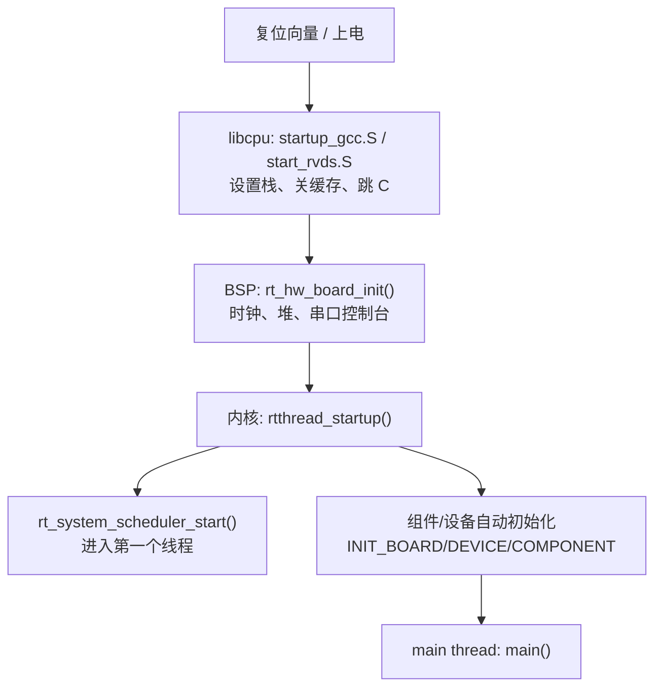

# 10. libcpu 与 BSP

内核、组件、设备框架都是**与 CPU 架构无关**的通用代码；真正把 RT-Thread 落到某颗芯片上的，是两层移植工作：

- **libcpu**（`libcpu/`）：CPU 架构移植层，提供上下文切换、中断入口、原子操作、CPU 复位等“操作系统跑起来的最低要求”；
- **BSP**（`bsp/`）：板级支持包，提供时钟、引脚、外设驱动、链接脚本、启动代码与 `rtconfig.h`。

本章说明这两层各自需要实现什么、目录如何组织、以及一个具体工程如何被组建成可运行镜像。

相关源码：

- [libcpu/Kconfig](file:///workspace/libcpu/Kconfig)：架构与 CPU 型号配置项
- [libcpu/SConscript](file:///workspace/libcpu/SConscript)：按 `rtconfig.ARCH` 选择架构目录
- [libcpu/arm/](file:///workspace/libcpu/arm)：ARM 架构移植（本章主要实例）
- [bsp/README.md](file:///workspace/bsp/README.md)：全量 BSP 列表
- [bsp/qemu-vexpress-a9/](file:///workspace/bsp/qemu-vexpress-a9)：仿真 BSP 实例（Cortex-A9）
- [bsp/stm32/](file:///workspace/bsp/stm32)：STM32 系列 BSP 与 HAL 驱动库

---

## 10.1 libcpu 的职责

### 10.1.1 为什么需要 libcpu

内核的 `context_switch`、`rt_hw_interrupt_disable`、`rt_hw_stack_init` 等函数在不同 CPU 上的实现完全不同。RT-Thread 的做法是把这些函数声明为“**移植接口**”，由 `libcpu/` 下对应架构的目录提供实现：

| 接口族 | 说明 |
| --- | --- |
| `rt_hw_context_switch` / `rt_hw_context_switch_to` / `rt_hw_context_switch_interrupt` | 线程上下文切换 |
| `rt_hw_interrupt_disable` / `rt_hw_interrupt_enable` | 开关中断（返回/恢复中断状态） |
| `rt_hw_stack_init` | 构造新线程的初始栈帧 |
| `rt_hw_cpu_reset` | 复位 CPU |
| `rt_hw_exception_install` / `rt_hw_hard_fault_exception` | 异常处理与回溯 |
| `__rt_ffs` | 查找第一个置位（`RT_USING_CPU_FFS`） |
| 原子操作（`rt_atomic_*`） | 多核与位操作时的原子语义 |

只要这些接口在目标架构上实现，内核其余部分无需改动即可运行。

### 10.1.2 目录组织

`libcpu/` 按“架构 → 具体 CPU”两级组织（[libcpu/](file:///workspace/libcpu)）：

| 架构目录 | 覆盖范围 |
| --- | --- |
| `arm/` | Cortex-M0/M3/M4/M7/M23/M33/M85、Cortex-R4/R52、Cortex-A、ARM9/11、armv6、AM335x、S3C24x0 等 |
| `aarch64/` | ARMv8 64 位（含 GICv3、PSCI、SMP 启动） |
| `risc-v/` | `common`、`rv64`、`t-head/c906`、`virt64` |
| `mips/` | `common`、`gs232`、`gs264`、`pic32` |
| `arc/`、`blackfin/`、`c-sky/`、`ia32/`、`nios/`、`ppc/`、`rx/`、`sparc-v8/`、`ti-dsp/`、`unicore32/`、`v850/`、`xilinx/`、`m16c/`、`avr32/` | 其余架构 |
| `sim/` | `posix` / `win32` 模拟器移植 |

`arm/` 内部再分两层：`arm/common/`（架构共用的原子、除法、`showmem`）与 `arm/cortex-m4/` 等（具体内核的上下文与栈）。构建时 `arm/SConscript` 先把 `common` 加进来，再按 `rtconfig.CPU` 加入型号目录：

```python
group = SConscript(os.path.join('common', 'SConscript'))   # 架构公共代码
if rtconfig.CPU in list:
    group = group + SConscript(os.path.join(rtconfig.CPU, 'SConscript'))
```

对应文件：[libcpu/arm/SConscript](file:///workspace/libcpu/arm/SConscript#L11-L18)。顶层 [libcpu/SConscript](file:///workspace/libcpu/SConscript#L12-L13) 则按 `rtconfig.ARCH` 选择架构目录。

### 10.1.3 libcpu 的 Kconfig

[libcpu/Kconfig](file:///workspace/libcpu/Kconfig) 定义了两类配置：

**架构能力开关**（多由具体型号 `select` 自动带出）：

| 配置 | 含义 |
| --- | --- |
| `ARCH_CPU_64BIT` | 64 位架构 |
| `RT_USING_CACHE` | 需要 Cache 管理（Cortex-M7/A、ARMv8 自动选中） |
| `RT_USING_HW_ATOMIC` | 硬件原子指令（M3/M4/M33/Cortex-A 等 `select`） |
| `RT_USING_CPU_FFS` | 提供 `__rt_ffs`（M3/M4/M7 等 `select`） |
| `ARCH_MM_MMU` / `ARCH_MM_MPU` | 是否具备 MMU / MPU |
| `ARCH_CPU_STACK_GROWS_UPWARD` | 栈增长方向（C28x 等向上增长） |

**架构/型号标识**：`ARCH_ARM`、`ARCH_ARM_CORTEX_M`（再细分 M0/M3/M4/M7/M23/M33/M85）、`ARCH_ARM_CORTEX_R`（R52）、`ARCH_ARM_CORTEX_A`（A5/A7/A8/A9/A55）、`ARCH_ARMV8`、`ARCH_RISCV`（RV32/RV64）、`ARCH_MIPS`、`ARCH_IA32`、`ARCH_HOST_SIMULATOR` 等。

其中 `ARCH_ARM_CORTEX_A` 还会带出 SMP 相关选项 `RT_SMP_AUTO_BOOT`、`RT_USING_GIC_V2`、`RT_USING_GIC_V3`、`RT_NO_USING_GIC`；`RT_USING_SMART` 下另有 `KERNEL_VADDR_START`（内核虚拟地址起始，ARM 默认 `0xc0000000`，ARMv8 默认 `0xffff000000000000`）与 `RT_IOREMAP_LATE`。

---

## 10.2 实例：Cortex-M4 移植

以 [libcpu/arm/cortex-m4/](file:///workspace/libcpu/arm/cortex-m4) 为例，看一个 CPU 移植最少需要哪些文件。

### 10.2.1 文件构成

| 文件 | 职责 |
| --- | --- |
| `context_gcc.S` / `context_rvds.S` / `context_iar.S` | 上下文切换汇编（按工具链分三份） |
| `cpuport.c` | 栈初始化、异常处理、`__rt_ffs`、CPU 复位 |
| `cpuport.h` | 供汇编 include 的寄存器/栈偏移宏 |

`SConscript` 按工具链挑汇编：[cortex-m4/SConscript](file:///workspace/libcpu/arm/cortex-m4/SConscript#L11-L23)

```python
if rtconfig.PLATFORM in ['armcc', 'armclang']:
    src += Glob('*_rvds.S')
if rtconfig.PLATFORM in ['gcc', 'llvm-arm']:
    src += Glob('*_init.S'); src += Glob('*_gcc.S')
if rtconfig.PLATFORM in ['iccarm']:
    src += Glob('*_iar.S')
```

对应 GCC 场景编入 `context_gcc.S`，ArmCC/ArmClang 编入 `context_rvds.S`，IAR 编入 `context_iar.S`。

### 10.2.2 上下文切换

`context_gcc.S` 提供的核心符号（[context_gcc.S](file:///workspace/libcpu/arm/cortex-m4/context_gcc.S)）：

| 符号 | 行号 | 作用 |
| --- | --- | --- |
| `rt_hw_interrupt_disable` | 36 | 读 PRIMASK 并关中断，返回旧状态 |
| `rt_hw_interrupt_enable` | 46 | 恢复 PRIMASK |
| `rt_hw_context_switch` / `rt_hw_context_switch_interrupt` | 60/61 | 记录 from/to，触发 PendSV |
| `PendSV_Handler` | 88 | 真正执行寄存器保存/恢复 |
| `rt_hw_context_switch_to` | 168 | 首次启动某线程（无 from） |
| `rt_hw_interrupt_thread_switch` | 220 | 中断内触发切换 |
| `HardFault_Handler` | 224 | 硬错误入口 |

Cortex-M 采用 **PendSV 触发切换**的经典做法：`rt_hw_context_switch()` 只是把 `from`/`to` 记到全局变量并挂起 PendSV 异常，真正的“压栈 r4–r11、切 PSP、出栈”发生在 `PendSV_Handler` 中，从而避免在中断上下文中做重活。

### 10.2.3 栈帧与栈初始化

`cpuport.c` 定义了两套等价的栈帧结构（[cpuport.c](file:///workspace/libcpu/arm/cortex-m4/cpuport.c#L39-L139)）——带/不带 FPU：

```c
struct stack_frame
{
#if USE_FPU
    rt_uint32_t flag;
#endif
    rt_uint32_t r4, r5, r6, r7, r8, r9, r10, r11;
    struct exception_stack_frame exception_stack_frame;   /* r0-r3,r12,lr,pc,psr */
};
```

`rt_hw_stack_init()`（[cpuport.c](file:///workspace/libcpu/arm/cortex-m4/cpuport.c#L141)）把一个新线程的初始栈布置成“看起来刚从异常返回”的样子：

1. 栈地址向下 8 字节对齐（`RT_ALIGN_DOWN(stk, 8)`）；
2. 预留 `struct stack_frame` 大小；
3. 全部填 `0xdeadbeef`（便于发现未初始化使用）；
4. `r0 = parameter`（线程入口参数）、`lr = texit`（线程退出函数）、`pc = tentry`（线程入口）、`psr = 0x01000000`（Thumb 态）；
5. 返回栈顶指针，交给内核写进 TCB 的 `sp`。

**注意**：`USE_FPU` 由编译宏自动判定（`__VFP_FP__` 且非 `__SOFTFP__` 等）。FPU 场景下栈帧会多保存 `s0–s31` 与 `FPSCR`，栈开销显著增大——这也是为什么 Cortex-M4F 上线程栈要留足余量。

### 10.2.4 异常处理与回溯

`rt_hw_hard_fault_exception()`（[cpuport.c](file:///workspace/libcpu/arm/cortex-m4/cpuport.c#L372)）在 HardFault 时打印现场：

- 先调用用户安装的 `rt_exception_hook`，返回 `RT_EOK` 表示已处理、不再继续；
- 否则打印 `psr`、`r00–r12`、`lr`、`pc`；
- 依据 `exc_return` 的 bit2 判断“fault on thread”还是“fault on handler”；前者会调用 `list_thread()` 打印线程栈；
- 若 bit4 为 0 提示 `FPU active`；
- `hard_fault_track()` 进一步解码 `SCB_CFSR/HFSR/MMAR/BFAR`，指出是 usage/bus/mem-manage fault 还是 vector fetch 失败（`RT_USING_FINSH` 时可用）。

`rt_hw_cpu_reset()`（[cpuport.c](file:///workspace/libcpu/arm/cortex-m4/cpuport.c#L434)）向 `SCB_AIRCR` 写 `0x05FA0004` 触发软复位。`__rt_ffs()`（[cpuport.c](file:///workspace/libcpu/arm/cortex-m4/cpuport.c#L450-L497)）针对 ArmCC/Clang/IAR 用 `RBIT+CLZ` 汇编实现，GCC 直接用 `__builtin_ffs`。

---

## 10.3 BSP 的职责与结构

### 10.3.1 BSP 提供什么

libcpu 让内核“能调度”，BSP 让系统“能在这个板子上跑”。一个 BSP 目录通常包含：

| 文件/目录 | 职责 |
| --- | --- |
| `SConstruct` | SCons 构建入口，设置工具链、调用 `PrepareBuilding`/`DoBuilding` |
| `rtconfig.py` | 工具链路径、编译/链接选项、`ARCH`/`CPU`/`PLATFORM` 定义 |
| `Kconfig` | `mainmenu` + source 内核/组件/BSP 驱动配置 |
| `.config` | 保存的配置（menuconfig 输出） |
| `rtconfig.h` | `.config` 生成的头文件，所有 `RT_USING_*` 宏在此 |
| `SConscript` | 遍历子目录、组织本板源码 |
| `board/` | 板级初始化、链接脚本、外设移植（`board.c`/`board.h`） |
| `drivers/` 或 `libraries/HAL_Drivers/` | 芯片外设驱动 |
| `applications/` | 应用代码，含 `main.c` |
| `link.lds` / `link.sct` / `link.icf` | 各工具链的链接脚本 |

### 10.3.2 构建入口 `SConstruct`

[qemu-vexpress-a9/SConstruct](file:///workspace/bsp/qemu-vexpress-a9/SConstruct) 是标准模板：

```python
RTT_ROOT = os.getenv('RTT_ROOT') or os.path.join(os.getcwd(), '..', '..')
sys.path = sys.path + [os.path.join(RTT_ROOT, 'tools')]
from building import *

TARGET = 'rtthread.' + rtconfig.TARGET_EXT
env = Environment(tools=['mingw'],
    AS=rtconfig.AS, ASFLAGS=rtconfig.AFLAGS,
    CC=rtconfig.CC, CFLAGS=rtconfig.CFLAGS, ...)
objs = PrepareBuilding(env, RTT_ROOT)          # 收集所有 SConscript 源文件
if GetDepend('RT_USING_SMART'):
    env['LINKFLAGS'] = env['LINKFLAGS'].replace('link.lds', 'link_smart.lds')
DoBuilding(TARGET, objs)                        # 编译链接出目标
```

`PrepareBuilding()` 与 `DoBuilding()` 来自 [tools/building.py](file:///workspace/tools/building.py)（第 11 章详述）：前者递归加载 `SConscript` 并构造 `DefineGroup`，后者完成实际编译链接。**Smart 模式下自动换用 `link_smart.lds`**，因为用户态需要额外的内存布局。

### 10.3.3 工具链描述 `rtconfig.py`

[rtconfig.py](file:///workspace/bsp/qemu-vexpress-a9/rtconfig.py) 定义两组信息：

**架构标识**（供 libcpu 选择目录）：

```python
ARCH = 'arm'
CPU  = 'cortex-a'
CROSS_TOOL = 'gcc'
PLATFORM   = 'gcc'
EXEC_PATH  = os.getenv('RTT_EXEC_PATH') or r'/usr/bin'
LINK_SCRIPT = 'link.lds'
```

**工具链命令与选项**：`CC`/`CXX`/`AS`/`AR`/`LINK`/`OBJCOPY`/`SIZE` 等，`DEVICE`（`-march=armv7-a -mtune=cortex-a7 ...`）、`CFLAGS`、`AFLAGS`、`LFLAGS`（含 `-T link.lds`）。`PLATFORM` 取值决定编译哪套汇编文件（`gcc`/`armcc`/`armclang`/`iccarm`）与 libc 适配。

此例还演示了**宏生成**技巧：`rtconfig.py` 顶部用 Python 生成 `drivers/automac.h`，为 QEMU 网卡分配随机 MAC 地址——说明 `rtconfig.py` 不只是变量声明，还可以在构建前执行预处理。

### 10.3.4 配置入口 `Kconfig`

[qemu-vexpress-a9/Kconfig](file:///workspace/bsp/qemu-vexpress-a9/Kconfig)：

```kconfig
mainmenu "RT-Thread Project Configuration"

config BSP_DIR
    string
    option env="BSP_ROOT"
    default "."

config RTT_DIR
    string
    option env="RTT_ROOT"
    default "../.."

config PKGS_DIR
    string
    option env="PKGS_ROOT"
    default "packages"

source "$RTT_DIR/Kconfig"          # 内核 + 组件 + 设备框架配置
source "$PKGS_DIR/Kconfig"         # 软件包
source "$BSP_DIR/drivers/Kconfig"  # 本板外设驱动
```

配置树从顶层 [Kconfig](file:///workspace/Kconfig) 递归展开，最终由 `menuconfig` 生成 `rtconfig.h`。板级差异全部沉到 `$BSP_DIR/drivers/Kconfig` 与 `board/Kconfig` 中。

### 10.3.5 链接脚本

[qemu-vexpress-a9/link.lds](file:///workspace/bsp/qemu-vexpress-a9/link.lds) 定义了镜像布局（`OUTPUT_FORMAT("elf32-littlearm")`，起始地址 `0x60010000`）：

```ld
.text : {
    *(.vectors)
    *(.text) *(.text.*)

    __fsymtab_start = .;  KEEP(*(FSymTab))  __fsymtab_end = .;      /* FinSH 命令表 */
    __ve_table_start = .; KEEP(*(SORT(*.VarExpTab.*))) __ve_table_end = .;  /* var export */
    __rt_utest_tc_tab_start = .; KEEP(*(UtestTcTab)) ...            /* utest 用例表 */
    __rtmsymtab_start = .;  KEEP(*(RTMSymTab)) ...                  /* 模块符号 */
    __rt_init_start = .;    KEEP(*(SORT(.rti_fn*))) __rt_init_end = .; /* 自动初始化表 */
} =0
```

**注意**：链接脚本是“自动初始化”“FinSH 命令表”“utest 用例表”能否工作的**前提**——`KEEP()` 保证这些段不被 `--gc-sections` 丢弃，`SORT(.rti_fn*)` 保证初始化顺序。手工移植新板时若链接脚本漏掉某段，对应功能就会静默失效。

---

## 10.4 一个真实 BSP：STM32

`bsp/stm32/` 是规模最大的 BSP 家族，采用“**库共享 + 板级目录**”结构（[bsp/stm32/](file:///workspace/bsp/stm32)）：

```
bsp/stm32/
├── libraries/
│   ├── HAL_Drivers/          # 各外设通用驱动（drv_usart.c、drv_spi.c、drv_eth.c ...）
│   │   ├── drivers/          # 通用驱动集合 + Kconfig + SConscript
│   │   └── nano/             # Nano 版精简驱动
│   ├── STM32F1xx_HAL/        # 各系列 HAL 库封装
│   ├── STM32F4xx_HAL/
│   └── templates/            # 新板模板
└── stm32f407-atk-explorer/   # 具体板级 BSP
```

以 `stm32f407-atk-explorer` 为例，板级目录（[bsp/stm32/stm32f407-atk-explorer/](file:///workspace/bsp/stm32/stm32f407-atk-explorer)）：

| 目录/文件 | 作用 |
| --- | --- |
| `applications/main.c` | 应用入口，`lvgl` 等示例 |
| `board/board.c`、`board.h` | `rt_hw_board_init()`：时钟、堆、控制台 |
| `board/CubeMX_Config/` | CubeMX 生成的 `main.h` / `stm32f4xx_it.c` 等 |
| `board/linker_scripts/` | `link.lds`(GCC)、`link.sct`(ArmCC)、`link.icf`(IAR) |
| `board/ports/` | 板级外设：`drv_lcd.c`、`drv_sram.c`、触摸、`fal`、文件系统 |
| `libraries/HAL_Drivers/drivers/` | 通用驱动 `drv_usart.c`、`drv_spi.c`、`drv_eth.c`、`drv_sdio.c` ... |

这种结构的价值在于：**同一芯片系列的多个板子复用 `libraries/`，板级目录只放差异**。添加新板只需复制 `templates/` 并修改 `board/`。

`libraries/HAL_Drivers/drivers/` 下按外设分类（部分）：`drv_usart.c`/`drv_usart_v2.c`（串口 v1/v2）、`drv_spi.c`（含 `drv_soft_spi.c` 软件模拟）、`drv_hard_i2c.c`/`drv_soft_i2c.c`、`drv_eth.c`、`drv_sdio.c`/`drv_sdmmc.c`、`drv_can.c`、`drv_pwm.c`、`drv_rtc.c`、`drv_wdt.c`、`drv_lcd.c`/`drv_lcd_mipi.c`、`drv_qspi.c`、`drv_nand.c`、`drv_sdram.c`、`drv_pm.c`、`drv_crypto.c` 等。这些驱动通过 `rt_device_register` / `RT_DEVICE_OPS` 接入第 8 章的设备框架。

---

## 10.5 启动与内存布局

### 10.5.1 启动链

从上电到应用，涉及 libcpu、BSP 与内核的接力（下图与第 1 章、第 7 章呼应）：



- **libcpu** 提供复位入口（如 ARM 的 `startup_gcc.S` / `start_rvds.S`），完成栈指针设置、C 运行时初始化；
- **BSP** 的 `rt_hw_board_init()` 配置时钟、初始化堆与串口，设置控制台；
- **内核** `rtthread_startup()` 依次调用各 `INIT_*_EXPORT` 组，最后启动调度器。

### 10.5.2 镜像内存布局

链接脚本定义的段落顺序（以 qemu-vexpress-a9 为例，见 [link.lds](file:///workspace/bsp/qemu-vexpress-a9/link.lds)）：

| 段 | 内容 |
| --- | --- |
| `.text` | 向量表、代码、以及 **FSymTab / rti_fn / UtestTcTab / VarExpTab / RTMSymTab** 等元数据段 |
| `.ARM.exidx` | ARM 异常索引（回溯用） |
| `.rodata` | 只读数据 |
| `.ctors` / `.dtors` | C++ 全局构造/析构（映射到 `.init_array`/`.fini_array`） |
| `.data` | 已初始化全局变量 |
| `.bss` | 未初始化全局变量（启动时清零） |

symbol 命名约定：`__text_start/__text_end`、`__rodata_start/__rodata_end`、`__data_start/__data_end`、`__bss_start/__bss_end`、`__rt_init_start/__rt_init_end`。内核与 BSP 通过这些符号定位各段边界。

**注意**：`RT_USING_SMART` 时 BSP 会改用 `link_smart.lds`（见 SConstruct），内核虚拟地址与用户虚拟地址分区；同一份 `board/` 代码无需改动，仅链接脚本不同。

---

## 10.6 移植一个新平台需要做什么

综合 libcpu 与 BSP 的职责，把 RT-Thread 移植到一块新板子通常分两步：

**第一步：确认/编写 libcpu**
- 若目标 CPU 已存在于 `libcpu/`（绝大多数 ARM/RISC-V/MIPS 内核），只需在 Kconfig/`rtconfig.py` 里选对 `ARCH`/`CPU`；
- 若是全新架构，需要实现 10.1.1 表列出的移植接口，并按 10.2 的组织方式建立 `context_*.S` 与 `cpuport.c`。

**第二步：编写 BSP**
1. 复制一个相近的 BSP 或 `bsp/stm32/libraries/templates/`；
2. 写 `rtconfig.py`（工具链、`ARCH`/`CPU`/`PLATFORM`）；
3. 写 `board/board.c` 中的 `rt_hw_board_init()`：系统时钟、`rt_system_heap_init`、控制台设备；
4. 提供复位启动代码与链接脚本（含所有 `KEEP` 段）；
5. 按需实现 `drivers/` 外设驱动并 `rt_device_register`；
6. 用 `menuconfig` 配置 `rtconfig.h`，`scons` 编译出镜像。

移植成功的最小判据：**串口能打印 FinSH 提示符并执行命令**——这同时验证了启动链、时钟、控制台、自动初始化与命令表段都已正确落地。

---

## 10.7 常见坑

- **链接脚本漏段** → FinSH 命令 / utest 用例 / 自动初始化全部失效（`KEEP()` 与 `SORT()` 是关键）；
- **`rtconfig.py` 的 `PLATFORM` 与工具链不匹配** → 会编入错误的 `context_*.S`，导致上下文切换崩溃；
- **libcpu 的 `rt_hw_stack_init` 栈对齐错误** → Cortex-M 上会触发 HardFault（栈必须 8 字节对齐）；
- **FPU 编译宏与硬件不一致** → `USE_FPU` 判定错误，浮点线程切换时寄存器丢失；
- **SMP 未选 GIC 型号** → `RT_USING_GIC_V2/V3` 都未选时落到 `RT_NO_USING_GIC`，多核中断无法分发；
- **`rtconfig.h` 手工修改** → 应通过 `menuconfig` 生成，手改易与 `.config` 不一致、下次配置覆盖。

---

## 10.8 小结

- **libcpu** 是 CPU 架构抽象层，把“上下文切换、中断、栈、原子、复位”这些架构相关动作收敛成一组移植接口；`libcpu/Kconfig` 用 `ARCH_*`/`select` 描述架构能力，`SConscript` 按 `rtconfig.ARCH`/`CPU`/`PLATFORM` 选源码。
- **BSP** 是板级支持包，用 `SConstruct`+`rtconfig.py`+`Kconfig`+`board/`+链接脚本把内核、组件、驱动组装成可烧录镜像；STM32 家族用“共享 `libraries/` + 板级目录”高效复用。
- **启动链**由 libcpu 复位入口 → BSP `rt_hw_board_init()` → 内核 `rtthread_startup()` → 自动初始化 → `main()` 接力完成。
- **链接脚本**是元数据段（命令表、初始化表、用例表）的物理载体，是移植中最容易被忽视的一环。

下一章进入 **构建与运行**，详细说明 SCons 脚本体系、Kconfig 生成流程、以及如何编译、烧录与调试。
