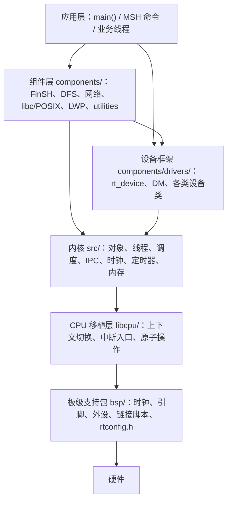

# RT-Thread 5.2.0 Code Wiki

本 Wiki 面向希望**系统理解并二次开发** RT-Thread 的工程师，从源码结构出发，逐层说明整体架构、模块职责、关键数据结构与函数、模块间依赖，以及工程的配置、构建与运行方式。

- 代码基线：RT-Thread `v5.2.0`（`RT_VER_NUM = 0x50200`），Apache-2.0
- 语言/构建：C（部分 C++/汇编），SCons + Kconfig，支持 GCC / ArmCC / ArmClang / IAR
- 分析对象：本仓库根目录 `/workspace`

---

## 1. 阅读路线

建议按“先骨架、再内核、后组件、最后工程化”的顺序阅读：

| 顺序 | 章节 | 解决的问题 |
| --- | --- | --- |
| 1 | [整体架构](01-architecture.md) | 系统分几层？一次上电到 `main()` 发生了什么？ |
| 2 | [内核对象模型](02-kernel-objects.md) | 所有内核对象如何统一管理？ |
| 3 | [线程与调度](03-thread-scheduler.md) | 线程如何创建/挂起/恢复？UP 与 SMP 如何选下一个线程？ |
| 4 | [时钟与定时器](04-clock-timer.md) | tick 从哪来？硬定时器与软定时器如何分工？ |
| 5 | [线程间通信](05-ipc.md) | 信号量/互斥量/事件/邮箱/消息队列如何阻塞与唤醒？ |
| 6 | [内存管理](06-memory.md) | 小内存、memheap、slab、mempool 如何选择？ |
| 7 | [中断、异常与启动](07-interrupt-boot.md) | 中断嵌套、临界区、断言、自动初始化表如何工作？ |
| 8 | [设备框架](08-device-framework.md) | `rt_device` 如何注册、查找、打开与读写？DM/OFW 是什么？ |
| 9 | [组件层](09-components.md) | FinSH、DFS、网络、libc/POSIX、LWP、工具组件各做什么？ |
| 10 | [libcpu 与 BSP](10-libcpu-bsp.md) | CPU 移植层需要实现什么？一个 BSP 由哪些文件构成？ |
| 11 | [构建与运行](11-build-run.md) | `scons` 如何把源码变成可烧录镜像？如何配置与运行？ |
| 12 | [配置与依赖关系](12-config-dependencies.md) | Kconfig/SConscript 如何裁剪？模块之间到底谁依赖谁？ |

---

## 2. 项目一句话概览

RT-Thread 是一个**以线程调度为核心、以对象模型为统一抽象、以 Kconfig + SCons 为配置构建体系**的嵌入式实时操作系统。其代码组织遵循清晰的分层：



关键特征：

- **统一对象模型**：线程、定时器、信号量、互斥量、设备等全部继承自 `struct rt_object`，按类挂入全局容器，支持按名称查找与内核对象枚举。
- **可裁剪**：几乎所有功能由 `rtconfig.h` 中的 `RT_USING_*` 宏控制，Kconfig 负责生成配置。
- **多核可扩展**：同一套内核源码通过 `RT_USING_SMP` 在 `scheduler_up.c` / `scheduler_mp.c`、`cpu_up.c` / `cpu_mp.c` 之间切换。
- **自动初始化**：驱动与组件通过 `INIT_*_EXPORT()` 放入链接段，启动时按优先级自动调用，无需手工在 `main()` 里逐个初始化。
- **POSIX 兼容与用户态**：`components/libc/posix` 提供 pthread/semaphore/mqueue 等；`components/lwp` + `components/mm` 在 RT-Thread Smart 上提供进程地址空间与系统调用。

---

## 3. 仓库目录速查

```
/workspace
├── src/                   内核实现（调度、线程、IPC、定时器、内存、对象、启动）
│   └── klibc/             内核态精简 C 库（kstring / kstdio）
├── include/               内核公共头文件（rtdef.h / rtthread.h / rtsched.h / rthw.h ...）
├── libcpu/                各 CPU 架构移植层（arm / risc-v / aarch64 / x86 ...）
├── components/            中间件与驱动框架
│   ├── drivers/           设备框架、DM、串口/SPI/I2C/PIN/PM 等设备类
│   ├── dfs/               文件系统（dfs_v1 / dfs_v2 + elmfat/romfs/ramfs/devfs ...）
│   ├── net/               SAL、netdev、lwIP、AT Socket
│   ├── finsh/             FinSH/MSH 命令行
│   ├── libc/              newlib/musl/picolibc/armlibc 适配 + POSIX
│   ├── lwp/ mm/           用户态进程与地址空间（RT-Thread Smart）
│   ├── utilities/         ulog、utest、ymodem、var_export、rt-link、libadt
│   └── fal/ vbus/ mprotect/
├── bsp/                   板级支持包（STM32 等约 90 个可运行板卡）
├── tools/                 SCons 构建脚本、Kconfig 前端、工程生成器
├── examples/              示例与 utest 用例
├── documentation/         官方按主题编写的中文文档
├── Kconfig                顶层配置入口
└── README_zh.md           项目说明
```

内核源码规模（便于定位）：

| 文件 | 行数 | 职责 |
| --- | --- | --- |
| [thread.c](file:///workspace/src/thread.c) | 1107 | 线程生命周期、延时、挂起/恢复、栈初始化 |
| [scheduler_up.c](file:///workspace/src/scheduler_up.c) | 568 | 单核优先级调度 |
| [scheduler_mp.c](file:///workspace/src/scheduler_mp.c) | 1291 | 多核调度与 IPI |
| [scheduler_comm.c](file:///workspace/src/scheduler_comm.c) | 277 | 调度器公共逻辑（状态、超时、优先级变更） |
| [ipc.c](file:///workspace/src/ipc.c) | 4025 | 信号量/互斥量/事件/邮箱/消息队列 |
| [timer.c](file:///workspace/src/timer.c) | 941 | 硬/软定时器、跳表、定时器线程 |
| [clock.c](file:///workspace/src/clock.c) | 165 | tick 与时钟中断处理 |
| [object.c](file:///workspace/src/object.c) | 704 | 内核对象容器与查找 |
| [idle.c](file:///workspace/src/idle.c) | 390 | 空闲线程、资源回收线程 |
| [components.c](file:///workspace/src/components.c) | 283 | 启动流程、自动初始化、main 线程 |
| [kservice.c](file:///workspace/src/kservice.c) | 1033 | 内核服务、堆入口、printf、断言、回溯 |
| [mem.c](file:///workspace/src/mem.c) / [memheap.c](file:///workspace/src/memheap.c) / [slab.c](file:///workspace/src/slab.c) | 654 / 998 / 856 | 三种堆实现 |
| [mempool.c](file:///workspace/src/mempool.c) | 411 | 固定块内存池 |
| [signal.c](file:///workspace/src/signal.c) | 675 | 内核信号 |
| [irq.c](file:///workspace/src/irq.c) | 137 | 中断进入/退出钩子 |

公共头文件：

| 文件 | 行数 | 内容 |
| --- | --- | --- |
| [rtdef.h](file:///workspace/include/rtdef.h) | 1426 | 全部核心结构体、宏、错误码、设备类、初始化段 |
| [rtthread.h](file:///workspace/include/rtthread.h) | 822 | 对外 API 声明 |
| [rtsched.h](file:///workspace/include/rtsched.h) | 180 | 调度器上下文抽象与内部调度 API |
| [rthw.h](file:///workspace/include/rthw.h) | 250 | 中断、上下文切换、移植层接口 |

---

## 4. 核心概念索引

| 概念 | 一句话解释 | 详见 |
| --- | --- | --- |
| 内核对象 `rt_object` | 所有内核资源的公共头部，含名称、类型、标志、链表节点 | [02](02-kernel-objects.md) |
| 线程 `rt_thread` | 调度的基本单位，含栈、优先级、状态、超时定时器 | [03](03-thread-scheduler.md) |
| 调度器 | 基于优先级位图的 O(1) 选择；同优先级时间片轮转 | [03](03-thread-scheduler.md) |
| tick | 系统时基，默认 1000 Hz，由 `rt_tick_increase()` 推进 | [04](04-clock-timer.md) |
| 定时器 | 硬定时器在中断上下文执行，软定时器在 `timer` 线程执行 | [04](04-clock-timer.md) |
| 挂起链表 | IPC 对象上等待线程的队列，支持 FIFO/优先级两种排序 | [05](05-ipc.md) |
| 自动初始化 | `INIT_BOARD_EXPORT` 等把函数指针放入链接段，启动时统一调用 | [07](07-interrupt-boot.md) |
| 设备 `rt_device` | 统一 open/read/write/control 接口，向上屏蔽硬件差异 | [08](08-device-framework.md) |
| BSP | 一块板子的时钟、引脚、外设、链接脚本与配置集合 | [10](10-libcpu-bsp.md) |
| `rtconfig.h` | Kconfig 生成的实际编译配置，决定哪些代码参与编译 | [11](11-build-run.md) |

---

## 5. 文档约定

- 代码引用采用可点击链接，例如 [rt_thread_init](file:///workspace/src/thread.c#L500-L560)，行号以当前仓库版本为准。
- 文中 `UP` 指单核（Uni-Processor）配置，`SMP` 指对称多核配置。
- 优先级数值**越小越高**；`RT_THREAD_PRIORITY_MAX` 默认为 32，空闲线程优先级为 `RT_THREAD_PRIORITY_MAX - 1`。
- 时间单位：`rt_tick_t` 为 tick；`RT_WAITING_FOREVER` 表示永久等待，`RT_WAITING_NO` 表示不等待。
- 章节中标注“注意”的地方为源码中容易踩坑或与注释不一致的实现细节。
